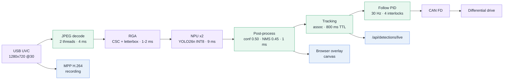
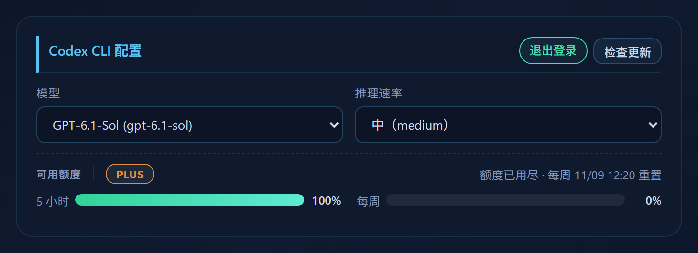
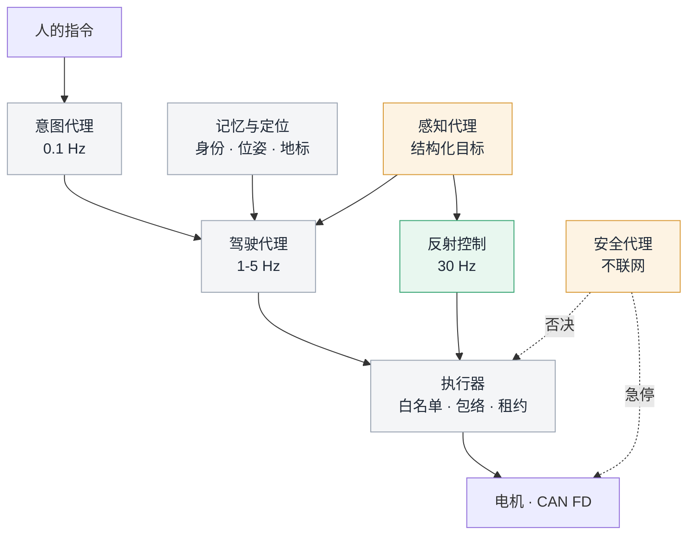
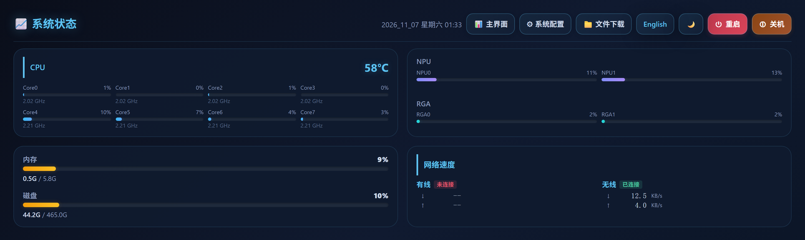
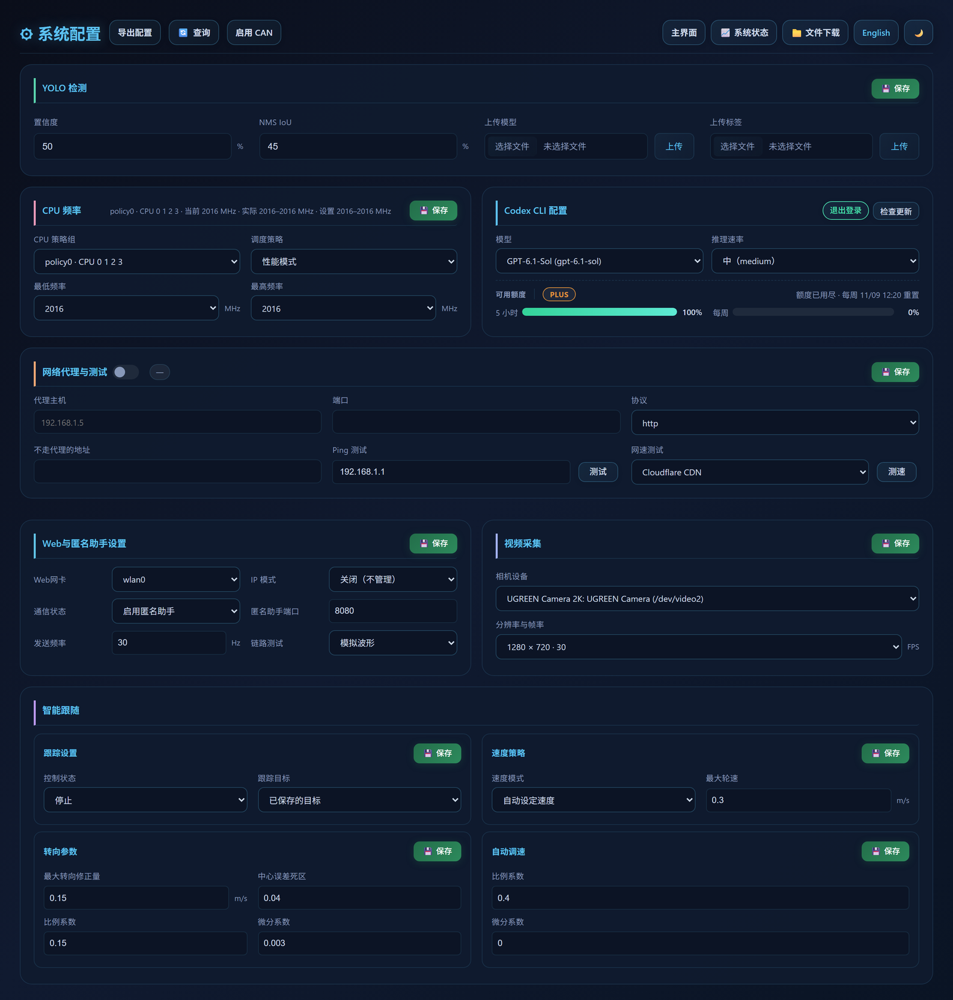
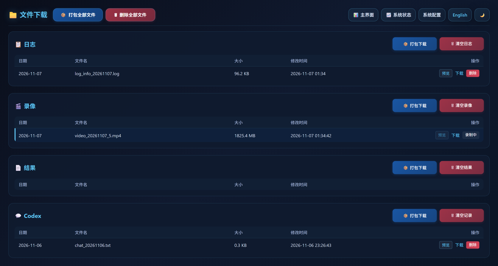
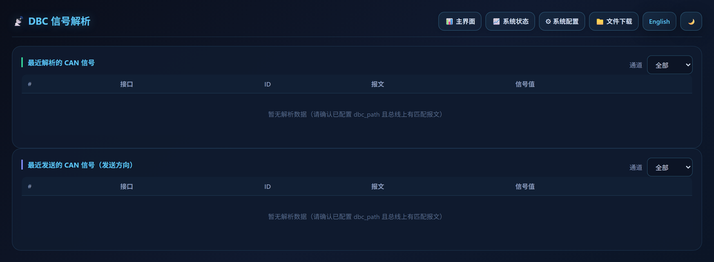
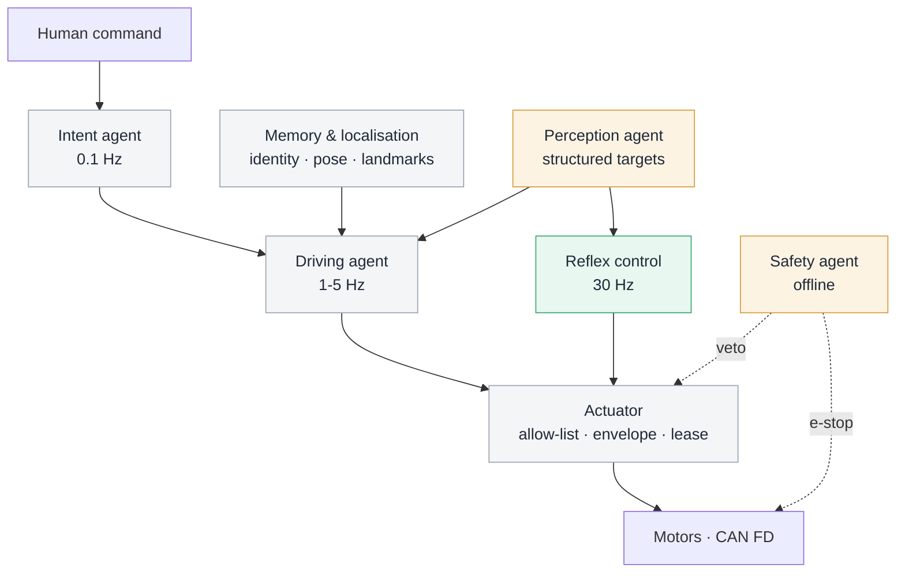

<div align="center">


</div>

# autonomous-driving-car

**Radxa ROCK 4D（RK3576）上的视觉循迹小车。相机到电机的整条链路在一个 C 进程内完成，实测端到端时延 79 ms；板载一个语言智能体，当前仅有观测权限。**

**A vision-guided differential-drive vehicle on Radxa ROCK 4D (RK3576). The whole camera-to-motor path runs inside one C process at a measured 79 ms end-to-end latency. An on-board language agent has observation rights only.**

[中文](#中文) · [English](#english)



<sub>图 1 / Figure 1 — 数据通路与时延预算。标注为该阶段实测耗时，非端到端累加。/ Data path and latency budget; stage timings are measured individually, not additive.</sub>

---

<a id="中文"></a>

## 摘要

本文描述一台差速小车的完整车载软件：V4L2 采集、JPEG 解码、RGA 预处理、RKNN 推理、目标关联、PID 跟随、CAN FD 输出、H.264 录像与 HTTP 控制台，全部编译为单一进程并由 systemd 托管。在 1280×720@30 输入下，实测端到端时延 p50 = 79 ms、p100 = 128 ms，NPU 单帧推理 9 ms，双核占用 13% / 11%。控制环以事件驱动方式跟随单一目标，具备四道执行联锁与六种停机语义。板上另有一个以非特权用户运行的语言智能体，通过只读接口与运行日志获取状态，不持有任何执行权限。本文同时给出把该智能体扩展为多智能体控车系统的目标架构、接口契约与分阶段验收判据。

## 1. 系统概览

### 1.1 硬件与软件栈

| 项 | 规格 |
|---|---|
| 计算平台 | Radxa ROCK 4D，Rockchip RK3576 |
| CPU | 4× Cortex-A72 @ 2.208 GHz + 4× Cortex-A53 @ 2.016 GHz |
| NPU | 6 TOPS INT8，2 个核心 |
| 内存 | 6 GB |
| 内核 | 7.4.0-rc1-npu-rt-full，`CONFIG_PREEMPT_RT=y`，`CONFIG_HZ=1000` |
| 工具链 | gcc 14.2.0（Debian 14.2.0-19），CMake |
| 推理运行时 | RKNN Runtime 2.5.0（`74ea630ce8`，2026-09-30） |
| 媒体栈 | V4L2 / libjpeg-turbo / RGA（2 核）/ Rockchip MPP |
| 相机 | USB UVC，MJPEG 1280×720@30 |
| 总线 | CAN FD（SocketCAN），当前 `can_enabled off` |
| 模型 | YOLO26n，INT8 量化，80 类 COCO |
| 进程形态 | 单进程、多线程，systemd `Type=notify`，`WatchdogSec=10` |

### 1.2 设计取舍

整条链路只有八个环节，每个环节的时限可枚举。引入进程边界意味着每帧至少一次序列化与一次上下文切换，而这两项开销在 33.3 ms 的帧周期里占比可观，收益（模块隔离）在一台单车、单摄像头的系统上并不成立。因此这里选择的是一份共享内存、一条固定优先级的线程集合、以及 O(1) 的帧句柄传递。

代价同样明确：没有进程隔离，一个越界写会带走整个系统。对应的补偿是编译期加固、帧环的显式生命周期，以及看门狗在 3 s 内发现线程停摆。

### 1.3 当前状态

| 能力 | 状态 |
|---|---|
| 采集 → 推理 → 跟踪 → 可视化 | 可用，连续运行 |
| 跟随控制律 | 可用，处于预览态（电机适配器未配置） |
| CAN FD 收发与 DBC 解析 | 代码就绪，总线未接入 |
| 录像与回放 | 可用 |
| 语言智能体 | 可用，只读 |

## 2. 时延预算

### 2.1 测量方法

`processing_age_ms` 定义为「一帧曝光结束」到「该帧连同检测结果被绘制到浏览器」的单调时钟差，由采集端打点、渲染端结算，跨线程传递使用帧序号而非指针。这是唯一被当作端到端指标的字段；分段耗时仅用于定位。

复现：

```bash
curl -s -u <user>:<pass> http://<board>/api/video/stats   # processing_age_ms / _max_ms
curl -s -u <user>:<pass> http://<board>/api/system        # NPU、RGA、温度
```

### 2.2 分段实测

服务每 10 s 输出一行分段计时（同一帧的字段分布在不同线程，**不可直接相加**）：

```text
yolo timing ms: capture_to_decode=46 deliver_to_decode=14 decode=4 queue=50 resize=2 run=9 post=1
yolo handoff ms: post_to_display=0 decode_to_display=48 samples=261
```

| 阶段 | 实测 | 说明 |
|---|---|---|
| 相机 → 解码完成 | 46 ms | 含一次 33.3 ms 的帧间隔与 USB 等时传输 |
| JPEG 解码 | 4 ms | 双线程，输出 NV12 dma-buf |
| 在途排队 | ~50 ms | 受在途上限约束，非算力不足 |
| RGA 预处理 | 1–2 ms | CSC + letterbox 合并为一次硬件任务 |
| NPU 推理 | 9 ms | INT8，单帧单次 |
| 后处理 | 1 ms | 阈值 0.50、NMS 0.45、类内去重 |
| 结果 → 显示 | 0–1 ms | 与渲染线程解耦 |

关键结论：**瓶颈不在算力**。单帧推理 9 ms 相对 33.3 ms 的帧周期余量充足，NPU 双核占用 13% / 11%。优化全部集中在搬运与排队，而非模型。

### 2.3 上界

在途帧数上限为 2：新帧到达时若两帧均未离开推理队列，则丢弃最旧帧。该策略把排队延迟限制在常数级（实测 p100 = 128 ms ≈ 3.8 个帧周期），同时保证吞吐不因个别慢帧塌陷。代价是丢帧：`infer_dropped` 增长属于设计行为，不是故障。

对控制而言这是正确取舍——3 帧前的画面所对应的转角已经失效，延迟比丢帧更危险。

### 2.4 四项工程决定

1. **不排队，丢帧。** 队列长度固定，语义是「最新可用帧」而非「全部帧」。
2. **RGA 不做软件回退。** 预处理失败即失败。CPU 回退不会报错，只会把 30 FPS 静默降为 12 FPS，这类降级在实时系统里比崩溃更难定位。
3. **letterbox 合入 RGA。** 色彩转换、缩放、填充一次完成，CPU 全程不接触像素。
4. **推理双核各一 worker，绑大核。** 与解码、编码共享 A72 簇，控制线程则在 A53 簇，见 §4。

## 3. 车辆控制

### 3.1 被控对象与控制律

控制目标是让选中检测框的**面积**与**横向位置**稳定在参考值，不使用里程计、地图或路径规划。每个被接受的推理结果触发一次控制计算，`dt` 取相邻两帧的采集时间戳差（`dt ≤ 0` 或 `dt > 0.5 s` 视为无效，进入 `priming`）。

```text
e_a(k) = clamp((A* − A_k) / A*, −1, +1)            面积误差（纵向，远近）
e_x(k) = 2 · (x_c − 0.5)                            横向误差（左右）
        |e| < 0.04 时置零                            死区

v(k)  = clamp(Kp_a·e_a + Kd_a·ė_a, 0, v_max)        自动：目标线速度
v(k)  = v_set                                       手动：定速
δ(k)  = clamp(Kp_x·e_x + Kd_x·ė_x, −δ_max, +δ_max)  转向修正量

v_L = clamp(v − δ, −v_max, +v_max)                  差速混合
v_R = clamp(v + δ, −v_max, +v_max)

u_L = clamp(Kp_w·(v_L − v̂_L) + Ki_w·∫(v_L − v̂_L)dt, −1, +1)   轮速环
u_R = clamp(Kp_w·(v_R − v̂_R) + Ki_w·∫(v_R − v̂_R)dt, −1, +1)
```

`v̂` 为电机解码器上报的实测轮速（m/s，单调时钟打点），`u` 为归一化执行量 `[-1, 1]`。**软件从不假设执行量与物理量的映射**：该映射由 `car_motor_can.conf` 描述的适配器负责，未配置时控制环只产出预览值。

`A*` 在跟随启用时由首个有效帧锁定（当前值 0.0098，约 1% 画面面积）。这意味着**跟随距离是相对的**——它保持的是启用瞬间的视觉尺度，而非绝对米制距离。要做绝对距离控制，需要单目测距或深度输入，当前不具备。

### 3.2 参数与包络

| 参数 | 默认 | 允许范围 | 作用 |
|---|---|---|---|
| `max_speed` | 0.30 m/s | (0, 2] | 纵向限幅 |
| `max_turn_delta` | 0.15 m/s | (0, 4] | 转向修正限幅 |
| `deadband` | 0.04 | [0, 0.5] | 误差死区（归一化） |
| `timeout_ms` | 300 ms | [100, 1000] | 目标/反馈失效阈值 |
| `speed_kp` / `kd` | 0.40 / 0 | ≤ 100 | 纵向环 |
| `turn_kp` / `kd` | 0.15 / 0.003 | ≤ 100 | 横向环 |
| `wheel_kp` / `ki` | 1.00 / 0.10 | ≤ 100 | 轮速环 |
| `wheel_integral_limit` | 1.0 | — | 积分独立限幅 |
| `class_id` | 0（person） | [0, 99] | 跟随类别 |

包络在执行侧强制：即使 PID 参数被改到发散，`clamp` 仍将输出限制在 `±v_max`。

### 3.3 联锁与停机语义

每帧计算后、下发前检查四道联锁；任一不通过即调用 `stop_wheels()`，理由写入 `status.reason`。

| 联锁 | 不通过时的 reason |
|---|---|
| 电机适配器已绑定 | `adapter_not_connected` |
| 控制线程获得 `SCHED_FIFO` | `fifo_unavailable` |
| CAN 已启用 | `can_disabled` |
| 轮速反馈新鲜（≤ `timeout_ms`） | `stale_wheel_feedback` |

| 停机原因 | 触发条件 |
|---|---|
| `target_lost` | 当前帧无匹配类别或全部框非法 |
| `stale_detection` | 检测结果未在时限内更新 |
| `priming` | 时间基建立中（首个 `dt` 或 `dt` 越界） |
| `motor_send_failed` | 适配器下发返回错误 |
| `motor_stop_failed` | 停机序列本身失败（最高危） |
| `disabled` / `shutdown` | 跟随未启用 / 进程退出 |

这六个字符串构成系统对外的全部失败语义。§6 会说明，对于需要重规划的上层智能体它们过于粗糙——缺的是「为什么」而非「停了」。

## 4. 实时性

### 4.1 线程与调度

所有线程使用 `SCHED_FIFO`，并按「控制路径 > 感知路径 > 网络与界面」排序优先级；控制与网络固定在 A53 簇，解码/推理/编码固定在 A72 簇，目的是把周期性负载与突发负载分开，减少缓存与 DVFS 抖动。

| 线程 | 策略 | 优先级 | 绑核 |
|---|---|---|---|
| `watchdog` | FIFO | 30 | LITTLE |
| `car_sport_ctrl` | FIFO | 20 | LITTLE |
| `can_recv` / `can_send` | FIFO | 15 | LITTLE |
| `video` | FIFO | 15 | BIG |
| `decode` | FIFO | 15 | BIG |
| `yolo_infer` | FIFO | 12 | BIG |
| `yolo` / `yolo_render` / `rec` | FIFO | 10 | BIG |
| `main` / `tcp` / `http` | FIFO | 5 | LITTLE |
| `http_worker` / `yolo_report` | FIFO | 1 | LITTLE |

控制线程不使用固定节拍，而是「每完成一次推理唤醒一次」，并以 50 ms 超时兜底。这样 PID 的 `dt` 与实际帧间隔一致，避免固定周期与变帧率之间的相位误差。

### 4.2 失效检测

应用层看门狗按线程注册，3 s 未喂即判定停摆；进程级由 systemd `WatchdogSec=10` 兜底，超时重启。两级超时都是**秒级**，对 0.3 m/s 的车体可接受，对更高速度不可接受——§6.7 会把它列为必须替换的一环。

### 4.3 已知陷阱

`CONFIG_PREEMPT_RT` 下，FIFO 线程持续占满核心会触发 cgroup v2 的实时带宽限制（默认 950 ms / 1000 ms），表现为周期性「整段卡住又恢复」。调频策略与实时预算必须一起配置，否则性能分析会指向错误的结论。细节见 [docs/REALTIME_SCHEDULING.md](docs/REALTIME_SCHEDULING.md)。

## 5. 板载语言智能体

### 5.1 信任边界

服务本体以 root 运行（需要配置网卡、调频、重启），智能体进程在 `fork` 后立即 `setuid`/`setgid` 至普通用户 `qianruo`，并继承服务的 systemd 沙箱：根文件系统只读（`ProtectSystem=strict`）、家目录只读（`ProtectHome=read-only`）、`/tmp` 私有（`PrivateTmp=yes`），可写路径仅 `config/`、`recordings/`、`.codex/` 与 `/etc/proxy-client.conf`。

因此它的写权限是**三个目录加一个配置文件**，不是整台机器；它的执行权限是**普通用户**，不是 root。这两条是设计约束，不是现状描述。

### 5.2 可见面

只读接口无需认证即可访问，这是刻意的：观测不构成风险。

| 接口 | 内容 |
|---|---|
| `GET /api/system` | CPU 各核、NPU、RGA、温度、内存 |
| `GET /api/video/stats` | 帧序号、丢帧计数、`processing_age_ms` |
| `GET /api/follow` | 控制参数、`status.reason`、轮速目标 |
| `GET /api/detections/live` | 当前帧检测结果 |
| `recordings/logs/*.log` | 按天切分的运行日志（含每 10 s 计时行） |
| `recordings/results/` | 检测日报 |

`status.reason` 是它回答「刚才为什么停」的唯一合法依据——这也是 §6 的 P1 验收项。

### 5.3 控制面

任何改变车辆状态或系统状态的请求都要求 Basic 认证且账号具备 root 权限：`POST /api/follow`、`POST /api/tracking`、`POST /api/can/send`、`POST /api/config`、`POST /api/reboot`。智能体没有凭据，无法通过这一层。

### 5.4 会话生命周期

| 项 | 值 |
|---|---|
| 执行方式 | 短生命周期子进程，`codex exec --json`，结果写 `-o` 文件 |
| 单轮超时 | 300 s |
| 单条消息上限 | 16 000 字符 |
| 并发 | 1 个任务 |
| 上下文 | 最近 6 轮，每条截断 1200 字符 |
| 用户输入 | 经 `stdin` 传递，不进入 `argv` |
| 认证 | 设备码流程，凭据落在 `CODEX_HOME`，不使用 API key |
| 额度 | ChatGPT 套餐双窗口（5 小时 / 每周），页面显示剩余百分比 |
| 审计 | 每轮一行写入 `recordings/codex/chat_YYYYMMDD.txt` |

<div align="center">



<sub>模型、推理强度、套餐与两个额度窗口。截图时周窗口已用满。</sub>

</div>

额度耗尽时 CLI 直接拒绝执行，前端表现为 `rate limit reached`。这是常见误判点：它看起来像网络故障，实际由 `GET /api/codex/quota` 的两个窗口决定。

## 6. 多智能体控车：目标架构

### 6.1 为什么必须分层

单次语言模型往返在本部署下是秒级的（2–10 s 量级，取决于网络与额度）。以 `v_max = 0.30 m/s` 计，3 s 的决策延迟对应 **0.9 m 的盲行距离**——在室内场景中已超过多数家具间距。与此同时，0.3 m/s 下的制动距离量级仅 2 cm（按 2 m/s² 减速度估算），说明低速工况的危险来源是**反应延迟**而非制动能力。

结论：语言模型不可能进入 30 Hz 回路。它必须待在毫秒级以下的层级，而把「执行」留给确定性代码。

| 层 | 频率 | 时间尺度 | 允许的决策者 |
|---|---|---|---|
| 反射层 | 30 Hz | 33 ms | 确定性代码（PID、联锁） |
| 策略层 | 1–5 Hz | 0.2–1 s | 小模型 / 规则 / 视野受限的 LLM |
| 意图层 | 0.1 Hz | 秒级 | 语言模型 |

### 6.2 角色与契约



<sub>图 2 / Figure 2 — 目标架构。绿色为已具备，黄色为部分具备，灰色为缺失。/ Target architecture: green exists, amber partial, grey missing.</sub>

| 角色 | 现状 | 输入 | 输出 | 时限 | 失效行为 |
|---|---|---|---|---|---|
| 反射控制 | 已有 | 单帧检测 + 轮速 | 左右轮归一化执行量 | 33 ms | 停机 |
| 感知代理 | 半个（固定 80 类） | 视频流 | 结构化目标列表 + 身份 | 33–200 ms | 上报 `stale_detection` |
| 记忆与定位 | 无 | 轮速、检测历史 | 对象身份、位姿、地标 | 1 s | 保守降级（丢失即忘） |
| 驾驶代理 | 无 | 意图 + 世界状态 | 原语序列 | 0.5–2 s | 请求停机 |
| 安全代理 | 半个（联锁 + 看门狗） | 全部动作请求 | 允许 / 拒绝 / 急停 | < 100 ms | 拒绝一切 |

### 6.3 共享世界状态

多智能体系统的典型失效模式是各持一份世界理解，在执行层冲突。本系统已有可用地基：帧序号单调递增、检测携带采集时间戳、`processing_age_ms` 给出数据新鲜度。目标形态是把这些收敛为**单一带版本的世界状态**：任一智能体读取时获得 `(seq, capture_ts, age_ms)`，写入只允许感知侧，策略侧只读。

这消除了「两个智能体看到不同画面」的可能——不是靠协议，而是靠数据结构。

### 6.4 单一执行权威

仲裁在执行侧，不在模型侧。任何智能体的动作都是一次**请求**，进入同一执行器，由执行器完成三件事：白名单（仅接受已定义原语）、包络（速度、时长、区域）、时限（租约到期即停）。模型之间可以争论，执行器不参与讨论。

模型输出是建议，执行器输出是电信号。这一条比任何提示词约束都可靠。

### 6.5 缺失的运动原语

当前仅有 `follow`（视觉伺服）与 `setpoint`（定速，转向仍由视觉误差闭环）。要让语言指令可执行，至少需要：

| 原语 | 语义 | 缺失条件 |
|---|---|---|
| `go(d, v)` | 直线行进 d 米 | 轮速积分 + 打滑补偿（无里程计） |
| `turn(θ)` | 转向 θ 度 | 偏航角来源（无 IMU 融合） |
| `stop()` | 立即停止 | 已具备，需提升为硬件级 |
| `look_for(desc)` | 按描述检索目标 | 开放词表检测（当前固定 80 类） |

### 6.6 工具契约（设计稿，未实现）

```jsonc
// 请求
{ "action": "go", "distance_m": 1.5, "speed": 0.25,
  "lease_ms": 3000, "intent": "接近门口", "confidence": 0.82 }

// 应答
{ "accepted": false,
  "reason": "envelope",
  "detail": "distance_m > 2.0",
  "state": { "seq": 90021, "age_ms": 79, "can_enabled": false,
             "target_lost_ms": 320, "halt": "stale_wheel_feedback" } }
```

应答必须结构化且包含 `state`：上层据此重规划，而不是重试。`halt` 字段直接复用 §3.3 的停机语义。

### 6.7 四层防护

| 层 | 机制 | 现状 |
|---|---|---|
| 参数包络 | C 侧范围校验 + `clamp` | 已有，需扩展到原语 |
| 执行隔离 | 模型只提交请求，不触达 CAN | 部分（无请求通道） |
| 独立急停 | 不依赖 Linux 的心跳检测，100–200 ms | 缺失（当前秒级） |
| 人在环 | 按住才动、松手即停 | 缺失 |

第二层与第三层的顺序不能颠倒：在执行通道存在之前引入语言控制，等于把秒级延迟直接接到电机上。

### 6.8 分阶段验收

| 阶段 | 交付 | 验收判据 |
|---|---|---|
| P1 | 观测代理（现状） | 被问「为什么停」时必须引用 `status.reason`；100 次问答零编造 |
| P2 | 语义目标选择 | 20 次指令 ≥ 16 次选中正确目标；误选后 300 ms 内停机 |
| P3 | 三原语 + 执行器 | 包络外参数 100% 拒绝（≥ 10⁴ 次随机请求）；急停端到端 < 100 ms |
| P4 | 里程计与短程导航 | 5 m 直线终点误差 < 20 cm（v ≤ 0.3 m/s）；超差即记录为失败 |
| P5 | 监督式自主 | 注入 100 次幻觉目标，安全代理拦截率 100% |

判据先于实现写下，是为了避免「能跑就算成功」。

### 6.9 能力边界

差速底盘、单目、无激光、无冗余感知、`v_max = 0.3 m/s`：这套硬件支撑的场景是**室内、短程、有人在场**。开放道路不在讨论范围——限制不在模型能力，而在车体没有第二套感知、没有独立制动、没有失效可用的定位。

## 7. 实测数据

2026-11-07 01:50，服务运行 10.4 小时后的一次读数：

| 指标 | 值 | 来源 |
|---|---|---|
| 端到端时延 | 79 ms（max 128 ms） | `/api/video/stats` |
| 采集帧率 | 30.000 FPS | `/api/video/stats` |
| 累计产出帧 | 89 993 | `produce_seq` |
| 解码 / RGA / 推理 / 后处理 | 4 / 1–2 / 9 / 1 ms | 运行日志计时行 |
| NPU 占用 | 13% / 11%（双核） | `/api/system` |
| RGA 占用 | 3% / 2%（双核） | `/api/system` |
| SoC 温度 | 59 ℃ | `/api/system` |
| 内存占用 | 10%（6 GB） | `/api/system` |
| 版本 | 1.1.0，commit `3b03399` | `/api/system` |

## 8. 限制与未验证项

- **执行器未闭环**：电机适配器未配置，`motor.configured = false`，控制输出不落 CAN。
- **无里程计**：轮速反馈可用，位姿不可用，无法执行绝对位移指令。
- **目标身份短时**：关联在 800 ms 无匹配后过期，目标离开画面再返回不保持身份。
- **语义容量固定**：80 类 COCO，无法响应开放词表描述。
- **参考面积相对化**：`A*` 由启用瞬间锁定，跟随距离不是绝对尺度。
- **硬件编码未压测**：录像走 MPP H.264，未做长时高负载验证。
- **看门狗粒度**：秒级，对更高速度不安全。
- **并发路径未审**：`can_slot_dispatch_locked` 与 `frame_ring` 的 claim/mmap 生命周期未做专项并发审查。

## 9. 参考

| 文档 | 内容 |
|---|---|
| [docs/FRAME_PIPELINE.md](docs/FRAME_PIPELINE.md) | 帧流水线与缓冲生命周期 |
| [docs/LATENCY_PROFILE.md](docs/LATENCY_PROFILE.md) | 时延剖析方法与历史数据 |
| [docs/REALTIME_SCHEDULING.md](docs/REALTIME_SCHEDULING.md) | 调度、绑核、cgroup v2 预算 |
| [docs/COMMUNICATION_FLOW.md](docs/COMMUNICATION_FLOW.md) | 模块间通信与事件流 |
| [docs/YOLO26N_QUANTIZATION.md](docs/YOLO26N_QUANTIZATION.md) | 量化流程与精度对比 |
| [docs/FUNCTIONAL_TEST_REPORT.md](docs/FUNCTIONAL_TEST_REPORT.md) | 功能测试记录 |

## 附录

### A. 构建与部署

```bash
cmake -B build -DCMAKE_BUILD_TYPE=Release
cmake --build build -j8          # 板上约 40 s
sudo scripts/deploy.sh -i        # 安装至 /opt，注册并重启 systemd 单元
```

浏览器访问 `http://<board>/`，使用系统账号通过 Basic 认证（`getpwnam` + `getspnam` + `crypt`，无独立用户库）。只读接口对局域网开放。

### B. 仓库结构

```text
source/           C 实现，约 1.7 万行
  core/           lifecycle · config · watchdog · CPU 亲和
  video/          V4L2 采集 · 帧环 · 解码 · MPP 编码 · 推流
  yolo/           RKNN 推理 · 前后处理 · 帧调度
  control/        跟踪 · PID · 跟随状态机 · CAN 适配
  can/            CAN FD 收发 · DBC 解析 · 电机映射
  http/           reactor · 路由 · 认证 · 各 API
  tcp/            网络信息 · 遥测
include/          与 source/ 同构
html/             前端，无构建步骤：5 个页面 + 28 个 JS/CSS
config/           运行配置、模型、标签、DBC、电机映射示例
scripts/          构建、部署、同步、Codex 桥接
docs/             设计文档与测试记录
```

### C. 接口摘要

| 接口 | 方法 | 认证 | 用途 |
|---|---|---|---|
| `/api/system`、`/api/video/stats` | GET | 无 | 运行状态 |
| `/api/detections/live` | GET | 无 | 当前帧检测结果 |
| `/api/follow` | GET | 无 | 参数、状态、停机原因 |
| `/api/follow` | POST | root | 参数、开关、目标类别 |
| `/api/tracking` | POST | root | 按 `seq` + 索引选择目标 |
| `/api/can/send` | POST | root | 原始 CAN 帧（绕过混合与限幅） |
| `/api/codex/chat` | POST | root | 智能体会话 |

### D. 运维

```bash
journalctl -u autonomous-driving-car -f     # 服务日志
recordings/logs/log_info_YYYYMMDD.log       # 按天切分，含 10 s 计时行
recordings/videos/                          # 分段录像
recordings/results/                         # 检测日报
recordings/codex/chat_YYYYMMDD.txt          # 智能体对话审计
```

| 现象 | 定位 |
|---|---|
| 画面静止但进程存活 | `capture_stall_ms`、`infer_dropped`，查相机与 USB 带宽 |
| 时延由 79 ms 上升 | 先看 `queue`，再看 `status.fifo` 是否退化为非实时 |
| 车辆无动作 | `status.reason`（多为 `adapter_not_connected`）+ `motor.configured` |
| 智能体报 `rate limit reached` | `GET /api/codex/quota`，套餐窗口，非网络 |
| 服务反复重启 | `systemctl show -p NRestarts`，对照 `WatchdogSec=10` |

<div align="center">

<a href="docs/img/ui-status.png"></a>
<a href="docs/img/ui-config.png"></a>
<a href="docs/img/ui-files.png"></a>
<a href="docs/img/ui-dbc.png"></a>

<sub>状态、配置、文件、DBC。DBC 为空表，总线尚未接入。</sub>

</div>

---
<a id="english"></a>

# English

**A vision-guided differential-drive vehicle on Radxa ROCK 4D (RK3576). The whole camera-to-motor path lives inside one C process at a measured 79 ms end-to-end latency. An on-board language agent has observation rights only — it can explain the vehicle, not drive it.**

## Abstract

This document describes the complete on-vehicle software of a differential-drive robot: V4L2 capture, JPEG decode, RGA preprocessing, RKNN inference, target association, PID following, CAN FD output, H.264 recording and an HTTP console — compiled into a single process supervised by systemd. At 1280×720@30 the measured end-to-end latency is p50 = 79 ms and p100 = 128 ms; a single inference costs 9 ms and leaves the dual-core NPU at 13% / 11% utilisation. The control loop follows one target, guarded by four actuation interlocks and six halt semantics. A language agent runs as an unprivileged user, observes the vehicle through read-only APIs and logs, and holds no execution authority. The second half of this document specifies the target architecture, interface contracts and staged acceptance criteria for turning that agent into a multi-agent driving system.

## 1. System overview

### 1.1 Hardware and software stack

| Item | Specification |
|---|---|
| Compute | Radxa ROCK 4D, Rockchip RK3576 |
| CPU | 4× Cortex-A72 @ 2.208 GHz + 4× Cortex-A53 @ 2.016 GHz |
| NPU | 6 TOPS INT8, 2 cores |
| Memory | 6 GB |
| Kernel | 7.4.0-rc1-npu-rt-full, `CONFIG_PREEMPT_RT=y`, `CONFIG_HZ=1000` |
| Toolchain | gcc 14.2.0 (Debian 14.2.0-19), CMake |
| Inference runtime | RKNN Runtime 2.5.0 (`74ea630ce8`, 2026-09-30) |
| Media stack | V4L2 / libjpeg-turbo / RGA (2 cores) / Rockchip MPP |
| Camera | USB UVC, MJPEG 1280×720@30 |
| Bus | CAN FD (SocketCAN), currently `can_enabled off` |
| Model | YOLO26n, INT8 quantised, 80 COCO classes |
| Process model | single process, multi-threaded, systemd `Type=notify`, `WatchdogSec=10` |

### 1.2 Design trade-off

The path has eight stages, and every stage has an enumerable deadline. A process boundary costs at least one serialisation and one context switch per frame; against a 33.3 ms frame period that overhead is not paid back by module isolation on a single-camera, single-vehicle system. The cost of this choice is equally explicit: no process isolation, so a single out-of-bounds write takes the whole system down. The compensation is compile-time hardening, an explicit frame-ring lifetime, and a watchdog that detects a stalled thread within 3 s.

### 1.3 Status

| Capability | State |
|---|---|
| Capture → inference → tracking → overlay | Operational |
| Following controller | Operational, preview only (motor adapter unconfigured) |
| CAN FD transport and DBC decoding | Code complete, bus not connected |
| Recording and playback | Operational |
| Language agent | Operational, read-only |

## 2. Latency budget

### 2.1 Measurement

`processing_age_ms` is the monotonic-clock difference between the end of exposure and the moment the frame is drawn with its detections. It is stamped at capture and settled at render, and passed across threads by frame sequence number rather than pointer. It is the only field treated as end-to-end; per-stage timers exist for localisation only.

```bash
curl -s -u <user>:<pass> http://<board>/api/video/stats   # processing_age_ms / _max_ms
curl -s -u <user>:<pass> http://<board>/api/system        # NPU, RGA, temperature
```

### 2.2 Per-stage measurements

The service emits a timing line every 10 s. Fields come from different threads and **must not be summed**:

```text
yolo timing ms: capture_to_decode=46 deliver_to_decode=14 decode=4 queue=50 resize=2 run=9 post=1
yolo handoff ms: post_to_display=0 decode_to_display=48 samples=261
```

| Stage | Measured | Note |
|---|---|---|
| Camera → decoded | 46 ms | Includes one 33.3 ms frame interval and USB isochronous transfer |
| JPEG decode | 4 ms | Two threads, NV12 dma-buf output |
| In-flight queueing | ~50 ms | Bounded by the in-flight cap, not by compute |
| RGA preprocessing | 1–2 ms | CSC + letterbox fused into one hardware job |
| NPU inference | 9 ms | INT8, one frame per call |
| Post-processing | 1 ms | conf 0.50, NMS 0.45, per-class dedup |
| Result → display | 0–1 ms | Decoupled from the render thread |

The conclusion is that **compute is not the bottleneck**: 9 ms of inference against a 33.3 ms frame period, with the dual-core NPU at 13% / 11%. All optimisation effort went into movement and queueing, not into the model.

### 2.3 Bound

In-flight frames are capped at two: when a new frame arrives and both slots are still occupied, the oldest is dropped. This holds queueing delay to a small constant (measured p100 = 128 ms ≈ 3.8 frame periods) and prevents a single slow frame from collapsing throughput. Frames are lost by design — a rising `infer_dropped` counter is expected behaviour, not a fault. For control this is the right trade: a frame three periods old describes a heading that no longer exists, and latency is more dangerous than a dropped frame.

### 2.4 Four engineering decisions

1. **Drop, never queue.** The queue semantics are "latest usable frame", not "all frames".
2. **No software fallback for RGA.** If preprocessing fails, it fails loudly. A CPU fallback would not raise an error; it would silently turn 30 FPS into 12 FPS, which is harder to diagnose than a crash.
3. **letterbox fused into RGA.** Colour conversion, scaling and padding happen as one hardware job; the CPU never touches a pixel.
4. **One inference worker per NPU core, pinned to the big cluster.** Control runs on the LITTLE cluster instead — see §4.

## 3. Vehicle control

### 3.1 Plant and control law

The controller stabilises the **area** and **horizontal position** of the selected detection box. There is no odometry, no map, no path planner. Each accepted inference result triggers one control step; `dt` is the difference of consecutive capture timestamps (`dt ≤ 0` or `dt > 0.5 s` is rejected and enters `priming`).

```text
e_a(k) = clamp((A* − A_k) / A*, −1, +1)            area error (longitudinal)
e_x(k) = 2 · (x_c − 0.5)                            lateral error
        zeroed when |e| < 0.04                      deadband

v(k)  = clamp(Kp_a·e_a + Kd_a·ė_a, 0, v_max)        auto: target linear speed
v(k)  = v_set                                       manual: fixed speed
δ(k)  = clamp(Kp_x·e_x + Kd_x·ė_x, −δ_max, +δ_max)  steering correction

v_L = clamp(v − δ, −v_max, +v_max)                  differential mix
v_R = clamp(v + δ, −v_max, +v_max)

u_L = clamp(Kp_w·(v_L − v̂_L) + Ki_w·∫(v_L − v̂_L)dt, −1, +1)   wheel loop
u_R = clamp(Kp_w·(v_R − v̂_R) + Ki_w·∫(v_R − v̂_R)dt, −1, +1)
```

`v̂` is measured wheel speed reported by the motor decoder in m/s with a monotonic timestamp; `u` is a normalised actuator command in `[-1, 1]`. **The software never assumes the mapping from normalised command to physical units** — that belongs to the adapter described by `car_motor_can.conf`. With no adapter configured, the loop produces preview values only.

`A*` is latched from the first valid frame when following is enabled (currently 0.0098, about 1% of the frame area). Following distance is therefore **relative**: it preserves the apparent scale at enable time, not an absolute metric distance. Absolute distance control would require monocular ranging or depth, which this platform does not have.

### 3.2 Parameters and envelope

| Parameter | Default | Allowed | Role |
|---|---|---|---|
| `max_speed` | 0.30 m/s | (0, 2] | longitudinal clamp |
| `max_turn_delta` | 0.15 m/s | (0, 4] | steering clamp |
| `deadband` | 0.04 | [0, 0.5] | error deadband (normalised) |
| `timeout_ms` | 300 ms | [100, 1000] | target / feedback expiry |
| `speed_kp` / `kd` | 0.40 / 0 | ≤ 100 | longitudinal loop |
| `turn_kp` / `kd` | 0.15 / 0.003 | ≤ 100 | lateral loop |
| `wheel_kp` / `ki` | 1.00 / 0.10 | ≤ 100 | wheel-speed loop |
| `wheel_integral_limit` | 1.0 | — | independent integral clamp |
| `class_id` | 0 (person) | [0, 99] | target class |

The envelope is enforced at the actuator boundary: even with divergent PID gains, `clamp` keeps the output inside `±v_max`.

### 3.3 Interlocks and halt semantics

Four interlocks are evaluated after every control step and before any command is issued; any failure calls `stop_wheels()` and writes the cause to `status.reason`.

| Interlock | `reason` on failure |
|---|---|
| Motor adapter bound | `adapter_not_connected` |
| Control thread holds `SCHED_FIFO` | `fifo_unavailable` |
| CAN enabled | `can_disabled` |
| Wheel feedback fresh (≤ `timeout_ms`) | `stale_wheel_feedback` |

| Halt cause | Condition |
|---|---|
| `target_lost` | No detection of the configured class in the current frame |
| `stale_detection` | Detection result not refreshed within the deadline |
| `priming` | Time base being established (first `dt` or out-of-range `dt`) |
| `motor_send_failed` | Adapter rejected the command |
| `motor_stop_failed` | The stop sequence itself failed (highest severity) |
| `disabled` / `shutdown` | Following disabled / process exiting |

These six strings are the entire failure vocabulary of the system. §6 argues they are too coarse for a planner: they say *that* it stopped, not *why*.

## 4. Real-time design

### 4.1 Threads and scheduling

Every thread runs `SCHED_FIFO`, ordered as control path > perception path > network and UI. Control and networking are pinned to the A53 cluster; decode, inference and encode to the A72 cluster, separating periodic from bursty load and reducing cache and DVFS jitter.

| Thread | Policy | Priority | Affinity |
|---|---|---|---|
| `watchdog` | FIFO | 30 | LITTLE |
| `car_sport_ctrl` | FIFO | 20 | LITTLE |
| `can_recv` / `can_send` | FIFO | 15 | LITTLE |
| `video` | FIFO | 15 | BIG |
| `decode` | FIFO | 15 | BIG |
| `yolo_infer` | FIFO | 12 | BIG |
| `yolo` / `yolo_render` / `rec` | FIFO | 10 | BIG |
| `main` / `tcp` / `http` | FIFO | 5 | LITTLE |
| `http_worker` / `yolo_report` | FIFO | 1 | LITTLE |

The control thread is not fixed-rate: it wakes once per completed inference, with a 50 ms timeout as a safety net. This keeps PID `dt` equal to the actual frame interval and avoids phase error between a nominal period and a variable frame rate.

### 4.2 Failure detection

A per-thread application watchdog fires after 3 s without a heartbeat; systemd `WatchdogSec=10` restarts the process as a second level. Both are **seconds**, acceptable at 0.3 m/s and not acceptable at higher speed — §6.7 lists this as a required replacement.

### 4.3 Known trap

Under `CONFIG_PREEMPT_RT`, a FIFO thread saturating a core triggers the cgroup v2 real-time bandwidth limit (default 950 ms per 1000 ms period), which appears as a periodic freeze-then-resume. Frequency scaling and the RT budget must be configured together, or profiling will point at the wrong conclusion. See [docs/REALTIME_SCHEDULING.md](docs/REALTIME_SCHEDULING.md).

## 5. On-board language agent

### 5.1 Trust boundary

The service runs as root because it configures interfaces, frequency governors and reboots. The agent process drops privileges to `qianruo` immediately after `fork` and inherits the service's systemd sandbox: root filesystem read-only (`ProtectSystem=strict`), home read-only (`ProtectHome=read-only`), private `/tmp` (`PrivateTmp=yes`), with write access limited to `config/`, `recordings/`, `.codex/` and `/etc/proxy-client.conf`.

Its write surface is therefore **three directories and one config file**, not the machine, and its privilege level is **unprivileged**, not root. Both are design constraints, not descriptions of current luck.

### 5.2 Observable surface

Read-only endpoints require no authentication, deliberately: observation carries no actuation risk.

| Endpoint | Content |
|---|---|
| `GET /api/system` | Per-core CPU, NPU, RGA, temperature, memory |
| `GET /api/video/stats` | Frame sequence, drop counters, `processing_age_ms` |
| `GET /api/follow` | Control parameters, `status.reason`, wheel targets |
| `GET /api/detections/live` | Detections of the current frame |
| `recordings/logs/*.log` | Daily logs, including the 10 s timing line |
| `recordings/results/` | Daily detection reports |

`status.reason` is the only legitimate source for answering "why did it stop", and that is exactly the P1 acceptance criterion in §6.8.

### 5.3 Control plane

Every request that changes vehicle or system state requires Basic authentication with a root-capable account: `POST /api/follow`, `POST /api/tracking`, `POST /api/can/send`, `POST /api/config`, `POST /api/reboot`. The agent holds no credentials and cannot cross this boundary.

### 5.4 Session lifecycle

| Item | Value |
|---|---|
| Execution | short-lived child process, `codex exec --json`, reply via `-o` file |
| Per-turn timeout | 300 s |
| Message limit | 16 000 characters |
| Concurrency | 1 job |
| Context | last 6 turns, each truncated to 1200 characters |
| User input | passed on `stdin`, never through `argv` |
| Authentication | device-code flow, credentials in `CODEX_HOME`, no API key |
| Quota | ChatGPT plan, two windows (5-hour / weekly), UI shows remaining % |
| Audit | one line per turn in `recordings/codex/chat_YYYYMMDD.txt` |

When the quota is exhausted the CLI refuses to run and the UI shows `rate limit reached`. This is the most common misdiagnosis: it looks like a network fault but is decided by the two windows in `GET /api/codex/quota`.

## 6. Multi-agent vehicle control

### 6.1 Why layering is mandatory

A single language-model round trip costs 2–10 s on this deployment, depending on network and quota. At `v_max = 0.30 m/s` a 3 s decision latency corresponds to **0.9 m of blind travel**, which already exceeds typical indoor clearances. Meanwhile the braking distance at 0.3 m/s is on the order of 2 cm (assuming 2 m/s²), so at low speed the hazard is **reaction latency**, not braking capability.

A language model therefore cannot enter a 30 Hz loop. It belongs at the second-and-below timescale, with execution left to deterministic code.

| Layer | Rate | Timescale | Permitted decision maker |
|---|---|---|---|
| Reflex | 30 Hz | 33 ms | Deterministic code (PID, interlocks) |
| Tactics | 1–5 Hz | 0.2–1 s | Small models / rules / constrained LLM |
| Intent | 0.1 Hz | seconds | Language model |

### 6.2 Roles and contracts



<sub>Figure 2 — Target architecture: green exists, amber partial, grey missing.</sub>

| Role | Status | Input | Output | Deadline | On failure |
|---|---|---|---|---|---|
| Reflex control | Exists | One frame + wheel speed | Normalised wheel commands | 33 ms | Stop |
| Perception agent | Partial (fixed 80 classes) | Video stream | Structured targets + identity | 33–200 ms | Report `stale_detection` |
| Memory & localisation | Missing | Wheel speed, detection history | Identity, pose, landmarks | 1 s | Degrade conservatively |
| Driving agent | Missing | Intent + world state | Primitive sequence | 0.5–2 s | Request stop |
| Safety agent | Partial (interlocks + watchdog) | Every action request | Allow / deny / e-stop | < 100 ms | Deny everything |

### 6.3 Shared world state

The classic multi-agent failure is each agent keeping its own world model and then fighting at the actuator: one insists the person is still on the left, another that the person is gone, and the vehicle oscillates. The foundation already exists — a monotonic frame sequence, capture timestamps on every detection, and `processing_age_ms` as an explicit freshness field. The target is a **single versioned world state**: readers receive `(seq, capture_ts, age_ms)`, writes are accepted only from the perception side, and the tactical side is read-only. This removes the possibility of two agents seeing different frames — through the data structure rather than through protocol.

### 6.4 Single actuation authority

Arbitration lives on the execution side, not in the models. Every agent action is a **request** into one actuator that performs three checks: allow-list (defined primitives only), envelope (speed, duration, region) and lease (stop on expiry). Models may disagree; the actuator does not negotiate. Model output is an opinion; actuator output is a voltage.

### 6.5 Missing motion primitives

Only `follow` (visual servo) and `setpoint` (fixed speed, steering still closed on visual error) exist today.

| Primitive | Semantics | Blocker |
|---|---|---|
| `go(d, v)` | Travel `d` metres | Wheel-speed integration and slip compensation (no odometry) |
| `turn(θ)` | Rotate `θ` degrees | Yaw source (no IMU fusion) |
| `stop()` | Stop immediately | Exists, must become hardware-level |
| `look_for(desc)` | Retrieve a target by description | Open-vocabulary detection (currently 80 fixed classes) |

### 6.6 Tool contract (design draft, unimplemented)

```jsonc
// request
{ "action": "go", "distance_m": 1.5, "speed": 0.25,
  "lease_ms": 3000, "intent": "approach the door", "confidence": 0.82 }

// response
{ "accepted": false,
  "reason": "envelope",
  "detail": "distance_m > 2.0",
  "state": { "seq": 90021, "age_ms": 79, "can_enabled": false,
             "target_lost_ms": 320, "halt": "stale_wheel_feedback" } }
```

The response must be structured and must carry `state`, so the planner can re-plan instead of retrying. The `halt` field reuses the vocabulary from §3.3.

### 6.7 Defence in depth

| Layer | Mechanism | Status |
|---|---|---|
| Parameter envelope | Range validation + `clamp` in C | Exists, must extend to primitives |
| Execution isolation | Models submit requests, never touch CAN | Partial (no request path yet) |
| Independent e-stop | Heartbeat not mediated by Linux, 100–200 ms | Missing (currently seconds) |
| Human in the loop | Hold-to-drive, release-to-stop | Missing |

The order of the second and third layers cannot be swapped: introducing language control before an execution path exists would connect a multi-second latency directly to the motors.

### 6.8 Staged acceptance

| Stage | Deliverable | Acceptance criterion |
|---|---|---|
| P1 | Observation agent (today) | Asked "why did it stop", must cite `status.reason`; zero fabrications in 100 queries |
| P2 | Semantic target selection | ≥ 16 of 20 commands select the intended target; stop within 300 ms of a wrong pick |
| P3 | Three primitives + actuator | 100% rejection of out-of-envelope parameters (≥ 10⁴ random requests); e-stop < 100 ms end-to-end |
| P4 | Odometry and short-range navigation | 5 m straight-line terminal error < 20 cm at v ≤ 0.3 m/s; anything worse is recorded as a failure |
| P5 | Supervised autonomy | 100 injected hallucinated targets, 100% intercepted by the safety agent |

Criteria are written before implementation to avoid "it moves, therefore it works".

### 6.9 Operating envelope

Differential drive, monocular camera, no lidar, no redundant perception, `v_max = 0.3 m/s`: the supported scenario is **indoor, short-range, supervised**. Open-road operation is out of scope — not because of model capability, but because the platform has no second sensing modality, no independent brake and no fail-operational localisation.

## 7. Measurements

Single reading at 2026-11-07 01:50, after 10.4 hours of uptime:

| Metric | Value | Source |
|---|---|---|
| End-to-end latency | 79 ms (max 128 ms) | `/api/video/stats` |
| Capture rate | 30.000 FPS | `/api/video/stats` |
| Frames produced | 89 993 | `produce_seq` |
| Decode / RGA / inference / post | 4 / 1–2 / 9 / 1 ms | timing log line |
| NPU utilisation | 13% / 11% (2 cores) | `/api/system` |
| RGA utilisation | 3% / 2% (2 cores) | `/api/system` |
| SoC temperature | 59 ℃ | `/api/system` |
| Memory in use | 10% of 6 GB | `/api/system` |
| Version | 1.1.0, commit `3b03399` | `/api/system` |

## 8. Limitations and unverified items

- **Actuator not closed-loop**: motor adapter unconfigured, `motor.configured = false`, control output never reaches CAN.
- **No odometry**: wheel speed is available, pose is not; absolute displacement commands are impossible.
- **Short-lived identity**: association expires after 800 ms without a match; a target leaving and re-entering the frame is not recognised.
- **Fixed semantic capacity**: 80 COCO classes; open-vocabulary descriptions are not supported.
- **Relative reference area**: `A*` is latched at enable time, so following distance is not an absolute scale.
- **Hardware encoding untested**: annotated recording uses MPP H.264, but no long-duration load test has been run.
- **Watchdog granularity**: seconds; unsafe at higher speeds.
- **Concurrency path unreviewed**: claim/mmap lifetimes in `can_slot_dispatch_locked` and `frame_ring` have not had a dedicated concurrency review.

## 9. References

| Document | Content |
|---|---|
| [docs/FRAME_PIPELINE.md](docs/FRAME_PIPELINE.md) | Frame pipeline and buffer lifetimes |
| [docs/LATENCY_PROFILE.md](docs/LATENCY_PROFILE.md) | Latency methodology and history |
| [docs/REALTIME_SCHEDULING.md](docs/REALTIME_SCHEDULING.md) | Scheduling, affinity, cgroup v2 budget |
| [docs/COMMUNICATION_FLOW.md](docs/COMMUNICATION_FLOW.md) | Inter-module communication and events |
| [docs/YOLO26N_QUANTIZATION.md](docs/YOLO26N_QUANTIZATION.md) | Quantisation flow and accuracy |
| [docs/FUNCTIONAL_TEST_REPORT.md](docs/FUNCTIONAL_TEST_REPORT.md) | Functional test record |

## Appendix

### A. Build and deploy

```bash
cmake -B build -DCMAKE_BUILD_TYPE=Release
cmake --build build -j8          # about 40 s on the board
sudo scripts/deploy.sh -i        # install to /opt, register and restart the unit
```

Open `http://<board>/`; Basic authentication is checked against system accounts (`getpwnam` + `getspnam` + `crypt`, no separate user store). Read-only endpoints are reachable from the LAN without credentials.

### B. Repository layout

```text
source/           C implementation, ~17k lines
  core/           lifecycle · config · watchdog · CPU affinity
  video/          V4L2 capture · frame ring · decode · MPP encode · streaming
  yolo/           RKNN inference · pre/post-processing · frame scheduling
  control/        tracking · PID · follow state machine · CAN adapter
  can/            CAN FD transport · DBC decoding · motor mapping
  http/           reactor · routing · authentication · APIs
  tcp/            network info · telemetry
include/          mirrors source/
html/             front end, no build step: 5 pages + 28 JS/CSS files
config/           runtime config, model, labels, DBC, motor mapping example
scripts/          build, deploy, sync, Codex bridge
docs/             design documents and test records
```

### C. API summary

| Endpoint | Method | Auth | Purpose |
|---|---|---|---|
| `/api/system`, `/api/video/stats` | GET | none | Runtime state |
| `/api/detections/live` | GET | none | Detections of the current frame |
| `/api/follow` | GET | none | Parameters, status, halt reason |
| `/api/follow` | POST | root | Parameters, enable, target class |
| `/api/tracking` | POST | root | Select a target by `seq` + index |
| `/api/can/send` | POST | root | Raw CAN frame (bypasses mixing and clamps) |
| `/api/codex/chat` | POST | root | Agent session |

### D. Operations

```bash
journalctl -u autonomous-driving-car -f     # service log
recordings/logs/log_info_YYYYMMDD.log       # daily, includes the 10 s timing line
recordings/videos/                          # segmented recordings
recordings/results/                         # daily detection reports
recordings/codex/chat_YYYYMMDD.txt          # agent conversation audit
```

| Symptom | Where to look |
|---|---|
| Picture frozen, process alive | `capture_stall_ms`, `infer_dropped`; camera or USB bandwidth |
| Latency rising above 79 ms | `queue` first, then `status.fifo` for a degraded scheduler |
| Vehicle does not move | `status.reason` (usually `adapter_not_connected`) and `motor.configured` |
| Agent reports `rate limit reached` | `GET /api/codex/quota`; plan windows, not network |
| Restart loop | `systemctl show -p NRestarts` against `WatchdogSec=10` |

---

**If you remember one thing:** the value of this platform is not the 79 ms — it is that observation and actuation sit behind two different doors. The multi-agent driving work ahead is not mainly about a smarter model; it is about keeping that sentence true in code.

GPL-3.0-or-later · [LICENSE](LICENSE)
