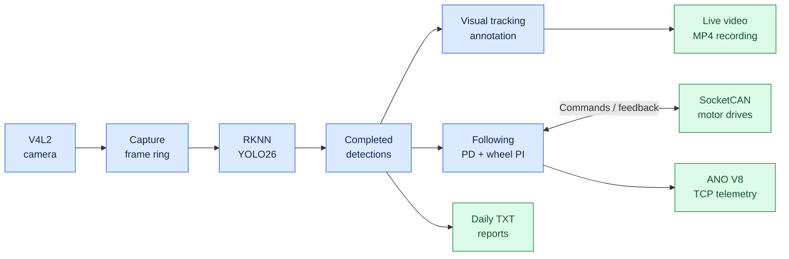
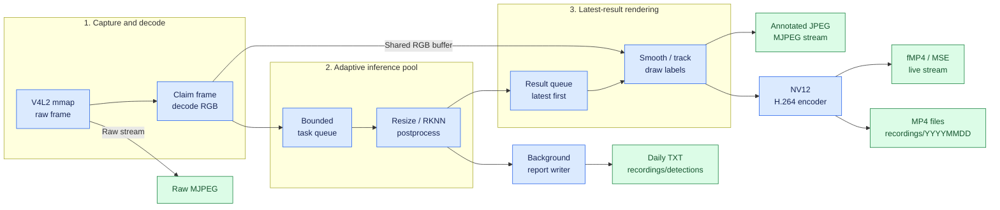
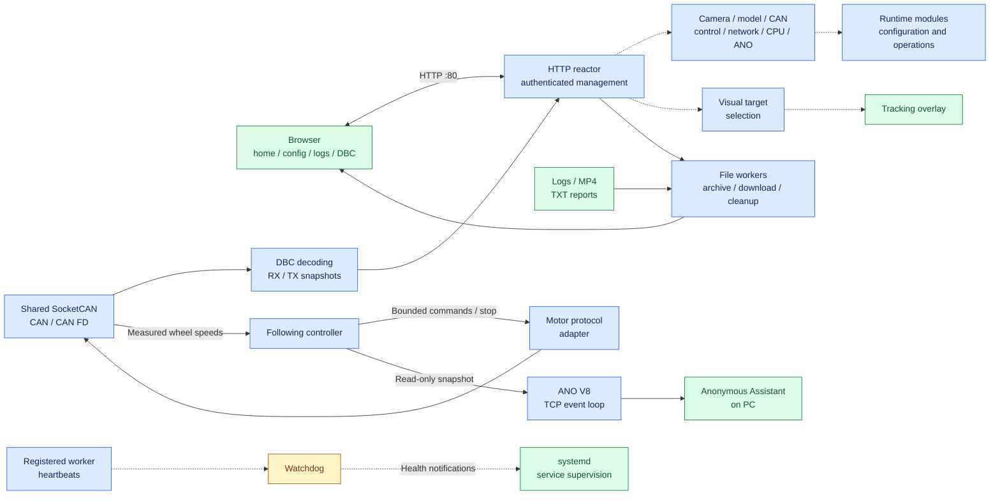
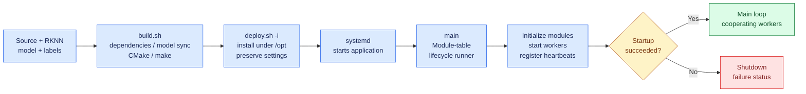
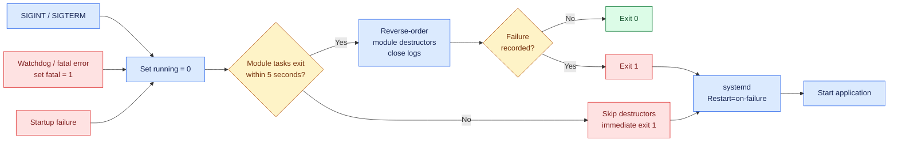
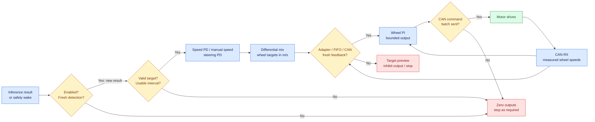

# Autonomous Driving Car

Autonomous Driving Car is a Linux-based vehicle platform being developed around a unified architecture for **perception, inference, and control**. Its hardware and system target is a shared computing platform running a Linux real-time kernel, bringing conventional motion-control algorithms, YOLO object detection, and large language model (LLM) inference into the same system.

The current implementation provides camera perception, RKNN YOLO26 inference, visual tracking, differential wheel control, and shared CAN communication. Web management, video recording, logs, and telemetry support operation and development. **LLM inference is a planned capability.**

The hardware validation platform is **Radxa ROCK 4D / RK3576**. The application uses C11/C++11, the browser interface uses HTML/CSS/JavaScript, and the build and deployment tools use Bash.

## Platform architecture

The current runtime is one C/C++ application with cooperating worker threads. [main.c](source/core/main.c) coordinates module startup and shutdown; shared frame buffers, timestamped detection results, and controller snapshots connect the processing stages.

The diagrams below follow the implemented runtime from left to right. Each view focuses on one part of the system so labels remain readable at normal README width. Solid arrows show data or execution flow; dotted arrows show management and supervision. Blue nodes process data, green nodes represent outputs or healthy states, amber nodes check prerequisites, and red nodes show stop or failure paths.

### Runtime overview



The following controller consumes detections independently of visual target selection. LLM inference is planned and is not part of the current runtime paths.

### Perception and media pipeline



Frame storage is shared through [frame_ring.h](include/video/frame_ring.h); claims and buffer ownership protect raw and RGB frames while workers use them. Bounded queues favor recent results for rendering. Each completed inference also feeds following and report generation. H.264 streaming and MP4 recording share one encoding session.

### Web management, CAN, and supervision



### Build and startup



Module-table order: **context → log → config → platform → CAN → CAN RX/TX → TCP → HTTP → following → ANO → video → YOLO → watchdog → recording → signals**. Modules may create additional workers for following, inference, composition, reports, and media/file clients.

### Shutdown and recovery



The five-second wait covers module-table task threads. Destructors stop and join their owned workers where implemented. If a module task remains active, cleanup is skipped to avoid releasing resources it may still use. The kernel reclaims process resources; recording finalization is not guaranteed on this failure path.

### Following and wheel-feedback loop



Safety prerequisites are checked on timed wakes even without a new inference; PID updates use accepted inference timestamps. Following always starts disabled. Automatic speed uses relative target-area error; steering uses horizontal target error. Each wheel PI loop compares target speed with real measured feedback. Visual selection affects the overlay, while following selects its own target by configured class and proximity to its previous target or seed.

The CPU handles capture processing, appearance features, control, communication, and management; the NPU runs YOLO inference. Worker affinity, adaptive inference allocation, frame ownership, and watchdog supervision support execution on the shared platform.

A Linux real-time kernel is the system target. The current controller requests `SCHED_FIFO` priority **20** and reports scheduling admission separately from PREEMPT_RT kernel support through `/api/follow`. Timing and latency must be evaluated on the deployed hardware.

## Perception and motion control

**Perception.** V4L2 capture feeds YOLO26 detection through RKNN. Camera modes, confidence threshold, NMS IoU, model files, and labels are configurable in the browser. Available camera modes and hardware encoding depend on the device and drivers.

**Visual tracking.** Click a detection on the home page to select it and record its appearance. Numbered labels and the selected object's cyan box are drawn into the video and included in recordings. Tracking combines appearance, overlap, and motion to attempt recovery after short interruptions. Object IDs and appearance references are local to the running process.

**Intelligent Following.** The wheel controller consumes detection results independently of visual tracking. Automatic speed uses relative target size; manual mode uses the configured speed. Steering uses PD control, while the left and right wheels each use PI control with measured feedback. Wheel-speed targets and differential steering correction use **m/s**.

Clicking a visual target does not enable wheel motion. Following starts stopped after every service restart. Motor output requires:

- Following explicitly enabled for the current session.
- Fresh detections and measured left/right wheel-speed feedback.
- An available, enabled CAN interface and a valid, enabled motor protocol profile.
- Successful FIFO scheduling for the control thread.

Target loss, stale feedback, and unavailable prerequisites inhibit motion. Adapt [car_motor_can.example.conf](config/car_motor_can.example.conf) to the drive manufacturer's command, stop, and feedback formats before creating `config/car_motor_can.conf`. The example is disabled; special enable sequences or checksums require an appropriate adapter.

CAN and CAN FD traffic, DBC decoding, and motor commands share the same transport module. Target size provides a relative visual cue rather than a calibrated distance measurement.

## Hardware and software requirements

The board must provide Linux, a V4L2 camera, a working Rockchip NPU driver, and a compatible `librknnrt.so`. Vehicle control additionally requires SocketCAN hardware, an adapted motor profile, and actual wheel-speed feedback.

Build dependencies:

- C11/C++11 compiler, GNU Make, CMake **3.18+**, and Bash.
- libsystemd, libnl-3/libnl-route-3, libjpeg, and OpenCV core/imgproc development libraries.
- Standard Linux utilities including `flock`, `sha256sum`, `strings`, `awk`, `tar`, and `zip`.
- Optional FFmpeg libavcodec/libavutil development libraries and pkg-config for the FFmpeg backend. Software H.264 uses `libx264`; hardware encoding uses an available RKMPP or V4L2 backend.

## Build and deployment

Prepare the model and labels before the first build:

| File | Requirement |
| --- | --- |
| `config/yolo26.rknn` | Prepared YOLO26 model matching the board's NPU platform and supported output layout |
| `config/coco.names` | Class labels matching the model |

The RKNN model is not included in Git. Model preparation takes place outside this repository's build process; the scripts do not train, convert, or download models. Working model initialization is required for normal service startup.

Run builds and deployments through the existing scripts from the repository root:

```bash
bash scripts/build.sh -R
sudo bash scripts/deploy.sh -i
```

The build produces `bin/autonomous-driving-car`. Deployment installs the executable, frontend, model, and configuration under `/opt/autonomous-driving-car`, installs the systemd unit, and starts the service.

| Command | Action |
| --- | --- |
| `bash scripts/build.sh -R` | Release build with optimization and debug information |
| `bash scripts/build.sh -D` | Debug build with terminal debug output |
| `bash scripts/build.sh -R -P rk3576` | Build with an explicitly selected model platform |
| `bash scripts/build.sh -C` | Remove build outputs and clear **project logs**; does not build |
| `sudo bash scripts/deploy.sh -i` | Install or update, preserving installed data and device settings |
| `sudo bash scripts/deploy.sh -u` | Uninstall, including installed configuration, logs, and recordings |
| `sudo bash scripts/deploy.sh -r` | Uninstall, then install again; installed data is removed |

Normal updates use `deploy.sh -i` and restart the service. The service runs from `/opt/autonomous-driving-car`, monitors worker heartbeats, and restarts on failure.

## Browser operation

Open **`http://<board-ip>/`**. The Web interface uses fixed HTTP port **80**.

| Page | Address | Available operations |
| --- | --- | --- |
| Home | `/` | Live video, visual target selection, resource monitoring |
| System Configuration | `/config` | Camera, YOLO, CAN, CPU, following, Web IP, and telemetry settings |
| Driving Logs | `/logs` | Log/report browsing, video playback, file downloads, cleanup |
| DBC viewer | `/dbc` | CAN definitions and decoded signals |

Home and DBC pages accept a local Linux account through HTTP Basic authentication. Configuration, logs, and administrative actions require `root` or membership in the `sudo` group. Some read-only status APIs are public.

**Web & ANO Settings** combines interface IP configuration and telemetry settings with one Save button. IP configuration manages the selected system interface; HTTP listens on the board's IPv4 interfaces. Reconnect at the new address after changing the board's IP.

Web access supports **two source IPv4 addresses**. One address can open multiple tabs, streams, or downloads while sharing a slot. The slot expires 30 seconds after its last connection closes; an additional address receives HTTP 503.

## Model and configuration management

[model_sync.sh](scripts/model_sync.sh) is a shared dependency of [build.sh](scripts/build.sh) and [deploy.sh](scripts/deploy.sh). It identifies the NPU platform, checks the RKNN header and declared target, and synchronizes prepared model files by their hashes.

A model uploaded through the browser is retained when the application is rebuilt or redeployed. If the source and deployed models have both changed independently, synchronization stops and preserves both files. Internal synchronization metadata is stored directly under `config/`.

Updates retain existing deployed `config.txt`, `follow.conf`, `car_motor_can.conf`, `cpu_freq.conf`, and `ano.conf` settings. Labels and DBC files may be replaced by source versions.

Runtime paths are relative to the working directory; the installed service uses `/opt/autonomous-driving-car`.

| Path | Purpose |
| --- | --- |
| `config/config.txt` | Camera, inference, CAN, and Web IP settings |
| `config/follow.conf` | Following parameters |
| `config/car_motor_can.conf` | Motor command and feedback protocol |
| `config/cpu_freq.conf` | CPU policy settings |
| `config/ano.conf` | Anonymous Assistant settings |
| `config/yolo26.rknn`, `config/coco.names` | Model and class labels |
| `config/*.dbc` | CAN databases |
| `logs/YYYYMMDD/` | Application information and error logs |
| `recordings/YYYYMMDD/` | Annotated MP4 recordings |
| `recordings/detections/YYYYMMDD/result_YYYYMMDD.txt` | Daily inference results |

**Export config** downloads actual configuration files and the model as `.tar.gz`. Empty directories and internal synchronization metadata are omitted; the total uncompressed file size is limited to **64 MiB**.

## Recording and observability

H.264/MSE and MJPEG provide live video. H.264 streaming shares its encoding session with MP4 recording. Recording starts automatically when a session can start; manually stopping recording ends that H.264 session and disables automatic continuation.

Daily TXT reports record completed inferences, including results with no detected objects. Entries contain capture time, image dimensions, lens position when available, class/confidence, and `X1 X2 Y1 Y2` coordinates in the original image. Processing favors recent frames, so reports and videos need not include every captured frame.

The Driving Logs page provides individual downloads and a whole-page ZIP. Bulk deletion protects recordings that are active or being finalized. ZIP downloads omit active or incomplete videos.

```bash
systemctl status autonomous-driving-car --no-pager
journalctl -u autonomous-driving-car -f
curl -s http://127.0.0.1/api/video/stats
curl -s http://127.0.0.1/api/follow
curl -s http://127.0.0.1/api/ano
```

For startup problems, check the RKNN model, NPU driver/runtime, and camera. Use video counters for capture/encoding issues and controller readiness for missing motor output. HTTP routes are defined in [http.c](source/http/http.c).

The service permits core dumps, and Release builds retain debug information. With a configured system `systemd-coredump` collector, use `sudo coredumpctl info /opt/autonomous-driving-car/bin/autonomous-driving-car` and retain the matching executable for analysis.

## Anonymous Assistant

**Anonymous Assistant 2.0.1** receives **ANO V8 over TCP**, with the board as server and the PC as client. Configure the port and send rate in **Web & ANO Settings**. Defaults are **8080**, **30 Hz**, and initially disabled; saved settings are restored at startup. It supports **two TCP clients**.

Telemetry publishes target/actual speed and steering correction. Simulated waveforms help check the link. The telemetry connection does not issue motor commands.

Official website: [ANO Tech](https://www.anotc.com/). Downloads and documentation: [Anonymous Assistant](https://gitee.com/anotc/AnoAssistant).

## Repository structure

| Location | Responsibility |
| --- | --- |
| `source/core/` | Module lifecycle, shared context, configuration, logging, CPU affinity |
| `source/video/`, `source/yolo/` | Capture, inference, annotations, streaming, recording, reports |
| `source/control/` | Appearance features, visual tracking, motion control |
| `source/can/` | Shared CAN transport, DBC decoding, motor integration |
| `source/tcp/`, `source/telemetry/` | Network transport, ANO protocol, controller telemetry |
| `source/http/`, `html/` | Web server, APIs, browser pages, styles, JavaScript |
| `source/watchdog/` | Worker heartbeat supervision |
| `include/` | Module interfaces and shared types |
| `config/` | Device settings, model, labels, CAN databases |
| `scripts/` | Bash build, deployment, and model synchronization |

## Development direction

The next architectural step is to integrate LLM inference alongside YOLO and conventional motion control. This will extend the platform toward unified perception, inference, and control while retaining explicit interfaces for observations, model outputs, and actuator commands.

Shared-resource scheduling, control timing, and end-to-end latency on Linux real-time kernels remain areas for continued evaluation. The implemented behavior documented above provides the foundation for that work; LLM integration and broader autonomous decision-making are future development goals.

## License

[GPL-3.0-or-later](LICENSE).
