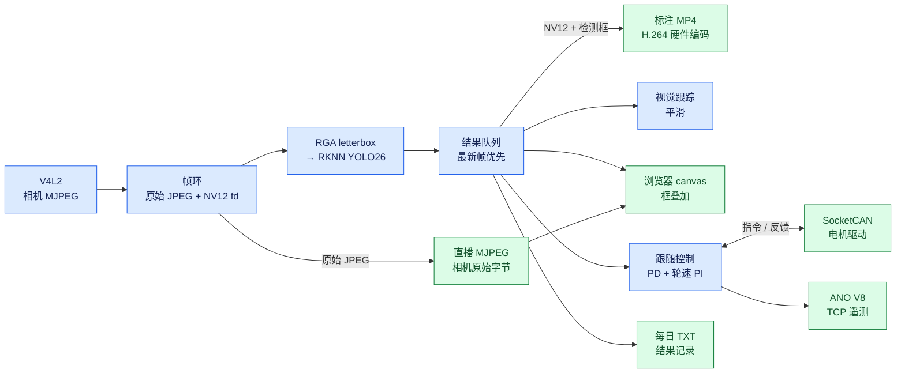
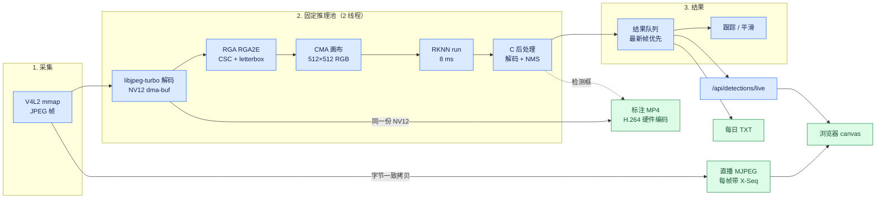
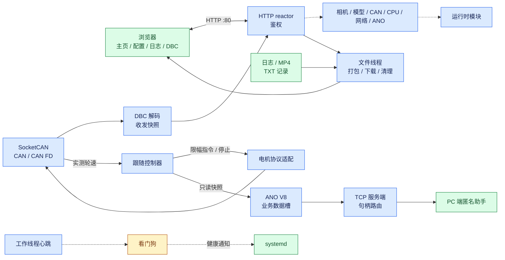
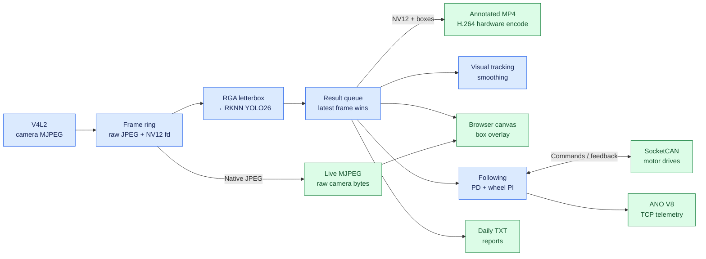
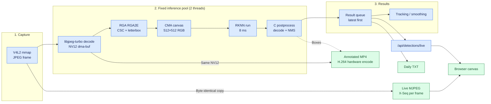
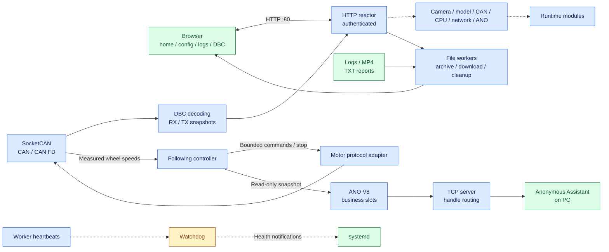

# Autonomous Driving Car

**中文** | **[English](#english-documentation)**

---

## 中文文档

自动驾驶小车（Autonomous Driving Car）是一个**感知、推理、控制**一体化的 Linux 车载平台。当前版本把相机采集、RKNN YOLO26 推理、视觉跟踪、差速轮控制、CAN/CAN FD 通信、标注录像和浏览器管理界面跑在同一个纯 C11 应用里。LLM 推理属于规划能力，尚未实现。

目标板是 **Radxa ROCK 4D / RK3576**：NPU 双核、RGA 双核和模型平台都按这颗 SoC 在编译期确定。

推理链路里除解码外都由硬件完成：

```
相机 MJPEG → libjpeg-turbo 软解（NV12 dma-buf）→ RGA（色彩转换 + letterbox）→ NPU → C 后处理
```

分工明确：libjpeg-turbo 在 CPU 上把 JPEG 解成 NV12（720p 单帧约 5 ms，两个解码线程各持一个 libjpeg 实例、绑在大核上并行），RGA 一趟完成色彩转换与缩放，NPU 输出检测张量，CPU 另承担后处理与结果分发。端到端 80 ms，整机 CPU 占用约 4 %。

直播保持传感器原始画质：`/video/mjpeg` 直接转发相机 MJPEG 字节，检测框由浏览器 canvas 按帧序号叠加。录像走另一条路——推理解出的 NV12 画上框后由 VEPU510 硬件编成 H.264，保存为 MP4。

### 实测性能

以下数据来自板端部署版本，采集 30 fps：

| 指标 | 数值 |
| --- | --- |
| 端到端延迟（`processing_age_ms`） | **80 ms**，最大 126 ms |
| 每帧流水线工作量 | **约 16 ms**（解码 5、RGA 1、NPU 9、后处理 1；解码与 NPU 在不同线程上重叠） |
| 整机 CPU 占用 | **约 4 %** |
| 每核 NPU 负载 | 8–13 % |
| 每核 RGA 负载 | 约 2 % |
| 采集 / 丢帧 | 30 fps，环形缓冲丢帧 0，`infer_dropped` 0 |

80 ms 由三部分构成：33 ms 相机侧延迟（UVC 一帧的固有延迟，不是软件问题）、约 16 ms 流水线，以及最多一个帧周期的渲染节拍。逐环节耗时见[延迟剖析](docs/LATENCY_PROFILE.md)。

### 快速开始

```bash
bash scripts/build.sh -R          # Release 构建 → bin/autonomous-driving-car
sudo bash scripts/deploy.sh -i    # 安装到 /opt 并启动服务
curl -s http://127.0.0.1/api/video/stats
```

浏览器打开 `http://<板子IP>/` 进入管理界面。

前置条件：内核需带 Rockchip NPU 和 RGA 驱动，用户态需要 libjpeg-turbo、`librknnrt.so` 和 `librga.so`，以及准备好的 `config/yolo26.rknn`。详见[依赖](#依赖)与[构建与部署](#构建与部署)。

### 架构

单个 C/C++ 进程加协作式工作线程。[main.c](source/core/main.c) 按固定顺序运行模块表；共享帧环、结果队列和控制器快照把各阶段连起来。图中蓝色为数据处理，绿色为输出，琥珀色为检查，红色为失败路径。录像只有一份标注 MP4：带检测框、走硬件 H.264 编码。

#### 运行时总览



#### 感知与媒体流水线



两个推理线程，每个绑定一个 NPU 核**和**一个 RGA 核：

| 线程 | NPU | RGA |
| --- | --- | --- |
| `yolo_infer` 0 | Core 0（`mask 0x1`） | RGA2E core 0（`0x4`） |
| `yolo_infer` 1 | Core 1（`mask 0x2`） | RGA2E core 1（`0x8`） |

每个解码线程各有自己的 libjpeg 实例和 8 槽 NV12 dma-buf 环，解出的帧留在槽里；worker 让 RGA 一趟完成色彩转换与缩放，写进 CMA 画布，再把画布地址直接交给 `rknn_inputs_set`——RGA 与 NPU 之间零拷贝。

#### Web 管理、CAN 与监控



模块表顺序：**context → log → config → DBC → CAN → CAN RX/TX → TCP → HTTP → following → ANO → video → YOLO → watchdog → recording → signals**。运动与感知线程心跳丢失视为致命错误；管理线程只记录日志并复位，不因此停车。

### 感知

**采集。** V4L2 MJPEG，1280×720，30 fps。设备通过稳定路径（`/dev/v4l/by-id/...`）打开，因为新增内置媒体驱动会改变 `/dev/videoN` 编号。

**解码。** libjpeg-turbo 在 CPU 上把 JPEG 解成 NV12，写进 CMA dma-buf 供 RGA 直接读取，720p 单帧约 5 ms。解码已从采集线程里剥出来：2 个解码线程各持一个 libjpeg 实例并行工作，`SCHED_FIFO` 15 绑在大核组（cpu4-7，按 `cpu_capacity` 自动发现）。单线程软解只能到 25 fps，双线程跑满相机的 29 fps，采集线程只负责 claim 与投递。板载 `rockchip-jpegd`（VDPU720）对同一帧多次解码结果不一致——8×8 块内第 0 行精确正确、其余行每次不同，画面上会留下块状灰斑与边缘断口，因此不使用。

**预处理。** RGA 一次调用完成 NV12 → RGB、等比缩放和居中放置到 512×512 画布，约 1 ms。114 灰边只在启动时填一次，之后每帧 RGA 只写中心区域。

**推理。** RKNN YOLO26n，512×512 输入，单核约 8 ms。

**后处理。** C 实现：在 NHWC 分数张量上逐锚点扫类别、收集候选、按类贪心 NMS（IoU 0.45）、取前 32，约 1 ms。

**结果。** 结果队列偏向最新帧；消费者较慢时跳过中间结果，保持低延迟。

#### 模型接口

| 张量 | 形状 | 类型 | 含义 |
| --- | --- | --- | --- |
| `/model.23/Sigmoid_output_0` | `[1,5376,80]` | INT8，NHWC | 类别分数 |
| `/model.23/Mul_2_output_0` | `[1,4,5376]` | FP16 | cx, cy, w, h（模型像素） |

worker 只对框张量向运行时请求 float，类别分数自己反量化。输出布局不符的模型在加载时直接拒绝。框保持 FP16 是因为 INT8 会把框量化成约 2.73 px 的步长，代价是 mAP(50–95) 掉 2.45 个点；类别用 NHWC 是为了让同一锚点的 80 个分数连续，后处理从 4 ms 降到 1 ms。

64 图留出集上的精度（conf ≥ 0.001、类内 NMS IoU 0.7、101 点 AP）：**mAP50 0.5909，mAP50–95 0.4336**。

### RGA 预处理

预处理全部在 RGA 上完成：NV12 → RGB、等比缩放、居中放进 512×512 画布，一次调用约 1 ms。

应用通过 librga 的 im2d C 接口提交作业，每块板子安装一次：

```sh
git clone https://github.com/airockchip/librga
sudo cp librga/libs/Linux/gcc-aarch64/librga.so /usr/local/lib/
sudo mkdir -p /usr/local/include/rga && sudo cp librga/include/*.h /usr/local/include/rga/
sudo /sbin/ldconfig
```

`scripts/deploy.sh` 会检查库和 `/dev/rga`，也支持用 `LIBRGA_SOURCE` 指定源文件安装。

RK3576 的 RGA2E 在内核里以 **RGA2** 设备注册，按核调度使用 `IM_SCHEDULER_RGA2_CORE0/1`（0x4/0x8）。

### 视觉跟踪与跟随

**跟踪。** 在主页点击检测框即可选中目标。匹配使用匀速预测、预测框重叠、位移、尺寸变化和类别门限，模糊匹配会被拒绝。ID 仅在本进程内有效，800 ms 无匹配即过期。编号标签和选中目标的青色框由**浏览器 canvas** 叠加显示。

**跟随。** 轮速控制器独立消费检测结果，与视觉跟踪解耦。自动速度按目标相对大小计算，手动模式用配置速度。转向用 PD，左右轮各自用 PI 并带实测反馈。轮速目标与差速修正的单位都是 **m/s**。

选中视觉目标不会使能轮子运动，且每次服务重启后跟随都从停止状态开始。电机输出还要求：检测结果新鲜、左右轮速反馈实测可用、CAN 接口可用且电机协议配置有效、控制线程成功获得 FIFO 调度。目标丢失、反馈过期或前置条件缺失都会抑制运动。

请先把 [car_motor_can.example.conf](config/car_motor_can.example.conf) 按驱动器厂商的指令、停止和反馈格式改好，再创建 `config/car_motor_can.conf`。

### Web 界面

浏览器打开 **`http://<板子IP>/`**，HTTP 固定 **80** 端口。

| 页面 | 地址 | 功能 |
| --- | --- | --- |
| 主页 | `/` | 实时视频、框叠加、目标选择、资源监控（CPU、NPU、RGA） |
| 系统配置 | `/config` | 相机、YOLO、CAN、CPU、跟随、Web IP、遥测 |
| 行车日志 | `/logs` | 日志与记录浏览、视频回放、下载、清理 |
| DBC 查看 | `/dbc` | CAN 定义与解码信号 |

主页与 DBC 页用本地 Linux 账号做 HTTP Basic 认证；配置、日志和管理操作要求 `root` 或 `sudo` 组。部分只读状态接口完全公开。

资源卡片显示逐核 CPU、**逐核 NPU**、**逐核 RGA** 以及内存/磁盘。NPU 负载来自 `/sys/kernel/debug/rknpu/load`；RGA 占用率由应用按核计时统计——对每次 `improcess` 调用计时，按 1 秒滑窗汇总。

Web 访问支持**两个源 IPv4 地址**，同一地址可开多个标签页。槽位在最后一个连接关闭 30 秒后过期，多余地址收到 HTTP 503。

#### 直播与框叠加

主页播放 `GET /video/mjpeg`，即相机原始 JPEG 帧的 `multipart/x-mixed-replace` 流。每个分段带 `X-Seq` 头，浏览器据此知道当前画面是哪一帧。


框来自 `GET /api/detections/live?after=N`，记录里有 `seq`、图像 `w`/`h`，以及每个目标的 `x1, y1, x2, y2, class, score, name`（原图像素坐标）。浏览器把记录与显示帧对齐；如果该帧没有推理结果，就回退到六帧内最近的记录，再远则跳过该帧。

720p 下单帧 60–110 KB，30 fps 不限额需要 18–26 Mbps。`mjpeg_max_kbps` 限制单客户端预算：socket 积压时丢弃整帧，避免延迟累积。

### 录像与可观测性

录像自动开始，产物是**一份带检测框的 MP4**。每次会话在 `recordings/videos/` 下写 `annot_<日期>_<时间>.mp4`：推理路径解出的 NV12 在 Y 平面画上检测框，再交给 VEPU510 硬件编成 H.264。恒定 QP 18（FIXQP，不做码率控制），720p 实测约 **7.9 Mbps**，即 **3.5 GB/小时**，VLC、ffplay 和浏览器都能直接播放。帧不重复解码——标注录像复用的就是推理已经解好的那份 NV12，每帧只多一次内存拷贝。

分段只按**日期变化**触发：跨天时结束当前文件、在新日期目录下开始下一段，录像不中断。另有手动分段接口供前端调用。MP4 的样本偏移是 64 位的，单文件不受 4 GiB 限制。

录像从不等待推理，所以模型卡住或重载不会中断录像。检测框只画进 MP4；浏览器画面仍是原始字节加前端叠加层。

每日 TXT 记录所有完成的推理，包括没有检测到目标的帧：采集时间、帧序号、图像尺寸、可用的镜头位置、目标序号/类别/置信度，以及原图坐标 `X1 X2 Y1 Y2`。写入在推理线程之外批量进行。

```bash
systemctl status autonomous-driving-car --no-pager
journalctl -u autonomous-driving-car -f
curl -s http://127.0.0.1/api/video/stats
curl -s http://127.0.0.1/api/rec/status
curl -s http://127.0.0.1/api/system
```

`GET /api/video/stats` 报告 `capture_fps`、`capture_dropped`、`driver_dropped`、`capture_stall_ms`、`render_skipped` 和 `processing_age_ms`，可用来区分相机问题和推理滞后。Release 构建保留调试信息，可用 `coredumpctl` 分析。

### 模型与配置管理

[model_sync.sh](scripts/model_sync.sh) 由 [build.sh](scripts/build.sh) 和 [deploy.sh](scripts/deploy.sh) 共用。平台固定为 `rk3576`；脚本校验 RKNN 文件头与声明目标，并按哈希同步准备好的模型。通过浏览器上传的模型在重新构建或重新部署后仍会保留；若源模型与部署模型各自独立变更，同步会中止并同时保留两份。

升级会保留 `config.txt`、`follow.conf`、`car_motor_can.conf`、`cpu_freq.conf` 和 `ano.conf`；标签与 DBC 文件可能被源版本替换。

| 路径 | 用途 |
| --- | --- |
| `config/config.txt` | 相机、推理、CAN 与 Web IP 设置 |
| `config/follow.conf` | 跟随参数 |
| `config/car_motor_can.conf` | 电机指令与反馈协议 |
| `config/cpu_freq.conf` | CPU 策略设置（默认 `performance`） |
| `config/ano.conf` | 匿名助手设置 |
| `config/yolo26.rknn`、`config/coco.names` | 模型与类别标签 |
| `config/*.dbc` | CAN 数据库 |
| `recordings/logs/` | 应用日志 |
| `recordings/videos/` | 标注 MP4 录像 |
| `recordings/results/result_YYYYMMDD.txt` | 每日推理结果 |

关键视频设置：

| 设置 | 含义 |
| --- | --- |
| `video_device` | V4L2 采集节点，建议用 `/dev/v4l/by-id/` 路径 |
| `video_width`、`video_height` | 采集分辨率，录像使用同样尺寸 |
| `video_fps` | 请求帧率，`0` 表示沿用驱动默认 |
| `mjpeg_max_kbps` | 单客户端直播预算（kbit/s），`0` 不限额 |

**导出配置**会把实际配置文件和模型打包成 `.tar.gz` 下载（解压后不超过 64 MiB，内部同步元数据除外）。

### 通信注册

业务模块注册自己的通信地址并持有接收槽。发送只用**句柄 + 数据 + 长度**，传输层负责解析端口、连接、CAN ID 和帧格式。

- TCP 用两阶段注册：`tcp_prepare_register()` 准备，配置保存成功后再 `tcp_commit_register()` 提交；CAN 用 `can_locked_register()`。
- 发送用 `tcp_send(handle, data, length)` / `can_send(handle, data, length)`。
- 接收用业务自持槽上的 `data_slot_pop()`。

TCP 保留部分写，并在接收槽满时重置客户端。CAN 按接口加 ID 路由，保留原始单调接收时间戳，并强制保留电机 ID、显式停止、FIFO 准入、反馈新鲜度和输出限幅。完整路径、容量和锁规则见[通信流程](docs/COMMUNICATION_FLOW.md)。

### 仓库结构

| 位置 | 职责 |
| --- | --- |
| `source/core/` | 模块生命周期、共享上下文、配置、日志、CPU 亲和性 |
| `source/video/` | 采集、帧环、RGA 预处理、标注 MP4 录像、MJPEG 直播 |
| `source/yolo/` | 推理池、后处理、跟踪事件、结果记录 |
| `source/control/` | 视觉跟踪、运动控制 |
| `source/can/` | SocketCAN、端口/ID 注册、数据槽、DBC 解码、电机协议 |
| `source/tcp/` | 连接管理、端口注册、句柄路由、数据槽 |
| `source/telemetry/` | ANO 业务槽、流解析、协议编码 |
| `source/http/`、`html/` | Web 服务与接口、页面、浏览器组件 |
| `source/watchdog/` | 工作线程心跳监管 |
| `include/` | 模块接口与共享类型 |
| `config/` | 设备设置、模型、标签、CAN 数据库 |
| `scripts/` | 构建、部署、模型同步 |
| `tools/model/` | 离线模型链路：ONNX 导出、RKNN 量化、数据集准备、原始输出 dump、mAP 评测 |
| `docs/` | 架构、延迟、量化、实时调度等文档 |

视频相关模块：`video_stream.c` 负责采集与 MJPEG 分发，`frame_ring.c` 负责缓冲交接，`rga_preprocess.c` 负责 RGA 画布，`video_rec.c` 负责录像会话与分段，`rec_annot.c` 负责画框与硬件编码线程，`rec_mp4.c` 负责 MP4 容器。

### 依赖

**硬件。** Radxa ROCK 4D（RK3576）、能输出 MJPEG 的 USB UVC 相机；车辆控制还需要 SocketCAN 硬件和支持轮速反馈的驱动器。

**内核。** 需要
[rock-4d-npu-kernel](https://github.com/qianruo-orange/rock-4d-npu-kernel)
的 `7.4.0-rc1-npu-rt-full` 或更新版本，这些驱动**内置**在镜像里：

| 驱动 | 应用是否需要 |
| --- | --- |
| RKNPU（`rknpu`） | 需要 —— 推理 |
| JPEG 解码（`rkjpegd`） | 不需要 —— 解码由 CPU 上的 libjpeg-turbo 完成 |
| RGA3 / RGA2E（`rga3`） | 需要 —— 预处理 |
| VEPU510 编码（`mpp`） | 需要 —— 标注录像的 H.264 编码 |

应用用到 NPU、RGA 和 VEPU510 三个引擎；标注录像需要 MPP 用户态库 `librockchip_mpp.so`，装在 `/usr/local/lib`。

**用户态。** `librknnrt.so`（2.5.0）、`librga.so`、`librockchip_mpp.so`、libsystemd、libnl-3/libnl-route-3。

**构建。** C11 编译器、GNU Make、CMake 3.18+、Bash，以及常用的 `flock`、`sha256sum`、`strings`、`awk`、`tar`、`zip`。源码不含 C++，也不需要 OpenCV。

### 构建与部署

首次构建前准备好 `config/yolo26.rknn`（512×512 输入、上文所述的两路输出）和 `config/coco.names`。模型不入库；生成它的链路见 [tools/model/README.md](tools/model/README.md)，量化历史见 [docs/YOLO26N_QUANTIZATION.md](docs/YOLO26N_QUANTIZATION.md)。

```bash
bash scripts/build.sh -R          # Release
sudo bash scripts/deploy.sh -i    # 安装并启动
```

| 命令 | 作用 |
| --- | --- |
| `bash scripts/build.sh -R` | Release 构建，带优化和调试信息 |
| `bash scripts/build.sh -D` | Debug 构建，终端输出 |
| `bash scripts/build.sh -C` | 清除构建产物与工程日志 |
| `sudo bash scripts/deploy.sh -i` | 安装或升级，保留数据与设备设置 |
| `sudo bash scripts/deploy.sh -u` | 卸载，含配置、日志与录像 |
| `sudo bash scripts/deploy.sh -r` | 先卸载再安装 |

构建产物是 `bin/autonomous-driving-car`；部署会把可执行文件、前端、模型和配置装到 `/opt/autonomous-driving-car`，安装 systemd 单元并启动服务。平台固定为 RK3576。

在 cgroup v2 系统上，部署会写入
`/etc/systemd/system/-.slice.d/90-autonomous-driving-car-rt.conf`，使服务组内允许 FIFO 与 deadline 线程。该配置生效期间 CPU 配额与权重在整个层级不可用；卸载时保留，全局 RT 预算不变。

### 发展方向

下一步是把 LLM 推理与 YOLO、常规运动控制并列集成。共享资源调度、控制时序和实时内核上的端到端延迟仍在评估；上文描述的实现是这项工作的基础。

## English documentation

A Linux vehicle platform for **perception, inference and control** on a single
real-time kernel. The current build runs camera capture, RKNN YOLO26 inference,
visual tracking, differential wheel control, CAN/CAN-FD communication, annotated
recording and a browser management interface as one C11 application.
LLM inference is planned, not implemented.

The target board is the **Radxa ROCK 4D / RK3576**: the NPU cores, RGA cores and
model platform are fixed for that SoC at compile time.

Every stage except decoding runs on hardware accelerators:

```
camera MJPEG → libjpeg-turbo decode (NV12 dma-buf) → RGA (CSC + letterbox) → NPU → C postprocess
```

libjpeg-turbo turns the JPEG into NV12 on the CPU (~5 ms per 720p frame), RGA
does colour conversion and scaling in one pass, the NPU emits the detection
tensors, and the CPU handles postprocessing and result dispatch. Decoding runs
on two threads, each with its own libjpeg instance, pinned to the big cores.
End to end this is 80 ms at about 4 % whole-system CPU load.

The live view keeps the sensor's own quality: `/video/mjpeg` forwards the
camera's MJPEG bytes and the browser canvas overlays the boxes, aligned by frame
sequence number. Recording takes a different path - the NV12 the inference path
decoded gets the boxes drawn in and the VEPU510 encodes it to H.264, stored as
MP4.

### Measured performance

Numbers from the deployed build on the board, 30 fps capture:

| Metric | Value |
| --- | --- |
| End-to-end latency (`processing_age_ms`) | **80 ms**, max 126 ms |
| Pipeline work per frame | **~16 ms** (decode 5, RGA 1, NPU 9, postprocess 1; decode overlaps NPU on other threads) |
| CPU load, whole system | **~4 %** |
| NPU load per core | 8–13 % |
| RGA load per core | ~2 % |
| Capture / dropped frames | 30 fps, 0 from the ring, 0 `infer_dropped` |

80 ms splits into 33 ms of camera-side latency (UV C one-frame delay, not
software), ~16 ms of pipeline, and up to one frame period of render pacing. See
[latency profile](docs/LATENCY_PROFILE.md) for per-stage timings.

### Quick start

```bash
bash scripts/build.sh -R          # release build → bin/autonomous-driving-car
sudo bash scripts/deploy.sh -i    # install under /opt, start the service
curl -s http://127.0.0.1/api/video/stats
```

Open `http://<board-ip>/` for the web interface.

Prerequisites are a kernel with the Rockchip NPU and RGA drivers, libjpeg-turbo,
`librknnrt.so`, `librga.so`, and a prepared `config/yolo26.rknn`. Details in
[Requirements](#requirements) and [Build and deployment](#build-and-deployment).

### Architecture

One C/C++ process with cooperating worker threads. [main.c](source/core/main.c)
runs a module table in a fixed order; a shared frame ring, a result queue and
controller snapshots connect the stages. Blue nodes process data, green nodes are
outputs, amber nodes are checks, red nodes are failure paths.

#### Runtime overview



#### Perception and media pipeline



Two worker threads, each bound to one NPU core **and** one RGA core:

| Thread | NPU | RGA |
| --- | --- | --- |
| `yolo_infer` 0 | Core 0 (`mask 0x1`) | RGA2E core 0 (`0x4`) |
| `yolo_infer` 1 | Core 1 (`mask 0x2`) | RGA2E core 1 (`0x8`) |

Each decode thread keeps its own libjpeg instance and 8-slot NV12 dma-buf ring;
the worker asks RGA for colour conversion plus scaling in one pass into a
CMA-backed model canvas, and passes that canvas address straight to
`rknn_inputs_set`, giving a zero-copy handoff between RGA and NPU.

#### Web management, CAN and supervision



Module-table order: **context → log → config → DBC → CAN → CAN RX/TX → TCP →
HTTP → following → ANO → video → YOLO → watchdog → recording → signals**.
Motion and perception threads are fatal on a missed heartbeat; management
threads log and reset instead of stopping the vehicle.

### Perception

**Capture.** V4L2 MJPEG at 1280×720, 30 fps. The device is opened through a
stable path (`/dev/v4l/by-id/...`), because adding a built-in media driver can
renumber `/dev/videoN`.

**Decode.** libjpeg-turbo decodes the JPEG into NV12 on the CPU (~5 ms per 720p
frame) and writes it into a CMA dma-buf that RGA reads directly. Decoding was
moved out of the capture thread into two threads, one libjpeg instance each,
running `SCHED_FIFO` 15 on the big cores (cpu4-7, discovered from
`cpu_capacity`): a single software decoder tops out at 25 fps, the pair
saturates the camera's 29 fps, and the capture thread only claims and submits.
The on-SoC `rockchip-jpegd` (VDPU720) is not used: repeated decodes of the same
frame do not agree — row 0 of every 8x8 block is exact while the remaining rows
differ each run, leaving blocky grey patches and broken edges on screen.

**Preprocess.** RGA performs NV12 → RGB, letterbox scaling and placement into a
512×512 canvas in one call (~1 ms). The 114-grey border is filled once at start
up; RGA only writes the centre rectangle each frame.

**Inference.** RKNN YOLO26n, 512×512 input, ~8 ms per frame on one NPU core.

**Postprocess.** C implementation: per-anchor class scan over the NHWC score
tensor, candidate collection, class-wise greedy NMS (IoU 0.45), top-32. ~1 ms.

**Results.** The result queue favours the newest frame; a slower consumer skips
intermediate results and keeps latency low.

#### Model interface

| Tensor | Shape | Type | Meaning |
| --- | --- | --- | --- |
| `/model.23/Sigmoid_output_0` | `[1,5376,80]` | INT8, NHWC | class scores |
| `/model.23/Mul_2_output_0` | `[1,4,5376]` | FP16 | cx, cy, w, h in model pixels |

The worker asks the runtime for float only on the box tensor and dequantises the
scores itself. A model with a different output layout is rejected at load time.
Boxes stay FP16 because INT8 quantises them to a ~2.73 px step, which costs
2.45 mAP(50–95) points. Scores are NHWC so the 80 values of one anchor are
contiguous, which cut postprocessing from 4 ms to 1 ms.

Accuracy on a 64-image held-out set (conf ≥ 0.001, class NMS IoU 0.7, 101-point
AP): **mAP50 0.5909, mAP50–95 0.4336**.

### Preprocessing on the RGA

All preprocessing happens on RGA: NV12 → RGB, proportional scaling and centring
into the 512×512 canvas, in one call of about 1 ms.

The application submits work through librga's im2d C API. Install it once per
board:

```sh
git clone https://github.com/airockchip/librga
sudo cp librga/libs/Linux/gcc-aarch64/librga.so /usr/local/lib/
sudo mkdir -p /usr/local/include/rga && sudo cp librga/include/*.h /usr/local/include/rga/
sudo /sbin/ldconfig
```

`scripts/deploy.sh` verifies the library and `/dev/rga`, and can install the
library from `LIBRGA_SOURCE`.

RK3576 reports its RGA2E cores as **RGA2** devices, so per-core scheduling uses
`IM_SCHEDULER_RGA2_CORE0/1` (0x4/0x8).

### Visual tracking and following

**Tracking.** Click a detection on the home page to select it. Matching uses
constant-velocity prediction, predicted box overlap, displacement, size change
and class gates; ambiguous matches are rejected. IDs are local to the process
and expire after 800 ms without a match. The numbered labels and the selected
object's cyan box are overlaid by the **browser canvas**.

**Following.** The wheel controller consumes detections independently of visual
tracking. Automatic speed uses relative target size, manual mode uses the
configured speed. Steering is PD; each wheel is PI with measured feedback.
Wheel-speed targets and differential correction use **m/s**.

Selecting a visual target does not enable motion, and following always starts
stopped after a service restart. Motor output additionally requires fresh
detections and wheel feedback, an available and enabled CAN interface with a
valid motor profile, and FIFO scheduling for the control thread. Target loss,
stale feedback or missing prerequisites inhibit motion.

Adapt [car_motor_can.example.conf](config/car_motor_can.example.conf) to the
drive manufacturer's command, stop and feedback formats before creating
`config/car_motor_can.conf`.

### Web interface

Open **`http://<board-ip>/`**; HTTP listens on port **80**.

| Page | Address | Operations |
| --- | --- | --- |
| Home | `/` | Live video, box overlay, target selection, resource monitor (CPU, NPU, RGA) |
| System Configuration | `/config` | Camera, YOLO, CAN, CPU, following, web IP, telemetry |
| Driving Logs | `/logs` | Log/report browsing, video playback, downloads, cleanup |
| DBC viewer | `/dbc` | CAN definitions and decoded signals |

Home and DBC accept a local Linux account through HTTP Basic authentication.
Configuration, logs and administrative actions require `root` or `sudo` group
membership. Some read-only status APIs are public.

The resource card shows CPU per core, **NPU per core**, **RGA per core** and
memory/disk. NPU load comes from `/sys/kernel/debug/rknpu/load`; RGA load is measured
inside the application by timing each `improcess` call per core over a
one-second window.

Web access supports **two source IPv4 addresses**; one address can open many
tabs. The slot expires 30 s after its last connection closes and an extra
address receives HTTP 503.

#### Live view and overlay

The home page plays `GET /video/mjpeg`, a `multipart/x-mixed-replace` stream of
the camera's own JPEG frames. Each part carries an `X-Seq` header so the browser
knows which frame is on screen.

Boxes come from `GET /api/detections/live?after=N`, returning records with
`seq`, image `w`/`h` and per object `x1, y1, x2, y2, class, score, name` in
original-image pixels. The browser matches the record to the displayed frame; if
inference skipped that frame it falls back to the nearest earlier record within
six frames, and beyond that it skips the frame.

Each frame is 60–110 KB at 720p, so an uncapped 30 fps stream needs
18–26 Mbps. `mjpeg_max_kbps` caps the per-client budget; when a socket backs up,
whole frames are dropped so latency does not accumulate.

### Recording and observability

Recording starts automatically and produces a **single MP4 with the detection
boxes burned in**. Each session writes `annot_<date>_<time>.mp4` under
`recordings/videos/`: the NV12 the inference path already decoded gets the
boxes drawn into its luma plane, then the VEPU510 encodes it to H.264. Coding
uses a constant QP of 18 (FIXQP, no rate control): measured about **7.9 Mbps**,
or **3.5 GB/hour** at 720p, and the file plays in VLC, ffplay
and the browser. No frame is decoded twice - the annotated file reuses the NV12
from inference and costs one memory copy per frame.

Segments break on a **date change**: at midnight the current file is closed and
the next one starts in the new day's directory without interrupting the
recording. A manual split endpoint exists for the UI. MP4 sample offsets are
64-bit, so a single file is not limited to 4 GiB.

Recording never waits on inference, so a stalled or reloading model does not
interrupt it. The boxes are drawn into the MP4 only; the browser picture is
still the raw bytes plus a client-side overlay.

Daily TXT reports record completed inferences, including frames with no
detections: capture time, sequence, dimensions, lens position when available,
target index/class/confidence and `X1 X2 Y1 Y2` in the original image. Writers
batch records off the inference threads.

```bash
systemctl status autonomous-driving-car --no-pager
journalctl -u autonomous-driving-car -f
curl -s http://127.0.0.1/api/video/stats
curl -s http://127.0.0.1/api/rec/status
curl -s http://127.0.0.1/api/system
```

`GET /api/video/stats` reports `capture_fps`, `capture_dropped`,
`driver_dropped`, `capture_stall_ms`, `render_skipped` and `processing_age_ms`,
which separate camera problems from inference lag. Release builds keep debug
information for `coredumpctl`.

### Model and configuration management

[model_sync.sh](scripts/model_sync.sh) is shared by [build.sh](scripts/build.sh)
and [deploy.sh](scripts/deploy.sh). The platform is fixed to `rk3576`; the script
checks the RKNN header and declared target and synchronises prepared models by
hash. A model uploaded through the browser survives rebuilds and redeployments;
if source and deployed models changed independently, synchronisation stops and
preserves both.

Updates retain `config.txt`, `follow.conf`, `car_motor_can.conf`,
`cpu_freq.conf` and `ano.conf`; labels and DBC files may be replaced from source.

| Path | Purpose |
| --- | --- |
| `config/config.txt` | Camera, inference, CAN and web IP settings |
| `config/follow.conf` | Following parameters |
| `config/car_motor_can.conf` | Motor command and feedback protocol |
| `config/cpu_freq.conf` | CPU policy settings (default: `performance`) |
| `config/ano.conf` | Anonymous Assistant settings |
| `config/yolo26.rknn`, `config/coco.names` | Model and class labels |
| `config/*.dbc` | CAN databases |
| `recordings/logs/` | Application logs |
| `recordings/videos/` | Annotated MP4 recordings |
| `recordings/results/result_YYYYMMDD.txt` | Daily inference results |

Key video settings:

| Setting | Meaning |
| --- | --- |
| `video_device` | V4L2 capture node; use the `/dev/v4l/by-id/` path |
| `video_width`, `video_height` | Capture resolution; recording uses the same size |
| `video_fps` | Requested frame rate; `0` keeps the driver default |
| `mjpeg_max_kbps` | Per-client live-stream budget in kbit/s; `0` = uncapped |

**Export config** downloads the actual configuration and model as `.tar.gz`
(≤ 64 MiB uncompressed, internal metadata excluded).

### Communication registration

Business modules register their addresses and own their receive slots. Sending
uses only **handle + data + length**; the transport resolves ports, connections,
CAN IDs and frame formats.

- TCP: `tcp_prepare_register()` then `tcp_commit_register()` once the configuration is saved; CAN: `can_locked_register()`.
- Send: `tcp_send(handle, data, length)` / `can_send(handle, data, length)`.
- Receive: `data_slot_pop()` on the business-owned slot.

TCP preserves partial writes and resets a client when its slot fills. CAN routes by interface plus ID, keeps original
monotonic receive timestamps, and enforces reserved motor IDs, explicit stop,
FIFO admission, feedback freshness and output limits. Full paths, capacities and
locking rules are in [communication flow](docs/COMMUNICATION_FLOW.md).

### Repository structure

| Location | Responsibility |
| --- | --- |
| `source/core/` | Module lifecycle, shared context, configuration, logging, CPU affinity |
| `source/video/` | Capture, frame ring, RGA preprocessing, annotated MP4 recording, MJPEG streaming |
| `source/yolo/` | Inference pool, postprocessing, tracking events, reports |
| `source/control/` | Visual tracking, motion control |
| `source/can/` | SocketCAN, port/ID registration, data slots, DBC decoding, motor protocol |
| `source/tcp/` | Connections, registered ports, handle routing, data slots |
| `source/telemetry/` | ANO business slots, stream parsing, protocol encoding |
| `source/http/`, `html/` | Web server/APIs, pages, browser components |
| `source/watchdog/` | Worker heartbeat supervision |
| `include/` | Module interfaces and shared types |
| `config/` | Device settings, model, labels, CAN databases |
| `scripts/` | Build, deployment and model synchronisation |
| `tools/model/` | Offline model pipeline: ONNX export, RKNN quantisation, dataset prep, raw-output dumper, mAP evaluation |
| `docs/` | Architecture, latency, quantisation, real-time scheduling notes |

Video modules: `video_stream.c` owns capture and MJPEG fan-out,
`frame_ring.c` owns buffer handoff, `rga_preprocess.c` owns the RGA canvas,
`video_rec.c` owns recording sessions and segmentation, `rec_annot.c` owns the
box-drawing and hardware encoder thread, and `rec_mp4.c` owns the MP4 container.

### Requirements

**Hardware.** Radxa ROCK 4D (RK3576), a USB UVC camera that can produce MJPEG,
and — for vehicle control — SocketCAN hardware with a drive that reports wheel
speed.

**Kernel.** `7.4.0-rc1-npu-rt-full` or later from
[rock-4d-npu-kernel](https://github.com/qianruo-orange/rock-4d-npu-kernel), which
builds these drivers **into** the image:

| Driver | Needed by the application |
| --- | --- |
| RKNPU (`rknpu`) | yes — inference |
| JPEG decoder (`rkjpegd`) | no — decoding runs on the CPU via libjpeg-turbo |
| RGA3 / RGA2E (`rga3`) | yes — preprocessing |
| VEPU510 encoder (`mpp`) | yes — H.264 encoding for annotated recording |

The application uses the NPU, RGA and VEPU510 engines. Annotated
recording needs the MPP userspace library `librockchip_mpp.so` under
`/usr/local/lib`.

**Userspace.** `librknnrt.so` (2.5.0), `librga.so`, `librockchip_mpp.so`,
libsystemd, libnl-3/libnl-route-3.

**Build.** C11 compiler, GNU Make, CMake 3.18+, Bash, and the usual `flock`,
`sha256sum`, `strings`, `awk`, `tar`, `zip`. The sources contain no C++ and do
not need OpenCV.

### Build and deployment

Prepare `config/yolo26.rknn` (512×512 input, two outputs as described above) and
`config/coco.names` before the first build. The model is not in Git; the pipeline
that produces it is documented in [tools/model/README.md](tools/model/README.md)
with the quantisation history in
[docs/YOLO26N_QUANTIZATION.md](docs/YOLO26N_QUANTIZATION.md).

```bash
bash scripts/build.sh -R          # release
sudo bash scripts/deploy.sh -i    # install and start
```

| Command | Action |
| --- | --- |
| `bash scripts/build.sh -R` | Release build with optimisation and debug info |
| `bash scripts/build.sh -D` | Debug build with terminal output |
| `bash scripts/build.sh -C` | Remove build outputs and clear project logs |
| `sudo bash scripts/deploy.sh -i` | Install or update, preserving data and device settings |
| `sudo bash scripts/deploy.sh -u` | Uninstall, including configuration, logs and recordings |
| `sudo bash scripts/deploy.sh -r` | Uninstall then install |

The build produces `bin/autonomous-driving-car`; deployment installs the binary,
frontend, model and configuration under `/opt/autonomous-driving-car`, installs
the systemd unit and starts the service. The platform is fixed to RK3576.

On cgroup v2 systems, deployment installs
`/etc/systemd/system/-.slice.d/90-autonomous-driving-car-rt.conf` so FIFO and
deadline threads are permitted inside service groups. CPU quotas and weights are
unavailable across the hierarchy while that setting is active; it is retained on
uninstall and the global RT budget is unchanged.

### Development direction

The next architectural step is LLM inference alongside YOLO and conventional
motion control. Shared-resource scheduling, control timing and end-to-end latency
on the real-time kernel remain under evaluation; the behaviour documented above
is the foundation for that work.

### License

[GPL-3.0-or-later](LICENSE).
