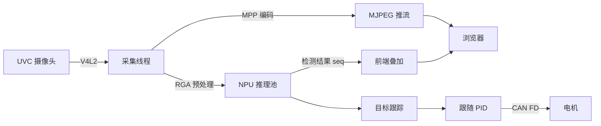

<div align="center">


# 🚗 Autonomous Driving Car

**一台开箱即用的视觉循迹小车：摄像头上车 → NPU 出框 → 点框锁定 → CAN 驱动车轮，全程在浏览器里操作。**

[](https://radxa.com)
[](#)
[](#)
[](#)
[](LICENSE)

**🌐 语言 / Language：** [**中文**](#-中文手册) · [**English**](#-english-manual)

</div>

---

<h1 id="-中文手册">📖 中文手册</h1>

<div align="right"><a href="#top">⬆ 回到顶部 / back to top</a></div>

## 一、这是什么

**这是一套跑在 Radxa ROCK 4D（RK3576）上的自动驾驶小车固件 + 控制台。**

它把一辆差速小车的全部环节做进了一个 C 进程：摄像头采集、NPU 目标检测、目标跟踪、PID 跟随、
CAN 电机输出、视频推流，以及一个不用装任何客户端的网页控制台。板上电、连 WiFi，
手机或电脑浏览器打开就能看到实时画面并开始驾驶。

**为什么不用现成的方案？**
树莓派 + ROS 那套在这块板子上跑不动 720p30 的实时闭环——CPU 解码就吃满了。这套实现把解码、预处理、
推理、编码全部压在硬件单元上（VPU / RGA / NPU），CPU 只做调度，所以能把端到端延迟控制在 300 ms 左右，
同时把控制环放进实时内核的 FIFO 线程里，避免"看到了但来不及刹车"。

**用它你能做什么**

| 场景 | 怎么做 |
|---|---|
| 视觉循迹 / 跟车 | 画面点框锁定目标 → 控制器按目标位置偏差算左右轮速差 → CAN 下发 |
| 目标检测演示 | 不接电机也能跑：画面实时出框，检测结果与截帧同帧对齐，可回放、可导出 |
| 边缘推理基准 | `/status` 实时展示 NPU/RGA/CPU 占用与端到端延迟，配合 `docs/LATENCY_PROFILE.md` |
| 板上 AI 助手 | 内置 Codex 对话与额度显示，直接在车机上问"刚才那帧检测到什么" |

**关键指标（实测，720p30）**

| 指标 | 数值 |
|---|---|
| 采集 → 显示端到端延迟 | ≈ 300 ms（页面底部实时可见） |
| 推理帧率 | 30 fps（YOLO26n 640，4 线程 + RGA） |
| 控制环周期抖动 | < 1 ms（FIFO + CPU 隔离） |
| 空闲内存占用 | ≈ 36 MB（服务进程） |

## 二、五分钟跑起来

```bash
# ① 依赖
sudo apt install -y build-essential cmake git python3 curl

# ② 编译（约 40 秒）
cd ~/autonomous-driving-car && ./scripts/build.sh -R
#    预期：[BUILD] done -> /home/qianruo/autonomous-driving-car/bin/autonomous-driving-car

# ③ 部署（会重启服务）
sudo ./scripts/deploy.sh -i
#    预期：=== deploy complete ===

# ④ 自检
curl -s -u qianruo:qianruo http://127.0.0.1/api/system | head -c 120
```

浏览器打开 `http://192.168.1.7/`，应看到实时画面和右上角的 FPS 徽标。

## 三、完整操作流程

### 3.1 环境准备（新板子第一次）

```bash
# 硬件是否就绪
ls /dev/rga /dev/dri/renderD128          # RGA + NPU
v4l2-ctl --list-devices                  # 摄像头，默认 /dev/video2
systemctl status proxy-client --no-pager # 联网代理（可选）

# 依赖库
ls /usr/local/lib/librga.so /usr/lib/librknnrt.so
```

缺少 RKNN 运行时或 MPP 时，服务能起来但画面/推理会失败，日志里会明确报错。

### 3.2 编译与部署

```bash
./scripts/build.sh -R          # Release；-D 为 Debug
sudo ./scripts/deploy.sh -i    # 安装到 /opt/autonomous-driving-car
sudo ./scripts/deploy.sh -u    # 卸载
```

`deploy.sh` 会依次：校验模型 → 停旧服务 → 同步配置与模型 → 拷贝二进制/前端/桥接脚本 →
写 systemd 单元 → 启服务并打印状态。

### 3.3 网页端操作

**主界面 `/`**
1. 打开即自动连接 MJPEG 流；右上角 FPS、底部显示「采集 FPS · 处理延迟 · 端到端延迟 · 丢帧」
2. 画面出现识别框后，**点击框**即锁定目标开始追踪；再点一次取消
3. 右侧「Codex 对话」可直接提问（需先在 `/config` 登录）

**系统配置 `/config`**（七张卡片）

| 卡片 | 操作步骤 |
|---|---|
| YOLO 检测 | 调置信度/NMS → 需要换模型时选 `.rknn` 与 `.names` →「上传」→「保存」 |
| CPU 频率 | 选策略组 → 选调度器 → 设最低/最高频率 →「保存」 |
| 网络代理 | 顶部开关即时启停整机代理；改主机/端口/协议 →「保存」；「测试」「测速」结果出在标题栏 |
| Web 与匿名助手 | 选网卡、IP 模式、ANO 端口与发送频率 →「保存」 |
| 视频采集 | 选设备与分辨率帧率 →「保存」 |
| 智能跟随 | 控制状态（停止/启用）、目标、速度策略；四个分组各有独立保存按钮 |
| Codex CLI | 登录/退出、模型与推理速率、可用额度、检查更新/安装更新 |

> 首次写操作会弹出「需要管理员权限」，输入 `root` 或 `sudo` 组账号（密码同登录密码）。
> 凭据只存在当前标签页的 `sessionStorage`，不会外发。

### 3.4 接电机（可选）

```bash
cp config/car_motor_can.example.conf config/car_motor_can.conf
# 按电机手册填写 cmd_id / offset / width / scale / stop_template
sudo ./scripts/deploy.sh -i
```

然后在 `/config` 顶部「启用 CAN」，选接口与波特率，再把「智能跟随」的控制状态设为「启用跟随」。

> **安全**：`enabled 0` 时控制器一个报文都不发。上车前务必确认电机驱动自带独立看门狗。

### 3.5 换模型

- 网页：`/config` → YOLO → 选文件 →「上传」
- 命令行：替换 `config/yolo26.rknn` → `sudo ./scripts/deploy.sh -i`（`model_sync.sh` 保证一致性）
- 量化过程见 [docs/YOLO26N_QUANTIZATION.md](docs/YOLO26N_QUANTIZATION.md)

### 3.6 Codex 助手

| 动作 | 位置 | 说明 |
|---|---|---|
| 登录 | `/config` → Codex →「登录」 | 设备码，15 分钟内有效；复制按钮兼容 http 非安全上下文 |
| 对话 | 主界面右侧 | `codex exec --json`，后台执行不阻塞网页 |
| 额度 | Codex 卡片 | 5 小时 / 每周两条，显示**剩余可用**，额度用尽会标红 |
| 升级 | 「安装更新」 | 后台 systemd 单元下载安装，进度实时显示 |

交互记录是纯文本，位置 `recordings/codex/chat_YYYYMMDD.txt`：

```
23:18:38 你：你好
23:19:04 Codex：……
23:19:20 错误：……
```

## 四、系统架构



**为什么用 `seq`**：画面帧和检测结果共享采集序号，前端按 `seq` 把框贴回对应那一帧，
所以不会出现"框比画面慢几帧"的错位；丢帧也能被准确统计。

```text
source/core        配置读写、日志
source/http        HTTP 服务与全部 API
source/video       V4L2 采集 · MPP 编码 · MJPEG
source/yolo        RKNN 推理池（多线程 + RGA）
source/control     跟随控制器（PID · 死区 · 限幅）
source/can         CAN FD 与电机协议映射
source/telemetry   匿名助手（ANO）
html/              前端（无构建步骤）
scripts/           build · deploy · model_sync · proxy_config · codex_bridge · git_sync
config/            运行期配置（可被网页修改）
docs/              设计、性能、测试文档
```

服务以 root 运行但有沙箱：`ProtectSystem=strict`、`ProtectHome=read-only`、`PrivateTmp=yes`，
仅 `config/`、`recordings/`、`.codex/` 可写 —— 所以 Codex 升级必须借 `systemd-run` 逃到宿主命名空间。

## 五、界面

<div align="center">

| 系统配置 | 系统状态 |
|:---:|:---:|
|  |  |

</div>

## 六、接口速查

```text
GET  /api/system              CPU/内存/磁盘/温度/NPU/RGA
GET  /api/config              运行配置            POST 保存
GET  /api/video/devices       摄像头枚举
GET  /api/video/stats         采集/推理统计
GET  /api/follow              跟随状态            POST 参数
GET  /api/proxy/config        代理配置（含开关）
POST /api/proxy/config        保存/应用代理
GET  /api/codex/status        登录与运行状态
GET  /api/codex/models        模型目录（缓存 1h）
GET  /api/codex/quota         额度（缓存 60s）
POST /api/codex/chat          发起对话
POST /api/codex/update/install 后台升级
GET  /api/codex/update/status  升级进度
```

## 七、文档

| 文档 | 内容 |
|---|---|
| [CODE_REVIEW](docs/CODE_REVIEW.md) | 代码评审与已知问题 |
| [COMMUNICATION_FLOW](docs/COMMUNICATION_FLOW.md) | 模块/线程通信与队列 |
| [FRAME_PIPELINE](docs/FRAME_PIPELINE.md) | 帧流水线时序 |
| [LATENCY_PROFILE](docs/LATENCY_PROFILE.md) | 端到端延迟剖析 |
| [REALTIME_SCHEDULING](docs/REALTIME_SCHEDULING.md) | PREEMPT_RT · FIFO · CPU 隔离 |
| [FUNCTIONAL_TEST_REPORT](docs/FUNCTIONAL_TEST_REPORT.md) | 功能测试报告 |
| [YOLO26N_QUANTIZATION](docs/YOLO26N_QUANTIZATION.md) | YOLO26n RKNN 量化 |
| [推理流水线延迟剖析](docs/pdf/推理流水线延迟剖析.pdf) | PDF |
| [YOLO26n 量化报告](docs/pdf/YOLO26n量化报告.pdf) | PDF |

## 八、排障

| 现象 | 检查 |
|---|---|
| 画面黑屏 | `curl /api/video/devices`；`fuser -v /dev/video2` |
| 检测框不出现 | `curl /api/detections/live`；模型与 names 是否匹配 |
| 样式全丢 | `curl /css/config.css` 应为 200 且字节数与磁盘一致 |
| 保存报 401 | 管理员凭据失效，弹框重新输入 |
| 小车不动 | `car_motor_can.conf` 缺失或 `enabled 0`；CAN 是否启用 |
| 更新卡住 | `releases.openai.com` 不通，脚本回退 GitHub，187 MB 很慢 |

---

<h1 id="-english-manual">📖 English Manual</h1>

<div align="right"><a href="#top">⬆ back to top</a></div>

## 1. What it is

**Firmware plus web console for a differential-drive car on Radxa ROCK 4D (RK3576).**

Capture, NPU detection, tracking, PID following, CAN motor output, MJPEG streaming and a browser
console all live in one C process. Power the board, join WiFi, open the page — the live view is there
and the car is drivable.

**Why not ROS on a Pi?** A 720p30 closed loop does not fit: software decode alone saturates the CPU.
Here decode, preprocessing, inference and encode all run on hardware blocks (VPU / RGA / NPU), so the
CPU only schedules. End-to-end latency stays around 300 ms and the control loop runs as a FIFO thread
on a PREEMPT_RT kernel.

| Metric (720p30) | Value |
|---|---|
| End-to-end latency | ≈ 300 ms (shown live at the bottom of the main page) |
| Inference rate | 30 fps (YOLO26n 640, 4 threads + RGA) |
| Control jitter | < 1 ms (FIFO + CPU isolation) |
| Idle RSS | ≈ 36 MB |

## 2. Five-minute start

```bash
sudo apt install -y build-essential cmake git python3 curl
cd ~/autonomous-driving-car && ./scripts/build.sh -R
sudo ./scripts/deploy.sh -i
curl -s -u qianruo:qianruo http://127.0.0.1/api/system | head -c 120
```

Open `http://192.168.1.7/`, then click a detection box to start tracking.

## 3. Workflow

1. **Build** — `./scripts/build.sh -R` produces `bin/autonomous-driving-car`.
2. **Deploy** — `sudo ./scripts/deploy.sh -i` syncs config/model, installs to
   `/opt/autonomous-driving-car`, writes the systemd unit and restarts.
3. **Configure** — `/config`: YOLO threshold and model, CPU governor, proxy, camera, follow PID,
   Codex CLI. Every card has its own Save button; the admin dialog (root or any `sudo` account) is
   requested on the first write and kept in `sessionStorage`.
4. **Drive** — on `/`, click a box to lock the target; the controller converts the offset into a
   left/right wheel delta and publishes it on CAN FD.
5. **Motor setup** (optional) — copy `config/car_motor_can.example.conf` to
   `config/car_motor_can.conf`, fill in the vendor protocol, enable CAN in `/config`, then set the
   follow controller to *Enable follow*.
6. **Upgrade models** — upload through the UI or replace `config/yolo26.rknn` and redeploy.
7. **Iterate** — `./scripts/git_sync.sh "message"` commits and pushes.

## 4. Architecture

Same diagram as the Chinese section: capture → NPU pool → (detections, `seq`) → overlay / tracker →
PID → CAN; frame and detection share the capture sequence, so overlays never drift.

The service is sandboxed (`ProtectSystem=strict`, `ProtectHome=read-only`, `PrivateTmp=yes`), with
only `config/`, `recordings/` and `.codex/` writable — hence the Codex upgrade uses a transient
`systemd-run` unit outside the sandbox.

## 5. Documentation

All design, latency and quantisation documents are listed in the [documentation table](#七文档)
above; links are verified to exist on every commit.

## 6. Troubleshooting

| Symptom | Check |
|---|---|
| Black preview | `/api/video/devices`, `fuser /dev/video2` |
| No detections | `/api/detections/live`, model/names mismatch |
| Styles missing | `/css/config.css` must return 200 with matching byte size |
| 401 on save | Re-enter admin credentials |
| Car does not move | `car_motor_can.conf` missing or `enabled 0`, CAN disabled |

---

<div align="center">

**GPL-3.0-or-later © qianruo-orange** · [LICENSE](LICENSE) · [⬆ back to top](#top)

</div>
