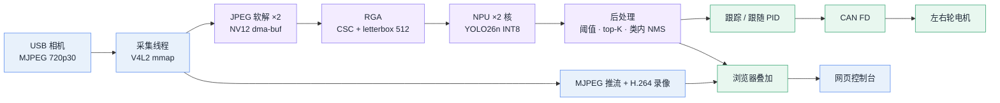
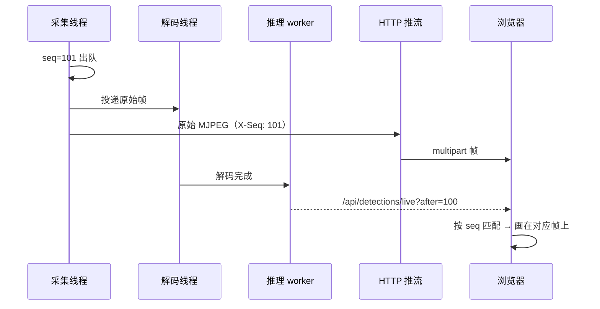
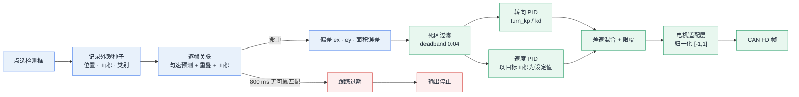
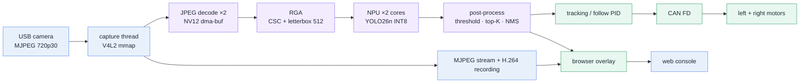

<a id="top"></a>

<div align="center">


# Autonomous Driving Car

**Radxa ROCK 4D（RK3576）上的视觉循迹小车：从相机到电机的整条链路跑在一个 C 进程里，连上 WiFi 打开网页就能开。**

[](#)
[](https://radxa.com)
[](#)
[](#)
[](#)
[](LICENSE)

[**中文**](#zh) · [**English**](#en)

</div>

---

<a id="zh"></a>

## 目录

- [这是什么](#这是什么)
- [实测指标](#实测指标)
- [整体架构](#整体架构)
- [帧流水线](#帧流水线)
- [跟踪与跟随控制](#跟踪与跟随控制)
- [实时调度与绑核](#实时调度与绑核)
- [网页控制台](#网页控制台)
- [构建与部署](#构建与部署)
- [配置与模型](#配置与模型)
- [HTTP API](#http-api)
- [仓库结构](#仓库结构)
- [日志与排障](#日志与排障)
- [已知限制](#已知限制)
- [参考文档](#参考文档)

---

## 这是什么

一辆差速小车的完整固件。摄像头采集、硬件加速推理、目标跟踪、PID 跟随、CAN FD 电机输出、视频推流、录像与回放，加上一个零安装的网页控制台，全部编译进同一个 C 可执行文件，由 systemd 托管。

设计上只有一条主线：**把像素处理压在硬件单元上，让 CPU 只做调度**。解码走 libjpeg-turbo 双线程，色彩转换与 letterbox 走 RGA，推理走 NPU 双核；实时画面直接转发相机原生 MJPEG、不做二次编码，录像才用板载 MPP 编成 H.264 fMP4。因此 720p30 的实时闭环在一颗嵌入式 SoC 上只占用约 4% 的整机 CPU。

| 能做什么 | 说明 |
|---|---|
| 视觉循迹 / 跟车 | 在画面上点选一个检测框，车自动转向并保持距离；目标丢失立即停车 |
| 纯检测演示 | 不接电机也能跑：实时出框、同帧对齐、检测结果可回放导出 |
| 边缘推理基准 | `/status` 看 NPU / RGA / CPU 逐核占用与端到端延迟曲线 |
| 分段录像 | 把原始画面按段编成 H.264 fMP4，浏览器内播放、打包下载 |
| 板上 AI 助手 | 内置 Codex 对话与额度显示，直接在车机上排查问题 |
| 总线调试 | DBC 解析、CAN 报文抓取与发送、信号在线解码 |

> **为什么不是树莓派 + ROS？**
> 720p30 的闭环在 Pi 上跑不动，光是软件解码就吃满 CPU。这里的取舍是：单进程共享内存，帧以 DMA-BUF 在采集、RGA、NPU 之间流转，不做序列化和拷贝；控制线程跑在 PREEMPT_RT 的 FIFO 优先级上，避免"看到了但来不及刹车"。代价是没有 ROS 生态，所有模块都要自己写。

---

## 实测指标

以下数字取自 2026-11-07 板端 `/api/video/stats`、`/api/system` 与运行日志的实际采样，不是理论值。

| 指标 | 数值 | 采集位置 |
|---|---|---|
| 端到端处理延迟 | **80 ms**（最大 128 ms） | `processing_age_ms` |
| 采集 | 1280×720 MJPEG，30.0 fps | `capture_fps` |
| 丢帧 | 采集 0 / 驱动 0 / 推理 0 | `*_dropped` |
| NPU 推理 | 512×512，双核，`run` 8–10 ms | `yolo timing` |
| JPEG 解码 | 2 线程并行，约 5 ms/帧 | `yolo timing` |
| 整机 CPU | ≈ 4%（60 s 平均），4×2016 + 4×2208 MHz | `/api/system` |
| 常驻内存 | 76 MB RSS / 18 线程 | `ps` |
| 温度 | 59 ℃，满载无风扇 | `/api/system` |
| 模型精度 | mAP50 **0.591** / mAP50-95 **0.434** | `tools/model` 留出集 |

---

## 整体架构



**模块表驱动的生命周期。** 所有常驻线程（名称、初始化顺序、调度策略、优先级、CPU 分组）集中声明在 `source/core/main.c` 的一张表里：按依赖顺序初始化，启动失败回滚连续前缀，退出时按相反顺序析构，并以 5 秒为限逐个 join。新增模块只要扩表，不用改调度代码。

**采集序号 `seq` 是贯穿全链路的主键。** 每一帧出队时拿到自增序号，解码、推理结果、推流帧、前端叠加都带着它。前端按 `seq` 把框贴回对应那一帧，因此框不会比画面慢几帧，丢帧也能被精确统计。



---

## 帧流水线

```mermaid
flowchart LR
    A["V4L2 采集<br/>1280×720 MJPEG"] -->|"mmap + claim"| B["libjpeg-turbo<br/>→ NV12 dma-buf"]
    B -->|"dma-buf 零拷贝"| C["RGA<br/>CSC + letterbox"]
    C -->|"RGB 512×512"| D["NPU<br/>RKNN 推理"]
    D --> E["解码输出<br/>INT8 类别 + FP16 框"]
    E --> F["阈值 · top-K<br/>类内 NMS"]
    F --> G["检测列表<br/>带 seq"]

    classDef io fill:#e8f1fb,stroke:#5b8def,color:#1f2937
    classDef hw fill:#f3ecff,stroke:#8f7cf0,color:#1f2937
    classDef out fill:#e8f7ef,stroke:#3aa675,color:#1f2937
    class A,G io
    class B,C,D hw
    class E,F out
```



**80 ms 的构成**（实测 `yolo timing`）：

| 环节 | 耗时 | 说明 |
|---|---:|---|
| 相机侧 | 33 ms | 驱动时间戳 → DQBUF 返回，UVC 固有的一帧延迟 |
| JPEG 软解 | 5 ms | 双线程并行，`deliver_to_decode = 0` 说明应用自身没有排队 |
| RGA CSC + letterbox | 1–2 ms | 一趟完成 NV12→RGB、缩放、居中填充 |
| NPU run | 9–10 ms | 512×512，双核各挂一个 worker |
| 后处理 | ≈ 1 ms | 逐锚点扫描 + 类内 NMS |
| 渲染节拍 | ≤ 33 ms | 叠加流按 30 fps 提交，最多等一个帧周期 |

几个关键取舍：

- **在途上限 2 帧**（`YOLO_MAX_INFLIGHT`）。解码拆成双线程后生产速率追平相机，若不设上限，队列会永久积压，端到端一度涨到 169 ms；限制在途为 2 后稳定在 80 ms，且 `infer_dropped` 保持 0。
- **跳帧策略**：推理跟不上时丢最旧的帧，保证画面永远是最新的，丢帧数在 `/api/video/stats` 可见。
- **全硬件通路**：RGA 缺失时推理池直接拒绝启动，不静默回退到 CPU 缩放。
- **性能调速器**：`ondemand` 会在 33 ms 帧间隔内降频，下一帧爬频导致解码/缩放/NMS 抖动（E2E 60±7 → 46±0.5 ms）。仓库默认写 `performance`，由 `/api/cpu_freq` 持久化。

---

## 跟踪与跟随控制

不做自动跟踪，避免误锁背景：**点哪个框就锁哪个**。



默认参数（`/api/follow` 可读写，重启后跟随默认关闭）：

| 参数 | 默认 | 作用 |
|---|---|---|
| `max_speed` | 0.30 m/s | 单轮速度上限 |
| `max_turn_delta` | 0.15 m/s | 左右轮差速上限 |
| `deadband` | 0.04 | 中心误差死区，防停车抖动 |
| `timeout_ms` | 300 ms | 目标丢失后多久强制停车 |
| `speed_kp` | 0.40 | 面积误差 → 速度 |
| `turn_kp` / `turn_kd` | 0.15 / 0.003 | 横向误差 → 差速 |
| `wheel_kp` / `wheel_ki` | 1.00 / 0.10 | 轮速闭环（有实测反馈时启用） |

安全设计：

- **控制线程不是固定节拍**：每次新检测结果唤醒一次，50 ms 超时兜底，所以控制频率跟随推理帧率，而不是空转。
- **双层限幅**：速度与差速各自限幅，PID 参数写错也不会全速冲出去。
- **积分限幅**：轮速环的 I 项单独限幅，避免长距离直道积分饱和。
- **失效保护**：目标丢失超过 `timeout_ms`、反馈超时、推理停滞超过 1 秒，任一条成立都立即输出停止命令；看门狗漏报 3 次则整个服务失败退出，由 systemd 拉起。
- **电机协议不写死**：`config/car_motor_can.conf` 用 ID / 偏移 / 位宽 / 缩放描述命令与反馈帧，只有校验通过才绑定；未配置时控制器启动即关闭，不会向总线瞎发。

---

## 实时调度与绑核

RK3576 是 4×Cortex-A53 + 4×Cortex-A72。分组按 SoC 写死在 `cpu_affinity.c`，不在运行时探测。

| 线程 | 策略 / 优先级 | CPU 组 |
|---|---|---|
| main · TCP · HTTP reactor | FIFO 5 | LITTLE |
| HTTP worker · 推理日报 | FIFO 1 | LITTLE |
| 图像渲染 · 录像 | FIFO 10 | BIG |
| NPU 推理 worker | FIFO 12 | BIG |
| JPEG 软解 ×2 · 相机采集 | FIFO 15 | BIG |
| CAN 收发 | FIFO 15 | LITTLE |
| **跟随控制** | **FIFO 20** | LITTLE |
| 看门狗 | FIFO 30 | LITTLE |

- 采集线程固定在 FIFO 15 绑大核：它绝大部分时间阻塞在 `DQBUF`，每 33.3 ms 唤醒一次只做入环，单次运行 < 1 ms。早先版本用 `SCHED_DEADLINE`，代价是内核要求 deadline 线程亲和性覆盖整个 root domain，只能在 8 个核之间漂移，最坏单次运行 0.867 ms；改绑核 FIFO 后降到 0.48 ms。
- 解码优先级高于推理（15 > 12），保证推理取帧时数据已就绪。
- **cgroup v2 陷阱**：内核启用 `CONFIG_RT_GROUP_SCHED` 时，服务子组可能没有实时预算，申请 FIFO 返回 `EPERM`。`scripts/deploy.sh` 会在停机前检查并在根 slice 上设 `DisableControllers=cpu`，验证生效后才安装。
- 跟随控制接口会回报实际拿到的策略、优先级与内核是否 RT，不是"配置了就算成功"。

---

## 网页控制台

纯静态 HTML/CSS/JS，无构建步骤，无外部 CDN 依赖，中英双语 + 明暗主题，手机浏览器可用。

| 页面 | 用途 |
|---|---|
| `/` | 实时画面、点框追踪、FPS 与延迟读数、Codex 对话 |
| `/status` | CPU 逐核占用与频率、温度、NPU / RGA、内存磁盘、网络速率 |
| `/config` | 相机、YOLO、CPU 调频、跟随、录像、网络与代理、Codex |
| `/logs` | 日志、录像、检测日报、文件打包下载 |
| `/dbc` | DBC 上传解析、实时报文、在线信号解码与发送 |

<div align="center">

| 系统配置 | 系统状态 |
|:---:|:---:|
|  |  |

</div>

认证走 HTTP Basic，账号密码即系统账户（`getpwnam` + `crypt` 校验），失败按来源 IP 做窗口限速并短暂封禁，避免 crypt 被打成 CPU DoS。

---

## 构建与部署

**前置条件**：Radxa ROCK 4D（RK3576）、PREEMPT_RT 内核、板端 `librknnrt` 2.5.0、`librockchip_mpp`、`librga`，以及与运行时匹配的 `config/yolo26.rknn`（模型不入库，见 [模型链路](tools/model/README.md)）。

```bash
sudo apt install -y build-essential cmake git python3 curl libnl-3-dev libnl-route-3-dev \
                    libjpeg-turbo8-dev librga-dev

# 编译（Release，约 40 秒）
cd ~/autonomous-driving-car && ./scripts/build.sh -R

# 部署（安装到 /opt，注册并重启 systemd 服务）
sudo ./scripts/deploy.sh -i

# 自检
curl -s -u qianruo:qianruo http://127.0.0.1/api/video/stats
```

| 脚本 | 参数 | 说明 |
|---|---|---|
| `scripts/build.sh` | `-R` Release / `-D` Debug / `-C` 清理 | 构建前会 `model_sync.sh reconcile` 校验模型与哈希 |
| `scripts/deploy.sh` | `-i` 安装 / `-u` 卸载 / `-r` 重装 | 处理 cgroup v2 实时预算，安装 systemd 单元 |
| `scripts/git_sync.sh` | `"提交信息"` | 提交工作区改动并推送到 origin，部署后保持板端与仓库一致 |
| `scripts/model_sync.sh` | `reconcile` / `validate` | 模型落位、校验、部署前后哈希比对 |
| `scripts/codex_bridge.py` | — | Codex 对话桥接，独立于 HTTP worker 运行 |

部署后目录为 `/opt/autonomous-driving-car`，服务以 `ProtectSystem=strict` 沙箱运行，只放开 `config/`、`recordings/`、`.codex/` 与 `/etc/proxy-client.conf` 可写，`html/` 只读。构建会生成 `include/core/version.h`（版本、提交号、分支、构建时间），页面右上角显示的就是它。

---

## 配置与模型

| 文件 | 入库 | 说明 |
|---|:--:|---|
| `config/config.txt` | ✗ | 主配置：相机、YOLO、CAN、网卡（网页保存） |
| `config/follow.conf` | ✗ | 跟随 PID 与限幅（网页保存） |
| `config/car_motor_can.conf` | ✗ | 电机协议映射，由 example 复制后改 |
| `config/car_motor_can.example.conf` | ✓ | 协议字段说明与示例 ID，**不是可用电机参数** |
| `config/cpu_freq.conf` | ✗ | 调频策略，默认 performance 固定高频 |
| `config/ano.conf` | ✗ | ANO V8 遥测采样配置 |
| `config/yolo26.rknn` | ✗ | 运行时模型，构建与部署按哈希校验 |
| `config/coco.names` | ✓ | 80 类标签 |
| `config/can0.dbc` · `can1.dbc` | ✓ | DBC 示例，可在网页上传替换 |

运行期配置一律不入库，避免每次调参都污染提交历史。

---

## HTTP API

接口以 JSON 为主（个别写接口返回纯文本状态），除页面与静态资源外均需 Basic 认证。

| 分组 | 端点 |
|---|---|
| 系统 | `GET /api/system` · `GET /api/cpu_freq` · `GET/POST /api/config` · `POST /api/reboot` · `POST /api/shutdown` |
| 视频 | `GET /api/video/devices` · `/caps` · `/stats` · `/api/camera` · `/api/tracking` |
| 检测 | `GET /api/detections/live?after=<seq>` · `/api/detections/reports` · `POST /api/yolo/upload` |
| 跟随 | `GET/POST /api/follow` |
| 录像 | `POST /api/rec/start` · `/stop` · `/split` · `GET /api/rec/status` · `/list` · `/pack` · `/delete` |
| 文件 | `GET /api/files/...` · `/download-session` · `/video-session` · `POST /api/files/pack` |
| CAN | `GET /api/can/ifaces` · `/frames` · `/decoded` · `POST /api/can/toggle` · `/send` · `/dbc` |
| 网络 | `GET /api/network` · `/ifaces` · `GET/POST /api/proxy/config` · `/api/nettest` |
| 日志 | `GET /api/logs` · `POST /api/logs/clear` |
| ANO 遥测 | `GET/POST /api/ano` |
| Codex | `GET /api/codex/status` · `/models` · `/quota` · `/history` · `POST /api/codex/chat` · `/update/install` |

---

## 仓库结构

```text
source/                 C 实现（约 1.7 万行）
├── core/               模块表、配置读写、日志、CPU 亲和性、通用容器
├── http/               epoll reactor + worker、全部 REST 接口、静态文件
├── video/              V4L2 采集 · 帧环 · RGA 预处理 · fMP4 录像 · JPEG 解码
├── yolo/               RKNN 推理池（多 worker + 在途限流）、后处理、事件分发
├── control/            跟随控制（PID · 死区 · 限幅 · 电机适配）与视觉跟踪
├── can/                CAN FD socket、DBC 解析、电机协议映射
├── tcp/                共享 TCP 事件循环（ANO 遥测复用）
├── telemetry/          ANO V8 采样帧编码与校验
└── watchdog/           线程心跳与失活处置
include/                对应头文件（含 RKNN 厂商接口）
html/                   前端，无构建步骤（5 个页面 + 28 个 JS/CSS）
scripts/                build · deploy · model_sync · git_sync · codex_bridge · proxy_config
tools/model/            离线模型链路：数据集 → ONNX → RKNN → 评测
docs/                   设计、延迟、调度、量化、测试与评审文档
config/                 运行期配置与标签、DBC、模型
```

---

## 日志与排障

| 位置 | 内容 |
|---|---|
| `journalctl -u autonomous-driving-car -f` | 服务日志（含 `yolo timing` / `handoff` 每 10 秒一行） |
| `recordings/logs/log_info_YYYYMMDD.log` | 按天切分的运行日志 |
| `recordings/videos/video_YYYYMMDD_N.mp4` | 分段录像（H.264 fMP4） |
| `recordings/results/` | 检测日报 |
| `recordings/codex/` | 对话记录与升级日志 |
| `recordings/proxy-backups/` | 代理配置改动前的备份 |

| 现象 | 排查 |
|---|---|
| 画面黑屏 | `curl /api/video/devices` 看设备是否存在；`fuser -v /dev/video2` 查占用 |
| 有画面没框 | `curl /api/detections/live`；模型输入尺寸与 `coco.names` 是否匹配 |
| 服务起不来 | 日志里找 `create thread ... EPERM`，多为实时调度预算被 cgroup 掐掉 |
| 服务反复重启 | `YOLO inference stalled > 1s` 触发故障保护，先看 NPU 是否被别的进程占用 |
| 延迟突然变高 | `/api/video/stats` 的 `processing_age_max_ms` 与 `infer_dropped`；查是否切回 `ondemand` 调频 |
| 小车不动 | `car_motor_can.conf` 缺失或 `enabled 0`；`/api/can/ifaces` 确认接口 up |
| 两侧轮子反向 | 反馈 `fb_scale` 符号或电机安装方向，不是 PID 问题 |
| 保存报 401 | 会话过期，重新弹框输入；连续失败会触发 IP 限速 |
| 样式全丢 | `curl /css/common.css` 应为 200，字节数与磁盘一致 |

---

## 已知限制

诚实列出来，避免误用：

- **CAN 与电机闭环未在本机验收**：仓库只有协议示例，没有绑定具体电机型号；实车闭环、CAN FD 总线收发与在线 DBC 解码需自行配置后验证。
- **单目标**：同时只跟一个目标，多目标切换会重置外观种子。
- **手工选点**：没有车道线检测或语义分割，循迹依赖 YOLO 的 80 类目标。
- **MJPEG 推流**：延迟可控但带宽不低，弱网下不如 WebRTC；硬件 JPEG 解码器存在同帧多次解码不一致的缺陷，因此固定用软件解码。
- **硬件编码只做了短时验证**：录像用 MPP 编 H.264，产物能被 ffprobe 正常解析，但没有做过小时级压测与异常掉电测试。
- 其余并发与边界问题见 [CODE_REVIEW](docs/CODE_REVIEW.md)，未全部修复，状态逐条标注。

---

## 参考文档

| 文档 | 内容 |
|---|---|
| [LATENCY_PROFILE](docs/LATENCY_PROFILE.md) | 80 ms 的逐环节剖析，以及被验证否定掉的优化 |
| [REALTIME_SCHEDULING](docs/REALTIME_SCHEDULING.md) | 线程策略、绑核依据、cgroup 实时预算处理 |
| [FRAME_PIPELINE](docs/FRAME_PIPELINE.md) | 帧发布、订阅、claim 与模型校验 |
| [COMMUNICATION_FLOW](docs/COMMUNICATION_FLOW.md) | 模块注册表、队列与背压 |
| [YOLO26N_QUANTIZATION](docs/YOLO26N_QUANTIZATION.md) | INT8 类别 + FP16 框的量化过程与精度 |
| [FUNCTIONAL_TEST_REPORT](docs/FUNCTIONAL_TEST_REPORT.md) | 105 项接口回归、浏览器与隔离验证记录 |
| [CODE_REVIEW](docs/CODE_REVIEW.md) | 代码审查与未修复问题清单 |
| [模型链路](tools/model/README.md) | checkpoint → ONNX → RKNN 的离线工具 |
| [推理流水线延迟剖析（PDF）](docs/pdf/推理流水线延迟剖析.pdf) · [YOLO26n 量化报告（PDF）](docs/pdf/YOLO26n量化报告.pdf) | 出版版报告 |

内核侧（PREEMPT_RT、NPU/RGA 驱动、调频补丁）在独立仓库：[qianruo-orange/rock-4d-npu-kernel](https://github.com/qianruo-orange/rock-4d-npu-kernel)。

## 路线图

- [ ] 多目标同时跟随与目标切换
- [ ] 车道线检测替代手工选点
- [ ] WebRTC 低延迟推流替代 MJPEG
- [ ] 用板端采集的数据做端侧微调
- [ ] CAN 电机协议的更多实测型号

---

<div align="right"><a href="#top">⬆ 回到顶部</a></div>

<a id="en"></a>

---

# English

**A vision-guided differential-drive car on Radxa ROCK 4D (RK3576).** Capture, NPU inference, tracking, PID following, CAN FD motor output, streaming and the web console all live in one C process, supervised by systemd. Power the board, join WiFi, open the page — the car is drivable.

## Measured on hardware

| Metric | Value |
|---|---|
| End-to-end processing latency | **80 ms** (max 128 ms) |
| Capture | 1280×720 MJPEG, 30.0 fps, 0 dropped frames |
| NPU inference | 512×512 YOLO26n, two cores, 8–10 ms per frame |
| JPEG decode | 2 threads, ~5 ms per frame |
| Whole-board CPU | ≈ 4 % (60 s average) |
| Resident memory | 76 MB RSS, 18 threads |
| Model accuracy | mAP50 0.591 / mAP50-95 0.434 |

Numbers come from `/api/video/stats`, `/api/system` and runtime logs, not from estimates.

## Architecture



Every thread — name, init order, scheduling policy, priority, CPU cluster — is declared in one table in `source/core/main.c`. Modules initialise in dependency order, roll back on failure, and are destroyed in reverse order with a 5-second join deadline.

Each frame carries a monotonic capture sequence `seq`. Detections, streamed frames and the overlay all reference the same `seq`, so boxes never drift from the picture and dropped frames are counted exactly.

## Frame budget (80 ms)

| Stage | Cost | Note |
|---|---:|---|
| Camera + driver | 33 ms | driver timestamp to `DQBUF`, inherent UVC latency |
| JPEG decode | 5 ms | two threads in parallel, no application-side queueing |
| RGA CSC + letterbox | 1–2 ms | NV12 → RGB, resize and padding in one pass |
| NPU run | 9–10 ms | 512×512, one worker per core |
| Post-process | ≈ 1 ms | anchor scan + class-wise NMS |
| Render cadence | ≤ 33 ms | overlay stream submits at 30 fps |

In-flight frames are capped at 2 (`YOLO_MAX_INFLIGHT`). With dual-thread decoding the producer caught up with the camera and the queue grew without bound — latency hit 169 ms. Capping in-flight depth brought it back to 80 ms with `infer_dropped` at 0.

## Following

No auto-tracking: you click a box, that box is followed. Detections are associated frame to frame by constant-velocity prediction, overlap and area, expiring after 800 ms. Steering and speed PIDs are mixed into wheel targets, clamped by `max_speed` and `max_turn_delta`, and mapped to CAN frames by a validated `car_motor_can.conf`. Target loss beyond `timeout_ms`, stale wheel feedback, or an inference stall over one second all force a stop command. The controller starts disabled and stays disabled until you enable it.

## Build and deploy

```bash
sudo apt install -y build-essential cmake git python3 curl libnl-3-dev libnl-route-3-dev \
                    libjpeg-turbo8-dev librga-dev
cd ~/autonomous-driving-car && ./scripts/build.sh -R
sudo ./scripts/deploy.sh -i
curl -s -u qianruo:qianruo http://127.0.0.1/api/video/stats
```

Requires a PREEMPT_RT kernel, `librknnrt` 2.5.0, `librockchip_mpp`, `librga`, and a matching `config/yolo26.rknn` (the model is not tracked; see [tools/model](tools/model/README.md)). `deploy.sh` handles the cgroup v2 real-time budget issue before stopping the running service.

## Repository layout

```text
source/    C implementation — core, http, video, yolo, control, can, tcp, telemetry, watchdog
include/   matching headers
html/      static console, five pages, no build step
scripts/   build · deploy · model_sync · git_sync · codex_bridge · proxy_config
tools/     offline model pipeline (dataset → ONNX → RKNN → evaluation)
docs/      latency, scheduling, frame pipeline, quantization, tests, review
config/    runtime config, labels, DBC, model
```

## Limitations

CAN motor closed-loop control is not validated on this unit — the repository ships an example mapping, not a specific motor model. Only one target is followed at a time, tracking relies on manual selection of the 80 COCO classes, and streaming is MJPEG rather than WebRTC. Recording uses the MPP H.264 encoder; output was verified with ffprobe but not soak-tested. Open review findings are tracked in [docs/CODE_REVIEW.md](docs/CODE_REVIEW.md).

## Documentation

[Latency profile](docs/LATENCY_PROFILE.md) · [Real-time scheduling](docs/REALTIME_SCHEDULING.md) · [Frame pipeline](docs/FRAME_PIPELINE.md) · [Communication flow](docs/COMMUNICATION_FLOW.md) · [Quantization](docs/YOLO26N_QUANTIZATION.md) · [Functional test report](docs/FUNCTIONAL_TEST_REPORT.md) · [Code review](docs/CODE_REVIEW.md) · [Model pipeline](tools/model/README.md)

Kernel side (PREEMPT_RT, NPU/RGA drivers, CPU-freq patches): [qianruo-orange/rock-4d-npu-kernel](https://github.com/qianruo-orange/rock-4d-npu-kernel).

## License

GPL-3.0-or-later © qianruo-orange — see [LICENSE](LICENSE).

<div align="right"><a href="#top">⬆ back to top</a></div>
