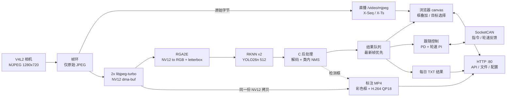
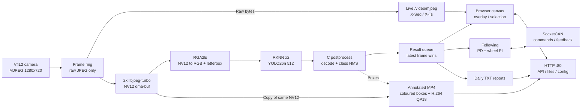

<div align="center">

<h1>Autonomous Driving Car</h1>

<p><strong>C11 &middot; RK3576 &middot; RKNN YOLO26 &middot; RGA / MPP</strong></p>

<p>
<a href="#依赖"></a>
<a href="#依赖"></a>
<a href="#感知流水线"></a>
<a href="#实时调度与绑核"></a>
<a href="LICENSE"></a>
</p>

<p><strong>中文</strong> &middot; <a href="#english-documentation">English</a></p>

</div>

---

## 中文文档

**文档导航**

| 上手 | 架构与实现 | 接口与参考 |
| :--- | :--- | :--- |
| [实测性能](#实测性能)<br>[快速开始](#快速开始)<br>[构建与部署](#构建与部署)<br>[依赖](#依赖) | [系统架构](#系统架构)<br>[感知流水线](#感知流水线)<br>[视觉跟踪与跟随](#视觉跟踪与跟随)<br>[实时调度与绑核](#实时调度与绑核) | [Web 界面](#web-界面)<br>[网络代理](#网络代理)<br>[Codex 对话](#codex-对话)<br>[API 速查](#api-速查)<br>[录像与标注](#录像与标注)<br>[日志、结果与排障](#日志结果与排障) |
| [配置与模型](#配置与模型)<br>[仓库结构](#仓库结构) | [通信注册](#通信注册)<br>[发展方向](#发展方向) | [许可证](#许可证)<br>[专题文档](docs/) |

一个纯 C11 进程里的车载平台：相机采集、RKNN YOLO26 推理、视觉跟踪、差速轮控制、CAN/CAN FD 通信、标注录像和浏览器管理界面跑在一起。源码全是 `.c`，不用 C++，也不需要 OpenCV。Web 界面另附「Codex CLI 对话」与「整机网络代理」配置；**LLM 规划（读取检测结果并参与控制）仍未实现**，Codex 对话只是聊天桥接。

目标板固定为 **Radxa ROCK 4D / RK3576**：NPU 双核、RGA 双核、CPU 大小核分组和模型平台都按这颗 SoC 写死，不做设备能力自发现。

| 环节 | 当前实现 |
| --- | --- |
| 推理链路 | V4L2 MJPEG → libjpeg-turbo 软解为 NV12 dma-buf → RGA（NV12→RGB + letterbox）→ RKNN → C 后处理 |
| 直播 | `/video/mjpeg` 原样转发相机 JPEG，检测框由浏览器 canvas 按帧序号叠加 |
| 标注录像 | 复用推理解出的 NV12 画彩色框，VEPU510 硬编 H.264（FIXQP QP18），存 MP4 |
| 调度 | 全部工作线程 `SCHED_FIFO`；大核 cpu4-7 跑媒体与推理，小核 cpu0-3 跑管理与控制 |
| Web | 端口 80，HTTP Basic 认证，按源 IPv4 分配最多 8 个槽位 |
| 许可证 | [GPL-3.0-or-later](LICENSE) |

除了解码在 CPU 上，其余媒体与推理阶段都走硬件：libjpeg-turbo 把 720p JPEG 解成 NV12（约 5 ms，2 个解码线程各持一个实例并行），RGA 一趟完成色彩转换与缩放，NPU 输出检测张量，CPU 只做后处理与结果分发。

### 实测性能

来自板端部署版本的一次实测（相机请求 30 fps，UVC 实际约 29 fps），数值随配置与负载波动，仅作量级参考：

| 指标 | 数值 |
| --- | --- |
| 端到端延迟 `processing_age_ms` | 约 80 ms，最大 126 ms |
| 每帧流水线工作量 | 约 15 ms（解码 5、RGA 1、NPU 8、后处理 1；解码与 NPU 在不同线程重叠） |
| 整机 CPU 占用 | 约 4 % |
| 每核 NPU / RGA 负载 | 8–13 % / 约 2 % |
| 采集与丢帧 | 请求 30 fps、实测约 29 fps，帧环丢帧 0，`infer_dropped` 0 |

80 ms ≈ 33 ms 相机侧固有延迟 + 约 15 ms 流水线 + 最多一个帧周期的渲染节拍。逐环节数据见[延迟剖析](docs/LATENCY_PROFILE.md)。

### 快速开始

```bash
# 1. 准备 config/yolo26.rknn（512×512、两路输出）与 config/coco.names，模型不入库
bash scripts/build.sh -R          # Release 构建 → bin/autonomous-driving-car
sudo bash scripts/deploy.sh -i    # 安装到 /opt/autonomous-driving-car 并启动服务
curl -s http://127.0.0.1/api/video/stats
curl -s http://127.0.0.1/api/rec/status
```

浏览器打开 `http://<板子IP>/` 进入管理界面。前置条件是带 Rockchip NPU / RGA / MPP 驱动的内核、[用户态依赖](#依赖)和准备好的模型；详见[构建与部署](#构建与部署)。

> [!IMPORTANT]
> 模型 `config/yolo26.rknn`（512×512、两路输出）与 `config/coco.names` **不入库**，首次构建前需自行准备。

### 构建与部署

| 命令 | 作用 |
| --- | --- |
| `bash scripts/build.sh -R` | Release 构建（默认，`-O3 -DNDEBUG -g`） |
| `bash scripts/build.sh -D` | Debug 构建，终端输出 |
| `bash scripts/build.sh -C` | 清除 build/、bin/、CMake 产物并清空工程日志 |
| `sudo bash scripts/deploy.sh -i` | 安装或升级，保留设备设置与录像数据（默认） |
| `sudo bash scripts/deploy.sh -u` | 卸载：停服务并 `rm -rf /opt/autonomous-driving-car`（含配置、日志、录像） |
| `sudo bash scripts/deploy.sh -r` | 先卸载再安装 |

构建产物是 `bin/autonomous-driving-car`。部署会把可执行文件、`html/`、`config/` 装到 `/opt/autonomous-driving-car`，创建 `recordings/{logs,videos,results}/`，安装仓库根的 [autonomous-driving-car.service](autonomous-driving-car.service) 并启动服务。

> [!WARNING]
> systemd 单元以 `WorkingDirectory=/opt/autonomous-driving-car` 运行，开启 `PrivateTmp=yes` 与 `ProtectSystem=strict`，只把 `config/` 和 `recordings/` 列为可写路径——需要落盘的临时文件必须放在 `recordings/` 下，不能写 `/tmp`。

在 cgroup v2 系统上，部署会写入 `/etc/systemd/system/-.slice.d/90-autonomous-driving-car-rt.conf`，允许服务组内创建 FIFO 实时线程；该配置生效期间整个层级的 CPU 配额与权重不可用，卸载时保留，全局 RT 预算不变。

### 依赖

**硬件。** Radxa ROCK 4D（RK3576）、能输出 MJPEG 的 USB UVC 相机；车辆控制还需要 SocketCAN 硬件和支持轮速反馈的驱动器。

**内核。** 需要 [rock-4d-npu-kernel](https://github.com/qianruo-orange/rock-4d-npu-kernel) 的 `7.4.0-rc1-npu-rt-full` 或更新版本，这些驱动内置在镜像里：

| 驱动 | 应用是否需要 |
| --- | --- |
| RKNPU (`rknpu`) | 需要 —— 推理 |
| JPEG 解码 (`rkjpegd`) | 不需要 —— 解码由 CPU 上的 libjpeg-turbo 完成 |
| RGA3 / RGA2E (`rga3`) | 需要 —— 预处理 |
| VEPU510 编码 (`mpp`) | 需要 —— 标注录像的 H.264 编码 |

板载 `rockchip-jpegd`（VDPU720）对同一帧多次解码结果不一致（8×8 块内只有第 0 行正确，其余行每次不同，画面会出现块状灰斑），因此不使用。应用用到 NPU、RGA、VEPU510 三个引擎。

**用户态。** `librknnrt.so`（2.5.0）、`librga.so`、`librockchip_mpp.so`（装 `/usr/local/lib`）、libjpeg-turbo、libsystemd、libnl-3/libnl-route-3。

**构建。** C11 编译器、GNU Make、CMake 3.18+、Bash，以及 `flock`、`sha256sum`、`strings`、`awk`、`tar`、`zip`。

RGA 通过 librga 的 im2d C 接口提交作业，每块板子安装一次：

```sh
git clone https://github.com/airockchip/librga
sudo cp librga/libs/Linux/gcc-aarch64/librga.so /usr/local/lib/
sudo mkdir -p /usr/local/include/rga && sudo cp librga/include/*.h /usr/local/include/rga/
sudo /sbin/ldconfig
```

`scripts/deploy.sh` 会检查库和 `/dev/rga`，也支持用 `LIBRGA_SOURCE` 指定源文件安装。RK3576 的 RGA2E 在内核里注册为 **RGA2** 设备，按核调度使用 `IM_SCHEDULER_RGA2_CORE0/1`（`0x4`/`0x8`）。

### 系统架构

[main.c](source/core/main.c) 按固定顺序运行模块表；共享帧环、结果队列和控制器快照把各阶段连起来。



帧环**只保存相机原始 JPEG**；NV12 dma-buf 不进帧环，由每个解码线程私有的 8 槽环管理（各线程一个 libjpeg 实例）。worker 让 RGA 一趟完成色彩转换与缩放，写进 CMA 画布，再把画布地址直接交给 `rknn_inputs_set`，RGA 与 NPU 之间零拷贝。结果队列偏向最新帧，消费者较慢时跳过中间结果。

两个推理线程各绑定一个 NPU 核和一个 RGA 核：

| 线程 | NPU | RGA |
| --- | --- | --- |
| `yolo_infer` 0 | Core 0（`mask 0x1`） | RGA2E core 0（`0x4`） |
| `yolo_infer` 1 | Core 1（`mask 0x2`） | RGA2E core 1（`0x8`） |

### 感知流水线

| 阶段 | 实现 |
| --- | --- |
| 采集 | V4L2 MJPEG，1280×720，请求 30 fps（UVC 实测约 29 fps）。建议把 `video_device` 配成 `/dev/v4l/by-id/...` 稳定路径，新增内置媒体驱动会改变 `/dev/videoN` 编号；当前板端用 `/dev/video2` |
| 解码 | libjpeg-turbo 在 CPU 上解成 NV12 写入 CMA dma-buf，720p 约 5 ms。2 个解码线程并行（`SCHED_FIFO` 15、大核），单线程软解只能到 25 fps，双线程跑满 29 fps；采集线程只负责 claim 与投递 |
| 预处理 | RGA 一次调用完成 NV12→RGB、等比缩放、居中放入 512×512 画布，约 1 ms。114 灰边只在启动时填一次 |
| 推理 | RKNN YOLO26n，512×512 输入，单核约 8 ms |
| 后处理 | C 实现：在 NHWC 分数张量上逐锚点扫类别、收集候选、按类贪心 NMS（IoU 0.45）、取前 32，约 1 ms |
| 结果 | 结果队列偏向最新帧；录像不等推理，模型卡住或重载不会中断录像 |

#### 模型接口

| 张量 | 形状 | 类型 | 含义 |
| --- | --- | --- | --- |
| `/model.23/Sigmoid_output_0` | `[1,5376,80]` | INT8，NHWC | 类别分数 |
| `/model.23/Mul_2_output_0` | `[1,4,5376]` | FP16 | cx, cy, w, h（模型像素） |

worker 只对框张量向运行时请求 float，类别分数自己反量化。加载时校验输入 1 路、输出 1 或 2 路，不符即拒绝；两路输出里谁是类别、谁是框按维度自动判别，`(1,80,A)` 与 `(1,A,80)` 两种排布都支持。框保持 FP16 是因为 INT8 会量化成约 2.73 px 步长，代价是 mAP(50–95) 掉 2.45 点；类别用 NHWC 让同一锚点的 80 个分数连续，后处理从 4 ms 降到 1 ms。

64 图留出集上的精度（conf ≥ 0.001、类内 NMS IoU 0.7、101 点 AP）：**mAP50 0.5909，mAP50–95 0.4336**。

### 视觉跟踪与跟随

主页点击检测框选中目标。匹配使用匀速预测、预测框重叠、位移、尺寸变化和类别门限，模糊匹配会被拒绝；ID 仅在本进程有效，800 ms 无匹配即过期。编号标签和选中目标的青色框由浏览器 canvas 叠加。

轮速控制器独立消费检测结果，与视觉跟踪解耦：自动速度按目标相对大小计算，手动模式用配置速度；转向用 PD，左右轮各自用 PI 并带实测反馈。轮速目标与差速修正的单位都是 **m/s**。选中视觉目标不会使能轮子运动，每次服务重启后跟随都从停止状态开始。电机输出还要求检测结果新鲜、轮速反馈可用、CAN 接口与电机协议配置有效、控制线程成功获得 FIFO 调度；目标丢失或前置条件缺失都会抑制运动。

先把 [car_motor_can.example.conf](config/car_motor_can.example.conf) 按驱动器厂商的指令、停止和反馈格式改好，再创建 `config/car_motor_can.conf`。

### 实时调度与绑核

所有工作线程都用 `SCHED_FIFO`，优先级 1–30，看门狗最高。早期版本的 `SCHED_DEADLINE` 已全部改回 FIFO：本内核上 DL 调度与绑核互斥（先绑后 DL 报 `EPERM`，先 DL 后绑报 `EBUSY`），无法兼得，因此优先保证绑核。

CPU 分组按 RK3576 写死：小核组 cpu0-3（Cortex-A53）跑 main、TCP/HTTP、CAN、跟随、看门狗和结果上报；大核组 cpu4-7（Cortex-A72）跑采集、解码、推理、渲染和录像。若 systemd 的 cpuset 把服务限制在部分核上，代码会与允许掩码求交，交集为空时两组都退回全部可用核。

模块表顺序（`source/core/main.c`）：`context → log → config → main → dbc → can → can_recv → can_send → tcp → http → http_worker → car_sport_ctrl → ano → video → decode → yolo → yolo_infer → yolo_render → yolo_report → watchdog → rec → signal`。运动与感知线程心跳丢失视为致命错误；管理线程只记录日志并复位，不因此停车。详见[应用实时调度](docs/REALTIME_SCHEDULING.md)。

### Web 界面

浏览器打开 `http://<板子IP>/`，HTTP 固定 80 端口。

| 页面 | 地址 | 功能 |
| --- | --- | --- |
| 主页 | `/` | 实时视频、框叠加、目标选择、右侧 Codex 对话栏 |
| 系统状态 | `/status` | 资源监控：逐核 CPU / NPU / RGA、内存 / 磁盘、网络速度 |
| 系统配置 | `/config` | 相机、YOLO、CAN、CPU、跟随、Web IP、遥测、网络代理、Codex CLI 登录 |
| 行车日志 | `/logs` | 日志与结果浏览、视频回放、下载、清理、Codex 交互记录 |
| DBC 查看 | `/dbc` | CAN 定义与解码信号 |

主页 `/` 与 DBC 页用本地 Linux 账号做 HTTP Basic 认证；`/config`、`/status`、`/logs` 页面以及所有写操作、日志/文件下载要求 `root` 或 `sudo` 组成员。部分只读状态接口完全公开。Web 访问按**源 IPv4 地址**分配槽位，最多 **8 个地址**（`HTTP_MAX_CLIENTS`）；同一地址的页面、API、视频和下载连接共用一个槽，可开多个标签页。槽位在最后一个连接关闭 30 秒后过期；连接未正常关闭导致计数卡住时，120 秒后按 stale 身份回收。超出槽位的地址收到 HTTP 503。

系统状态页（`/status`）显示逐核 CPU、**逐核 NPU**、**逐核 RGA** 以及内存/磁盘与网络速度。NPU 负载来自 `/sys/kernel/debug/rknpu/load`；RGA 占用率由应用对每次 `improcess` 调用计时，按 1 秒滑窗按核汇总。

主页右侧的聊天栏、配置页的网络与登录卡片、日志页的交互记录列表分别见[网络代理](#网络代理)与[Codex 对话](#codex-对话)。`/config` 底部两个卡片：网络代理与网络测试合并为一张卡片（占满整行，字段像 YOLO 卡片一样
平铺成两行网格，无二级标题），CPU 频率与 Codex CLI 配置一行左右并排；窗口窄于 960 px 时自动改为上下堆叠。

主页播放 `GET /video/mjpeg`，即相机原始 JPEG 帧的 `multipart/x-mixed-replace` 流。每个分段带 `X-Seq`（采集序号）和 `X-Ts`（采集时刻，板端单调时钟毫秒）：前者把画面与检测结果对齐，后者配合 `/api/video/stats` 换算端到端延迟。框来自 `GET /api/detections/live?after=N`，记录里有 `seq`、图像 `w`/`h` 和每个目标的 `x1, y1, x2, y2, class, score, name`（原图像素坐标）；浏览器按帧序号对齐，若该帧没有推理结果，回退到六帧内最近的记录，再远则跳过。720p 单帧 60–110 KB，30 fps 不限额需要 18–26 Mbps；`mjpeg_max_kbps` 限制单客户端预算，socket 积压时丢弃整帧避免延迟累积。

### 网络代理

配置页的「网络代理」卡片管理**开发板整机**出网流量使用的代理，配置文件是
`/etc/proxy-client.conf`（`proxy-client.service` 的 `EnvironmentFile`）。它与 Codex
对话完全独立：不读取也不修改任何 Codex 设置。

| 字段 | 含义 |
| --- | --- |
| `PROXY_HOST` | 代理主机 IP 或主机名（通常是电脑上代理软件的局域网地址） |
| `PROXY_PORT` | 端口，1–65535 |
| `PROXY_SCHEME` | `http` / `socks5` / `socks5h` |
| `NO_PROXY` | 不走代理的地址列表，默认 `localhost,127.0.0.1,::1` |

界面只呈现这四个输入框，当前代理地址和端口直接由输入框显示；「保存配置」「保存并应用」「重新读取」放在卡片标题栏右侧，不再显示配置文件路径、系统环境变量或原始文件内容。

两个保存按钮的区别：

- **保存配置**：只写回 `/etc/proxy-client.conf`，保留原有注释与其他行，并把旧文件备份到
  `recordings/proxy-backups/`。不会立即改变整机流量。
- **保存并应用**：写回后执行 `systemctl reload proxy-client.service`，由它重写
  `/etc/environment`、`/etc/profile.d/proxy.sh`、
  `/etc/systemd/system.conf.d/90-proxy-client.conf` 与 apt 代理设置。已有 shell 与服务
  需重新加载环境才会使用新值。

systemd 沙箱只开放这一个文件可写
（`ReadWritePaths=/etc/proxy-client.conf`），因此备份与临时输出都放在 `recordings/` 下。

> [!WARNING]
> 该配置作用于**整机**网络流量（apt、curl、各种 CLI 等），不是只给 Web 或 Codex 用；
> 代理主机不可达会让板子访问外网失败。

### Codex 对话

主页右侧是可与本机 `codex` CLI 对话的聊天栏，配置页提供登录设置，行车日志页可下载完整交互记录。
三者通过需要 root 认证的 `/api/codex/` 接口与 `bin/codex_bridge.py` 协作；C 层只拉起短命的
Python 进程，长回合由桥接脚本后台执行，HTTP worker 不等待模型。

- **登录（仅设备码）**：标题栏只有一个登录/退出按钮——未登录（含上次登录失败）时显示
  「登录」，点击即发起设备码登录并在卡片内展开登录链接与一次性验证码（15 分钟），
  复制验证码后在浏览器完成授权；已登录后同一按钮变为「退出登录」。不再提供 API Key
  登录；`config.toml` 只使用 Codex 内置的 ChatGPT provider，凭据由 CLI 自行从
  `.codex/auth.json` 读取。沙箱 / 工作目录仍不可配置；「检查更新」固定在卡片标题栏
  右侧，登录链接与验证码从终端输出中剥离 ANSI 转义后提取，避免乱码。
- **模型与推理速率**：配置页 Codex 卡片提供「模型」与「推理速率」两个下拉框（改动即
  保存）。模型可选默认（跟随 CLI）、`gpt-5.1-codex-max`、`gpt-5.2`、`gpt-5.1-codex`、
  `gpt-5.1`、`gpt-5-codex`、`gpt-5`；推理速率对应 `model_reasoning_effort`
  （minimal / low / medium / high / xhigh，其中 xhigh 仅 codex-max 与 5.2 支持），
  两者写入 `.codex/config.toml`，每次对话开始前由桥接脚本刷新。
- **检查更新**：配置页「检查更新」比对本地 `codex --version` 与 npm registry 上的
  `@openai/codex` 最新版本，查询走整机代理。这是只读检查，不会执行 `codex update`；代理
  偶发 TLS 失败时会重试多个端点，仍失败则显示上次成功检查的结果。
- **凭据与记录分离**：`/opt/autonomous-driving-car/.codex/` 存 CLI 凭据（不会被文件打包
  下载），`recordings/codex/chat_YYYYMMDD.jsonl` 逐行存 `user` / `assistant` / `event` 记录。
- **下载**：日志页列出每日记录，可单文件下载或打包导出（JSONL），也可一键清空。主页
  对话栏只保留「停止」按钮，下载与设置统一在配置页 / 日志页完成。
- **权限**：沙箱固定为 `sandbox=danger-full-access`，CLI 子进程降权到普通账号运行；
  等于把高权限 agent 暴露给通过网页认证的用户，请确保网络与认证配置可信。
- **多轮上下文**：目前由桥接脚本把最近 6 条消息拼进 prompt，尚未使用 `codex exec resume`。

> [!IMPORTANT]
> 当前账号没有有效 token 或额度时，聊天会返回 `401 Incorrect API key` / 额度不足提示；
> 请用设备码登录更新凭据；代理只解决网络可达，不能替代凭据。LLM 规划（读取检测结果并
> 参与控制）仍未实现，这里的 Codex 只是 Web 侧的 CLI 聊天桥接。

### API 速查

标 **R** 的接口需要 `root` / `sudo` 组 Basic Auth（`-u <用户>:<密码>`）。写成 `GET/POST` 的格子中 GET 公开、POST 需 **R**；`/api/files/*` 默认全部需 **R**，只有 `/api/files/video?` 与 `GET /api/files/pack` 可用下载会话 token（`download-session`）免密。完整路由表见 [source/http/http.c](source/http/http.c) 与 [http_files.c](source/http/http_files.c)。

| 分组 | 接口 | 说明 |
| --- | --- | --- |
| 状态 | `GET /api/system`、`/api/video/stats`、`/api/rec/status` | 系统资源、采集与推理统计、当前录像状态（公开） |
| 直播与检测 | `GET /video/mjpeg`、`/api/detections/live?after=N`、`/api/video/caps`、`/api/video/devices`、`/api/camera` | 原始 JPEG 流、按序号取检测框、相机能力（公开） |
| 录像 | `GET /api/rec/list`（公开）、`/api/rec/pack` **R**、`/recfile/<name>` **R** | 列表、打包下载、单文件下载 |
| 录像管理 | `POST /api/rec/start`、`/api/rec/stop`、`/api/rec/split`、`/api/rec/delete`、`/api/rec/clear` **R** | 启停、手动分段、删除、清空（跳过正在录制的文件） |
| 日志 | `GET /api/logs` **R**、`/logs/pack` **R**、`POST /api/logs/clear` **R**、`DELETE /logfile/<name>` **R** | 列表、打包、清空、删除单个日志 |
| 结果 | `GET /api/detections`、`/api/detections/reports`、`/api/detections/reports/pack` **R** | 每日 TXT 结果列表与打包 |
| 结果管理 | `POST /api/detections/reports/clear`、`/api/detections/reports/delete` **R** | 清空、删除单个报告 |
| 文件集 | `GET /api/files/pack`（token 或 **R**）、`POST /api/files/clear` **R**、`GET /api/files/preview?name=&type=` **R**、`/api/files/video?...`（token） | 全量打包、一键清空、预览与 Range 播放 |
| 配置 | `GET /api/config`（公开）、`POST /api/config` **R**、`GET /api/config/export` **R**、`/api/cpu_freq`、`/api/network*`、`/api/nettest` | 读写配置、导出、CPU 策略、网络诊断 |
| 模型 | `POST /api/yolo/upload` **R** | 上传替换 `.rknn` 模型 |
| 控制 | `GET /api/follow`、`/api/tracking`、`/api/can/*`、`/api/ano`（公开）；对应 POST **R** | 跟随、跟踪、CAN 收发与 DBC、遥测 |
| 系统管理 | `GET /api/reboot`、`/api/shutdown` **R** | 重启 / 关机 |
| 网络代理 | `GET /api/proxy/config` **R**、`POST /api/proxy/config` **R**、`POST /api/proxy/test` **R** | 读取/保存整机代理配置、连通性测试（仅接口，界面无按钮） |
| Codex 对话 | `/api/codex/status`、`update/check`、`config`、`login/device`、`chat`、`reset`、`stop`、`logout`、`history`、`records`、`record`、`export`、`records/clear` **R** | 状态、版本检查、设备码登录、对话、交互记录与导出 |

> [!TIP]
> 两个容易踩坑的参数：`POST /api/rec/split` 的请求体必须是**当前录像文件名**（如 `video_20261106.mp4`），不匹配返回 409；所有打包下载的文件名都带 `%Y%m%d_%H%M%S` 时间戳（如 `config_pack_20261106_113425.tar.gz`、`autonomous-driving-car_files_20261106_113425.zip`），避免浏览器复用缓存里的旧包。

### 录像与标注

录像自动开始，产物是**一份带检测框的 MP4**，每次会话在 `recordings/videos/` 下写 `video_<YYYYMMDD>.mp4`（同一天重开顺次加 `_1`、`_2`，不覆盖已录内容）。推理路径解出的 NV12 在 Y/UV 两个平面上画框，再交给 VEPU510 硬编 H.264。帧不重复解码——标注录像复用的就是推理已解好的那份 NV12，每帧只多一次内存拷贝。

框是**单一彩色的 3 px 描边**，颜色按类别从 12 色 BT.601 调色板稳定取（同类恒定、跨类岔开），左上角贴一条同色标签条写类别名和置信度（`person 0.88`），字色按底色亮度自动选黑/白。没有黑白双层框；彩色描边在白墙、白衬衫上也看得清，且只占一条 3 px 色带。编码用恒定 QP 18（FIXQP，不做码率控制），720p 实测约 **7.9 Mbps**（**3.5 GB/小时**），VLC、ffplay 和浏览器都能直接播放。

编码输入是 **12 个缓冲组成的环，按帧龄回收（保留 8 帧）**：MPP 异步读输入缓冲并把它当作后续 P 帧的参考帧，写完立刻复用会让框线在录像里退化成断续虚线。MP4 样本偏移用 64 位 `co64`，单文件不受 4 GiB 限制。

自动分段只按**日期变化**触发：跨天时收尾当前文件（写入 moov），在**同一目录**按新日期命名续录，不中断录像。手动分段用 `POST /api/rec/split`（见 [API 速查](#api-速查)）。检测框只画进 MP4；浏览器画面仍是原始字节加前端叠加层。

### 日志、结果与排障

日志目录 `recordings/logs/` 一级平铺，一天一个文件：`log_info_YYYYmmdd.log` 与 `log_err_YYYYmmdd.log`，按天追加；超过 10 MB 时当天文件轮转为 `.1`。每日 TXT 结果 `recordings/results/result_YYYYMMDD.txt` 记录所有完成的推理，包括没有目标的帧：采集时间、帧序号、图像尺寸、可用的镜头位置、目标序号/类别/置信度与原图坐标；写入在推理线程之外批量进行。

> [!NOTE]
> **通过页面清空或删除日志文件后，下一次写日志会自动重建同名文件，无需重启服务**（写入前检查句柄的 `st_nlink`，目录被删也会补建）。

`GET /api/video/stats` 的字段可用来区分相机问题和推理滞后：`produce_seq`、`display_seq`、`displayed_frames`、`capture_fps`、`capture_dropped`、`driver_dropped`、`capture_stall_ms`、`infer_dropped`、`render_skipped`、`raw_pinned`、`processing_age_ms`、`processing_age_max_ms`、`processing_age_max_at_ms`、`now_ms`。`GET /api/rec/status` 给出 `recording`、`file`、`start_ms`、`frames`、`bytes`、`fps`、`split_pending`、`split_error`、`skipped_cadence`、`skipped_size`、`io_error`、`free_mb`。

```bash
systemctl status autonomous-driving-car --no-pager
journalctl -u autonomous-driving-car -f
curl -s http://127.0.0.1/api/video/stats
curl -s http://127.0.0.1/api/rec/status
curl -s -u <用户>:<密码> http://127.0.0.1/api/logs
```

| 现象 | 原因与处理 |
| --- | --- |
| 页面提示「暂无日志文件」 | 日志被清空/删除过。当前版本下一条日志会自动重建；旧版本需重启服务（进程曾一直往已删除的 inode 里写） |
| `ffprobe` 报 `moov atom not found` | MP4 还在写入，未封口。先 `POST /api/rec/split`（带文件名）或停止服务再解析 |
| `/api/rec/split` 返回空或 409 | 需要 root 级 Basic Auth，且请求体是当前录像文件名 |
| 下载到旧的压缩包 | 所有包名带时间戳；清浏览器缓存或用新链接 |
| HTTP 503 | 已达 8 个源 IP 槽位上限，等待 30 s 过期或关闭其他客户端 |
| 录像里框线断成虚线 | MPP 输入缓冲过早复用；当前实现已按帧龄回收，若复现先确认部署的是最新构建 |
| 服务起不来 / FIFO 设置失败 | 检查 cgroup v2 的 `-.slice.d/90-autonomous-driving-car-rt.conf` 是否生效 |
| Codex 返回 `401 Incorrect API key` 或提示额度不足 | 当前账号没有有效 token 或额度。重新完成设备码登录；代理只解决网络可达 |
| 「检查更新」显示无法访问 npm registry | 代理链路偶发 TLS 失败；界面会自动重试多个端点并返回上次成功检查的结果 |
| 保存代理后整机未生效 | 「保存配置」只写文件；点「保存并应用」或执行 `sudo systemctl reload proxy-client.service` |

Release 构建保留调试信息（`-O3 -DNDEBUG -g`），可用 `coredumpctl` 分析崩溃。

### 配置与模型

[model_sync.sh](scripts/model_sync.sh) 由 [build.sh](scripts/build.sh) 和 [deploy.sh](scripts/deploy.sh) 共用。平台固定 `rk3576`；脚本校验 RKNN 文件头与声明目标，并按哈希同步模型。浏览器上传的模型在重新构建或部署后仍会保留；若源模型与部署模型各自独立变更，同步会中止并同时保留两份。升级保留 `config.txt`、`follow.conf`、`car_motor_can.conf`、`cpu_freq.conf`、`ano.conf`；标签与 DBC 文件可能被源版本替换。

`config/config.txt` 的仓库默认值（板端可按设备改写）：

| 键 | 值 | 说明 |
| --- | --- | --- |
| `can_enabled` | `off` | 是否启用 CAN |
| `ip_ifname` | `wlan0` | 显示与网络诊断用的网卡 |
| `video_device` | `/dev/video2` | V4L2 采集节点，建议换为 `/dev/v4l/by-id/...` |
| `video_width` / `video_height` | `1280` / `720` | 采集分辨率，录像同尺寸 |
| `video_fps` | `30` | 请求帧率，`0` 沿用驱动默认 |
| `mjpeg_max_kbps` | `12000` | 单客户端直播预算（kbit/s），`0` 不限额 |
| `yolo_model` / `yolo_names` | `config/yolo26.rknn` / `config/coco.names` | 模型与类别标签 |
| `yolo_input_size` | `640` | 仅动态模型或读取属性失败时的回退值 |
| `yolo_conf` / `yolo_nms` | `50` / `45` | 百分比整数（0.50 / 0.45） |
| `yolo_interval_ms` | `10` | 推理取帧间隔 |
| `yolo_threads` | `4` | **不决定**推理线程数 |

> [!WARNING]
> 几项容易误读：静态模型以 `.rknn` 的实际输入为准（当前 `yolo26.rknn` 是 **512×512**，即使配置写 `640`）；`yolo_threads` 被忽略，推理 worker 固定等于 NPU 核数（2），解码线程固定 2；`yolo_conf` / `yolo_nms` 是百分比整数而不是小数。

| 路径 | 用途 |
| --- | --- |
| `config/*.conf`、`config/*.dbc` | 设备设置、电机协议、CAN 数据库 |
| `config/yolo26.rknn`、`config/coco.names` | 模型与类别标签 |
| `recordings/logs/` | 应用日志（一天一个文件） |
| `recordings/videos/` | 标注 MP4 录像 |
| `recordings/results/` | 每日推理结果 TXT |
| `/etc/proxy-client.conf` | 整机网络代理配置（Web 界面可编辑） |
| `recordings/proxy-backups/` | 代理配置保存前的备份 |
| `recordings/codex/` | Codex 每日交互记录 JSONL |
| `/opt/autonomous-driving-car/.codex/` | Codex CLI 凭据与设置（不打包进文件下载） |

导出配置会把实际配置文件和模型打包成 `.tar.gz` 下载（解压后不超过 64 MiB，内部同步元数据除外）。模型不入库；生成链路见 [tools/model/README.md](tools/model/README.md)，量化历史见 [docs/YOLO26N_QUANTIZATION.md](docs/YOLO26N_QUANTIZATION.md)。

### 仓库结构

| 位置 | 职责 |
| --- | --- |
| `source/core/`、`include/core/` | 模块生命周期、共享上下文、配置、日志、CPU 亲和性 |
| `source/video/` | 采集、帧环、软解、RGA 预处理、标注录像、MJPEG 直播 |
| `source/yolo/` | 推理池、后处理、跟踪事件、结果记录 |
| `source/control/` | 视觉跟踪、运动控制 |
| `source/can/`、`source/tcp/` | SocketCAN / TCP、端口与 ID 注册、数据槽、DBC 解码 |
| `source/telemetry/` | ANO V8 业务槽、流解析、协议编码 |
| `source/http/`、`html/` | Web 服务与接口、页面、浏览器组件 |
| `source/watchdog/` | 工作线程心跳监管 |
| `config/`、`scripts/`、`tools/model/` | 设备设置与模型、构建部署脚本、离线模型工具链 |
| `docs/` | 专题文档 |

视频相关模块：`video_stream.c` 采集与 MJPEG 分发，`frame_ring.c` 缓冲交接（只存 raw JPEG），`jpeg_decoder.c` libjpeg-turbo 软解与 NV12 dma-buf 环，`rga_preprocess.c` RGA 画布，`video_session.c` 录像会话与分段，`video_record.c` 画框与硬件编码线程，`rec_mp4.c` MP4 容器，`rec_font.h` 标签用的 16×24 点阵字库。

Web 扩展模块：`http_api_codex.c` 与 `http_api_proxy.c` 是两套互不依赖的 HTTP 路由，分别拉起 `scripts/codex_bridge.py` 与 `scripts/proxy_config.py`（部署到 `bin/`）；前端对应 `html/js/codex-*.js` 与 `html/js/proxy-config.js`。

`docs/` 专题：[应用实时调度](docs/REALTIME_SCHEDULING.md)、[延迟剖析](docs/LATENCY_PROFILE.md)、[帧流水线与模型校验](docs/FRAME_PIPELINE.md)、[CAN/TCP 通信流](docs/COMMUNICATION_FLOW.md)、[YOLO26n 量化](docs/YOLO26N_QUANTIZATION.md)、[代码审查](docs/CODE_REVIEW.md)、[功能验证报告](docs/FUNCTIONAL_TEST_REPORT.md)。

### 通信注册

业务模块注册自己的通信地址并持有接收槽。发送只用**句柄 + 数据 + 长度**，传输层负责解析端口、连接、CAN ID 和帧格式：TCP 用 `tcp_prepare_register()` 准备、配置保存成功后 `tcp_commit_register()` 提交，CAN 用 `can_locked_register()`；发送用 `tcp_send(handle, data, length)` / `can_send(...)`，接收用业务自持槽上的 `data_slot_pop()`。TCP 保留部分写并在接收槽满时重置客户端；CAN 按接口加 ID 路由，保留原始单调接收时间戳，并强制保留电机 ID、显式停止、FIFO 准入、反馈新鲜度和输出限幅。完整路径、容量和锁规则见[通信流程](docs/COMMUNICATION_FLOW.md)。

### 发展方向

下一步是把 LLM 推理与 YOLO、常规运动控制并列集成。当前 Web 侧的 Codex 对话只是 CLI 聊天桥接，不读取检测结果、也不参与控制回路；共享资源调度、控制时序和实时内核上的端到端延迟仍在评估，上文描述的实现是这项工作的基础。

### 许可证

[GPL-3.0-or-later](LICENSE)。

[返回目录](#中文文档) &middot; [English](#english-documentation)

---

## English documentation

[中文](#中文文档) &middot; **English**

**On this page**

| Getting started | Architecture | Interfaces &amp; reference |
| :--- | :--- | :--- |
| [Measured performance](#measured-performance)<br>[Quick start](#quick-start)<br>[Build and deployment](#build-and-deployment)<br>[Requirements](#requirements) | [Architecture](#architecture)<br>[Perception pipeline](#perception-pipeline)<br>[Visual tracking and following](#visual-tracking-and-following)<br>[Real-time scheduling and affinity](#real-time-scheduling-and-affinity) | [Web interface](#web-interface)<br>[Network proxy](#network-proxy)<br>[Codex chat](#codex-chat)<br>[API reference](#api-reference)<br>[Recording and annotation](#recording-and-annotation)<br>[Logs, reports and troubleshooting](#logs-reports-and-troubleshooting) |
| [Configuration and models](#configuration-and-models)<br>[Repository layout](#repository-layout) | [Communication registration](#communication-registration)<br>[Development direction](#development-direction) | [License](#license)<br>[Topic docs](docs/) |

A Linux vehicle platform where camera capture, RKNN YOLO26 inference, visual
tracking, differential wheel control, CAN/CAN-FD, annotated recording and a web
management UI run in one C11 process. All sources are `.c`; there is no C++ and
no OpenCV. The web UI also offers a "Codex CLI chat" panel and a board-wide
network proxy editor; **LLM planning (reading detections and taking part in
control) is still not implemented** — the Codex panel is a chat bridge only.

The target is fixed to the **Radxa ROCK 4D / RK3576**: NPU cores, RGA cores,
big/little CPU split and model platform are hardcoded for that SoC rather than
auto-detected.

| Stage | Implementation |
| --- | --- |
| Inference path | V4L2 MJPEG → libjpeg-turbo decode to NV12 dma-buf → RGA (NV12→RGB + letterbox) → RKNN → C postprocess |
| Live view | `/video/mjpeg` forwards the camera JPEG unchanged; boxes are overlaid on a browser canvas by frame sequence |
| Recording | Reuses the decoded NV12, draws coloured boxes, VEPU510 H.264 (FIXQP QP18) → MP4 |
| Scheduling | Every worker uses `SCHED_FIFO`; big cores cpu4-7 run media/inference, little cores cpu0-3 run management/control |
| Web | Port 80, HTTP Basic auth, up to 8 source-IPv4 slots |
| License | [GPL-3.0-or-later](LICENSE) |

Everything except decoding runs on hardware. libjpeg-turbo turns 720p JPEG into
NV12 on the CPU (~5 ms, two parallel decode threads with one instance each), RGA
does colour conversion and scaling in one pass, the NPU emits the tensors, and
the CPU handles postprocessing and dispatch.

### Measured performance

One measurement on the deployed build (camera requested at 30 fps, UVC delivers
about 29 fps). Numbers vary with configuration and load:

| Metric | Value |
| --- | --- |
| End-to-end latency `processing_age_ms` | ~80 ms, max 126 ms |
| Pipeline work per frame | ~15 ms (decode 5, RGA 1, NPU 8, postprocess 1; decode overlaps NPU) |
| CPU load, whole system | ~4 % |
| NPU / RGA load per core | 8–13 % / ~2 % |
| Capture and drops | 30 fps requested, ~29 fps measured, 0 ring drops, 0 `infer_dropped` |

80 ms ≈ 33 ms of camera-side delay + ~15 ms of pipeline + up to one frame period
of render pacing. Per-stage data is in the [latency profile](docs/LATENCY_PROFILE.md).

### Quick start

```bash
# Prepare config/yolo26.rknn (512x512, two outputs) and config/coco.names; the model is not in Git
bash scripts/build.sh -R          # release build -> bin/autonomous-driving-car
sudo bash scripts/deploy.sh -i    # install under /opt/autonomous-driving-car, start service
curl -s http://127.0.0.1/api/video/stats
curl -s http://127.0.0.1/api/rec/status
```

Open `http://<board-ip>/` for the web UI. Prerequisites: a kernel with the
Rockchip NPU / RGA / MPP drivers, the [userspace libraries](#requirements) and a
prepared model. See [Build and deployment](#build-and-deployment).

> [!IMPORTANT]
> `config/yolo26.rknn` (512x512, two outputs) and `config/coco.names` are **not in Git**; provide them before the first build.

### Build and deployment

| Command | Action |
| --- | --- |
| `bash scripts/build.sh -R` | Release build (default, `-O3 -DNDEBUG -g`) |
| `bash scripts/build.sh -D` | Debug build with terminal output |
| `bash scripts/build.sh -C` | Remove build/, bin/, CMake artifacts and clear project logs |
| `sudo bash scripts/deploy.sh -i` | Install or upgrade, preserving settings and recordings (default) |
| `sudo bash scripts/deploy.sh -u` | Uninstall: stop service and `rm -rf /opt/autonomous-driving-car` (settings, logs, recordings included) |
| `sudo bash scripts/deploy.sh -r` | Uninstall then install |

The build produces `bin/autonomous-driving-car`. Deployment installs the binary,
`html/` and `config/` under `/opt/autonomous-driving-car`, creates
`recordings/{logs,videos,results}/`, installs the top-level
[autonomous-driving-car.service](autonomous-driving-car.service) and starts it.

> [!WARNING]
> The unit runs with `WorkingDirectory=/opt/autonomous-driving-car`,
> `PrivateTmp=yes` and `ProtectSystem=strict`; only `config/` and `recordings/`
> are writable. Anything that needs a temporary file must write under
> `recordings/`, not `/tmp`.

On cgroup v2 systems deployment writes
`/etc/systemd/system/-.slice.d/90-autonomous-driving-car-rt.conf` so FIFO
threads are allowed inside service groups. CPU quotas and weights are
unavailable across the hierarchy while that setting is active; it is retained
on uninstall and the global RT budget is unchanged.

### Requirements

**Hardware.** Radxa ROCK 4D (RK3576), a USB UVC camera capable of MJPEG, and —
for vehicle control — SocketCAN hardware with a drive that reports wheel speed.

**Kernel.** `7.4.0-rc1-npu-rt-full` or later from
[rock-4d-npu-kernel](https://github.com/qianruo-orange/rock-4d-npu-kernel),
which builds these drivers into the image:

| Driver | Needed |
| --- | --- |
| RKNPU (`rknpu`) | yes — inference |
| JPEG decoder (`rkjpegd`) | no — decoding runs on the CPU via libjpeg-turbo |
| RGA3 / RGA2E (`rga3`) | yes — preprocessing |
| VEPU510 encoder (`mpp`) | yes — H.264 recording |

The on-SoC `rockchip-jpegd` (VDPU720) is not used: repeated decodes of the same
frame disagree (only row 0 of each 8x8 block is exact, the rest varies), leaving
blocky grey patches. The application uses the NPU, RGA and VEPU510 engines.

**Userspace.** `librknnrt.so` (2.5.0), `librga.so`, `librockchip_mpp.so` (under
`/usr/local/lib`), libjpeg-turbo, libsystemd, libnl-3/libnl-route-3.

**Build.** C11 compiler, GNU Make, CMake 3.18+, Bash, plus `flock`,
`sha256sum`, `strings`, `awk`, `tar`, `zip`.

Work is submitted through librga's im2d C API; install it once per board:

```sh
git clone https://github.com/airockchip/librga
sudo cp librga/libs/Linux/gcc-aarch64/librga.so /usr/local/lib/
sudo mkdir -p /usr/local/include/rga && sudo cp librga/include/*.h /usr/local/include/rga/
sudo /sbin/ldconfig
```

`scripts/deploy.sh` verifies the library and `/dev/rga` and can install it from
`LIBRGA_SOURCE`. RK3576 exposes its RGA2E cores as **RGA2** devices, so
per-core scheduling uses `IM_SCHEDULER_RGA2_CORE0/1` (`0x4`/`0x8`).

### Architecture

[main.c](source/core/main.c) runs a module table in a fixed order; a shared
frame ring, a result queue and controller snapshots connect the stages.



The frame ring holds **only the camera's raw JPEG**. NV12 dma-bufs live in a
private 8-slot ring owned by each decode thread (one libjpeg instance each).
RGA converts and scales in one pass into a CMA canvas whose address is passed
straight to `rknn_inputs_set`, giving a zero-copy RGA→NPU handoff. The result
queue favours the newest frame, skipping intermediate results for slow
consumers.

Two inference workers, each bound to one NPU core and one RGA core:

| Thread | NPU | RGA |
| --- | --- | --- |
| `yolo_infer` 0 | Core 0 (`mask 0x1`) | RGA2E core 0 (`0x4`) |
| `yolo_infer` 1 | Core 1 (`mask 0x2`) | RGA2E core 1 (`0x8`) |

### Perception pipeline

| Stage | Implementation |
| --- | --- |
| Capture | V4L2 MJPEG 1280x720, 30 fps requested (~29 fps from UVC). Prefer a stable `/dev/v4l/by-id/...` path for `video_device`; adding a built-in media driver renumbers `/dev/videoN`. The board currently uses `/dev/video2` |
| Decode | libjpeg-turbo to NV12 in a CMA dma-buf, ~5 ms per 720p frame. Two threads (`SCHED_FIFO` 15, big cores); one software decoder tops out at 25 fps, the pair saturates 29 fps. Capture only claims and submits |
| Preprocess | One RGA call: NV12→RGB, letterbox scaling, centring into 512x512, ~1 ms. The 114-grey border is filled once at startup |
| Inference | RKNN YOLO26n, 512x512, ~8 ms on one NPU core |
| Postprocess | Per-anchor class scan over NHWC scores, candidates, class-wise greedy NMS (IoU 0.45), top-32, ~1 ms |
| Results | Latest-frame-first queue; recording never waits on inference, so a stalled or reloading model does not interrupt it |

#### Model interface

| Tensor | Shape | Type | Meaning |
| --- | --- | --- | --- |
| `/model.23/Sigmoid_output_0` | `[1,5376,80]` | INT8, NHWC | class scores |
| `/model.23/Mul_2_output_0` | `[1,4,5376]` | FP16 | cx, cy, w, h in model pixels |

The worker asks the runtime for float only on the box tensor and dequantises
scores itself. Load time validates one input and one or two outputs; with two,
class/box roles are inferred from the dims and both `(1,80,A)` and `(1,A,80)`
layouts are accepted. Boxes stay FP16 because INT8 quantises them to a ~2.73 px
step costing 2.45 mAP(50-95) points; NHWC scores keep one anchor's 80 values
contiguous, cutting postprocessing from 4 ms to 1 ms.

Accuracy on a 64-image held-out set (conf ≥ 0.001, class NMS IoU 0.7, 101-point
AP): **mAP50 0.5909, mAP50–95 0.4336**.

### Visual tracking and following

Click a detection on the home page to select it. Matching uses constant-velocity
prediction, predicted box overlap, displacement, size change and class gates;
ambiguous matches are rejected. IDs are process-local and expire after 800 ms.
Numbered labels and the selected object's cyan box are drawn by the browser
canvas.

The wheel controller consumes detections independently: automatic speed uses
relative target size, manual mode uses the configured speed; steering is PD and
each wheel is PI with measured feedback. Targets and differential correction use
**m/s**. Selecting a visual target does not enable motion, and following starts
stopped after every restart. Motor output additionally requires fresh detections
and wheel feedback, an available CAN interface with a valid motor profile, and
FIFO scheduling for the control thread.

Adapt [car_motor_can.example.conf](config/car_motor_can.example.conf) to the
drive's command, stop and feedback formats before creating
`config/car_motor_can.conf`.

### Real-time scheduling and affinity

Every worker uses `SCHED_FIFO` with priorities 1–30, watchdog highest. The
earlier `SCHED_DEADLINE` setup was removed: on this kernel deadline scheduling
and CPU affinity are mutually exclusive (affinity first gives `EPERM`, deadline
first gives `EBUSY`), so affinity wins.

CPU groups are hardcoded for RK3576: little cores cpu0-3 (Cortex-A53) run main,
TCP/HTTP, CAN, following, watchdog and result reporting; big cores cpu4-7
(Cortex-A72) run capture, decode, inference, rendering and recording. If
systemd's cpuset restricts the service, the sets are intersected with the
allowed mask, falling back to all allowed cores when either set is empty.

Module-table order (`source/core/main.c`): `context → log → config → main → dbc
→ can → can_recv → can_send → tcp → http → http_worker → car_sport_ctrl → ano
→ video → decode → yolo → yolo_infer → yolo_render → yolo_report → watchdog →
rec → signal`. A missed heartbeat from a motion or perception thread is fatal;
management threads log and reset instead of stopping the vehicle. See
[real-time scheduling](docs/REALTIME_SCHEDULING.md).

### Web interface

Open `http://<board-ip>/`; HTTP listens on port **80**.

| Page | Address | Operations |
| --- | --- | --- |
| Home | `/` | Live video, box overlay, target selection, Codex chat in the right column |
| System Status | `/status` | Resource monitor: per-core CPU / NPU / RGA, memory / disk, network throughput |
| System Configuration | `/config` | Camera, YOLO, CAN, CPU, following, web IP, telemetry, network proxy, Codex CLI sign-in |
| Driving Logs | `/logs` | Log/report browsing, playback, downloads, cleanup, Codex interaction records |
| DBC viewer | `/dbc` | CAN definitions and decoded signals |

Home `/` and DBC accept a local Linux account over HTTP Basic auth; `/config`,
`/status`, `/logs`, every write operation and log/file downloads require `root` or `sudo`
group membership. Some read-only status APIs are public. Slots are allocated by **source IPv4 address**,
up to **8** (`HTTP_MAX_CLIENTS`); page, API, video and download sockets from one
address share a slot and may open many tabs. A slot expires 30 s after its last
connection closes; a stuck socket count is reclaimed as stale after 120 s.
Addresses beyond the limit receive HTTP 503.

The status page (`/status`) shows per-core CPU, **NPU**, **RGA**, memory/disk and
network throughput. NPU load
comes from `/sys/kernel/debug/rknpu/load`; RGA load is measured in-process by
timing every `improcess` call per core over a one-second window.

The chat column on the home page, the network/sign-in cards on `/config` and the
interaction-record list on `/logs` are described in
[Network proxy](#network-proxy) and [Codex chat](#codex-chat). At the bottom of
`/config` there are two cards: network proxy and network tests merged into one
full-width card (fields laid flat in a two-row grid like the YOLO card, no
sub-headings), and CPU frequency beside Codex CLI.
Below 960 px they stack vertically.

The home page plays `GET /video/mjpeg`, a `multipart/x-mixed-replace` stream of
the camera's own JPEG frames. Each part carries `X-Seq` (capture sequence) and
`X-Ts` (capture time, board monotonic ms): the former aligns boxes with frames,
the latter combines with `/api/video/stats` for end-to-end latency. Boxes come
from `GET /api/detections/live?after=N` with `seq`, image `w`/`h` and per-object
`x1, y1, x2, y2, class, score, name` in original-image pixels; if inference
skipped a frame the browser falls back to the nearest record within six frames.
At 720p each frame is 60–110 KB, so uncapped 30 fps needs 18–26 Mbps;
`mjpeg_max_kbps` caps the per-client budget and whole frames are dropped when a
socket backs up.

### Network proxy

The "Network proxy" card on `/config` manages the proxy used by the **whole
board's** outbound traffic. Its config file is `/etc/proxy-client.conf`, the
`EnvironmentFile` of `proxy-client.service`. It is completely independent of the
Codex chat bridge: it neither reads nor changes any Codex setting.

| Field | Meaning |
| --- | --- |
| `PROXY_HOST` | Proxy host IP or name (usually the LAN address of a PC proxy app) |
| `PROXY_PORT` | Port, 1-65535 |
| `PROXY_SCHEME` | `http` / `socks5` / `socks5h` |
| `NO_PROXY` | Bypass list, default `localhost,127.0.0.1,::1` |

The card shows only these four inputs; the current proxy address and port are read
straight from the inputs. "Save config", "Save and apply" and "Reload" sit on the
right of the card title bar. The config-file path, system environment variables
and raw file contents are not shown in the UI.

The two save buttons differ:

- **Save** only rewrites `/etc/proxy-client.conf`, preserving comments and
  unrelated lines, and backs up the old file to `recordings/proxy-backups/`.
  It does not change live traffic.
- **Save and apply** additionally runs `systemctl reload proxy-client.service`,
  which rewrites `/etc/environment`, `/etc/profile.d/proxy.sh`,
  `/etc/systemd/system.conf.d/90-proxy-client.conf` and apt's proxy settings.
  Existing shells and services need to reload their environment.

The systemd sandbox exposes only this one file for writing
(`ReadWritePaths=/etc/proxy-client.conf`), so backups and temporary output live
under `recordings/`. A `POST /api/proxy/test` endpoint still exists for scripts
(TCP probe plus a proxied request to `api.openai.com`, where `401` means the
path works), but the UI no longer shows a test button.

> [!WARNING]
> This changes networking for the **whole board** (apt, curl, CLIs, ...), not
> just the web UI or Codex. An unreachable proxy host breaks outbound access.

### Codex chat

A chat column on the right of the home page talks to the local `codex` CLI; the
config page holds sign-in settings and the logs page can download the full
interaction log. They share the root-authenticated `/api/codex/` endpoints and
`bin/codex_bridge.py`. The C layer only spawns a short-lived Python process:
long turns are detached by the bridge, so no HTTP worker waits for a model.

- **Sign-in (device code only)**: the title bar has a single button — it reads
  "Sign in" when signed out (also after a failed attempt; clicking starts or
  retries the device-code flow and expands the sign-in link and one-time code,
  valid 15 minutes, inside the card) and flips to "Sign out" once signed in.
  API-key sign-in is no longer offered and `config.toml` always uses the
  built-in ChatGPT provider, whose credentials the CLI reads from
  `.codex/auth.json`. Sandbox / workdir stay non-configurable. "Check for
  updates" stays on the right of the card title bar. Sign-in link and code are
  parsed from terminal output with ANSI escapes stripped, so no mojibake.
- **Model and reasoning effort**: the Codex card on the config page has two
  dropdowns ("Model" and "Reasoning effort"; changes save immediately). Models:
  default (follow the CLI), `gpt-5.1-codex-max`, `gpt-5.2`, `gpt-5.1-codex`,
  `gpt-5.1`, `gpt-5-codex`, `gpt-5`. Effort maps to `model_reasoning_effort`
  (minimal / low / medium / high / xhigh; xhigh is only supported by
  codex-max and 5.2). Both are written to `.codex/config.toml`, refreshed by
  the bridge before every turn.
- **Check for updates**: the config page compares the local `codex --version`
  with the latest `@openai/codex` release on the npm registry through the
  board-wide proxy. This is read-only — it never runs `codex update`. The proxy
  drops some TLS handshakes, so several endpoints are retried and the last
  successful result is shown if they all fail.
- **Credentials and records are separate**: `/opt/autonomous-driving-car/.codex/`
  holds CLI credentials (never included in file archives), while
  `recordings/codex/chat_YYYYMMDD.jsonl` stores one JSON object per line with
  `user` / `assistant` / `event` roles.
- **Downloads**: the logs page lists daily records for single-file download,
  packed JSONL export or clearing. The home chat column keeps only a "Stop"
  button; downloads and settings live on the config / logs pages.
- **Privileges**: the sandbox is pinned to `danger-full-access` and CLI children
  drop to an unprivileged account. This exposes a high-privilege agent to anyone
  who passes web authentication — keep network and auth config trustworthy.
- **Multi-turn context**: currently built by prepending the last six messages to
  the prompt; `codex exec resume` is not used yet.

> [!IMPORTANT]
> Without a valid token / quota, a turn returns `401 Incorrect API key` or an
> out-of-credits message. Sign in again with the device-code flow; the proxy only
> fixes reachability, not credentials. LLM planning (reading detections and
> participating in control) is still not implemented; this Codex integration is a
> web-side CLI chat bridge only.

### API reference

**R** marks endpoints requiring `root` / `sudo` Basic Auth
(`-u <user>:<password>`). Where a cell says `GET/POST`, the GET is public and
the POST needs **R**. All `/api/files/*` endpoints need **R** except
`/api/files/video?` and `GET /api/files/pack`, which accept a download-session
token instead. Full tables: [source/http/http.c](source/http/http.c) and
[http_files.c](source/http/http_files.c).

| Group | Endpoints | Purpose |
| --- | --- | --- |
| Status | `GET /api/system`, `/api/video/stats`, `/api/rec/status` | Resources, capture/inference stats, recording state (public) |
| Live & detection | `GET /video/mjpeg`, `/api/detections/live?after=N`, `/api/video/caps`, `/api/video/devices`, `/api/camera` | Raw JPEG stream, boxes by sequence, camera caps (public) |
| Recordings | `GET /api/rec/list` (public), `/api/rec/pack` **R**, `/recfile/<name>` **R** | Listing, archive, single-file download |
| Recording control | `POST /api/rec/start`, `/api/rec/stop`, `/api/rec/split`, `/api/rec/delete`, `/api/rec/clear` **R** | Start/stop, manual split, delete, clear (active file is skipped) |
| Logs | `GET /api/logs` **R**, `/logs/pack` **R**, `POST /api/logs/clear` **R**, `DELETE /logfile/<name>` **R** | List, archive, clear, delete one |
| Reports | `GET /api/detections`, `/api/detections/reports`, `/api/detections/reports/pack` **R** | Daily TXT reports, listing and archive |
| Report control | `POST /api/detections/reports/clear`, `/api/detections/reports/delete` **R** | Clear, delete one report |
| File bundle | `GET /api/files/pack` (token or **R**), `POST /api/files/clear` **R**, `GET /api/files/preview?name=&type=` **R**, `/api/files/video?...` (token) | Full archive, bulk clear, preview, Range playback |
| Configuration | `GET /api/config` (public), `POST /api/config` **R**, `GET /api/config/export` **R**, `/api/cpu_freq`, `/api/network*`, `/api/nettest` | Read/write config, export, CPU policy, network tests |
| Model | `POST /api/yolo/upload` **R** | Upload a replacement `.rknn` model |
| Control | `GET /api/follow`, `/api/tracking`, `/api/can/*`, `/api/ano` (public); matching POSTs **R** | Following, tracking, CAN and telemetry |
| System | `GET /api/reboot`, `/api/shutdown` **R** | Reboot / power off |
| Network proxy | `GET /api/proxy/config` **R**, `POST /api/proxy/config` **R**, `POST /api/proxy/test` **R** | Read/save board-wide proxy config, test connectivity |
| Codex chat | `/api/codex/status`, `update/check`, `config`, `login/device`, `chat`, `reset`, `stop`, `logout`, `history`, `records`, `record`, `export`, `records/clear` **R** | Status, version check, device-code sign-in, chat, interaction records and export |

> [!TIP]
> Two easy-to-miss details: `POST /api/rec/split` needs the **current recording
> filename** as its request body (for example `video_20261106.mp4`); a mismatch
> returns 409. Every packed download carries a `%Y%m%d_%H%M%S` timestamp (for
> example `config_pack_20261106_113425.tar.gz` or
> `autonomous-driving-car_files_20261106_113425.zip`) so browsers cannot reuse a
> cached copy.

### Recording and annotation

Recording starts automatically and produces a **single MP4 with boxes burned
in**. Each session writes `video_<YYYYMMDD>.mp4` under `recordings/videos/` (a
same-day restart appends `_1`, `_2`, ...). Boxes are drawn into the Y and UV
planes of the NV12 that inference already decoded, then VEPU510 encodes H.264 —
one memory copy per frame, no second decode.

Each box is a **single 3 px coloured outline**, the colour chosen per class from
a 12-colour BT.601 palette (stable within a class, spread across classes), with
a matching label bar at the top-left showing name and confidence
(`person 0.88`); text switches between black and white by the bar's luma. There
is no black/white double outline. Coding uses constant QP 18 (FIXQP, no rate
control): about **7.9 Mbps** or **3.5 GB/hour** at 720p, playable in VLC, ffplay
and the browser.

Encoder input is a **ring of 12 buffers recycled by frame age (keep 8)**: MPP
reads buffers asynchronously and holds them as references for later P frames, so
reusing one immediately after `encode_put_frame()` shreds the overlay into
dashes. MP4 sample offsets are 64-bit (`co64`), so a single file is not limited
to 4 GiB.

Automatic segments break on a **date change**: at midnight the current file is
finalised (moov written) and recording continues in the **same directory** with
the new date in the filename. Manual splitting uses `POST /api/rec/split` (see
[API reference](#api-reference)). Boxes go into the MP4 only; the browser still
shows raw bytes plus a client-side overlay.

### Logs, reports and troubleshooting

`recordings/logs/` is flat with one file per channel per day:
`log_info_YYYYmmdd.log` and `log_err_YYYYmmdd.log`, appended across restarts; a
channel over 10 MB rotates to `.1`.
Daily TXT reports `recordings/results/result_YYYYMMDD.txt` record every completed
inference, including frames with no detections: capture time, sequence,
dimensions, lens position when available, target index/class/confidence and
original-image coordinates. Writers batch records off the inference threads.

> [!NOTE]
> **After the UI clears or deletes a log file, the next log line recreates it — no restart needed** (the writer checks `st_nlink` before each write
> and also rebuilds a removed log directory).

`GET /api/video/stats` separates camera problems from inference lag:
`produce_seq`, `display_seq`, `displayed_frames`, `capture_fps`,
`capture_dropped`, `driver_dropped`, `capture_stall_ms`, `infer_dropped`,
`render_skipped`, `raw_pinned`, `processing_age_ms`, `processing_age_max_ms`,
`processing_age_max_at_ms`, `now_ms`. `GET /api/rec/status` returns `recording`,
`file`, `start_ms`, `frames`, `bytes`, `fps`, `split_pending`, `split_error`,
`skipped_cadence`, `skipped_size`, `io_error`, `free_mb`.

```bash
systemctl status autonomous-driving-car --no-pager
journalctl -u autonomous-driving-car -f
curl -s http://127.0.0.1/api/video/stats
curl -s http://127.0.0.1/api/rec/status
curl -s -u <user>:<password> http://127.0.0.1/api/logs
```

| Symptom | Cause and action |
| --- | --- |
| UI says "no log files" | Logs were cleared/deleted. Current builds recreate the file on the next log line; older builds need a service restart (the process kept writing into an unlinked inode) |
| `ffprobe`: `moov atom not found` | The MP4 is still being written. Call `POST /api/rec/split` with the filename or stop the service first |
| `/api/rec/split` returns empty or 409 | Needs root-level Basic Auth and the current recording filename in the request body |
| Downloaded archive looks stale | All archive names carry a timestamp; clear the browser cache or use the fresh link |
| HTTP 503 | The 8 source-IP slots are full; wait 30 s for expiry or close another client |
| Boxes look like dashed lines in the MP4 | MPP input buffers were recycled too early; current builds recycle by frame age — confirm the deployed binary is current |
| Service fails to start / cannot set FIFO | Check that `-.slice.d/90-autonomous-driving-car-rt.conf` is active on cgroup v2 |
| Codex returns `401 Incorrect API key` or out-of-credits | No valid token/quota on the account. Repeat the device-code sign-in; the proxy only fixes reachability |
| "Check for updates" cannot reach the npm registry | The proxy drops some TLS handshakes; the UI retries several endpoints and falls back to the last successful result |
| Proxy change did not take effect board-wide | "Save" only writes the file; use "Save and apply" or run `sudo systemctl reload proxy-client.service` |

Release builds keep debug information (`-O3 -DNDEBUG -g`) for `coredumpctl`.

### Configuration and models

[model_sync.sh](scripts/model_sync.sh) is shared by
[build.sh](scripts/build.sh) and [deploy.sh](scripts/deploy.sh). The platform is
fixed to `rk3576`; the script validates the RKNN header and declared target and
synchronises models by hash. A browser-uploaded model survives rebuilds and
redeployments; if source and deployed models changed independently, sync stops
and preserves both. Upgrades retain `config.txt`, `follow.conf`,
`car_motor_can.conf`, `cpu_freq.conf` and `ano.conf`; labels and DBC files may be
replaced from source.

Default `config/config.txt` keys (the board may override them):

| Key | Value | Meaning |
| --- | --- | --- |
| `can_enabled` | `off` | Enable CAN |
| `ip_ifname` | `wlan0` | Interface used for display and network tests |
| `video_device` | `/dev/video2` | V4L2 node; prefer `/dev/v4l/by-id/...` |
| `video_width` / `video_height` | `1280` / `720` | Capture size, also used for recording |
| `video_fps` | `30` | Requested rate; `0` keeps the driver default |
| `mjpeg_max_kbps` | `12000` | Per-client live budget in kbit/s; `0` = uncapped |
| `yolo_model` / `yolo_names` | `config/yolo26.rknn` / `config/coco.names` | Model and labels |
| `yolo_input_size` | `640` | Fallback for dynamic models or when attribute reads fail |
| `yolo_conf` / `yolo_nms` | `50` / `45` | Integer percentages (0.50 / 0.45) |
| `yolo_interval_ms` | `10` | Inference pickup interval |
| `yolo_threads` | `4` | **Does not** size the inference pool |

> [!WARNING]
> Common misreadings: a static model uses its real input size (the current
> `yolo26.rknn` is **512x512** even though the config says `640`);
> `yolo_threads` is ignored — inference workers are fixed to the NPU core count
> (2) and decode threads to 2; `yolo_conf` / `yolo_nms` are percentages, not
> fractions.

| Path | Purpose |
| --- | --- |
| `config/*.conf`, `config/*.dbc` | Device settings, motor protocol, CAN databases |
| `config/yolo26.rknn`, `config/coco.names` | Model and class labels |
| `recordings/logs/` | Application logs, one file per day |
| `recordings/videos/` | Annotated MP4 recordings |
| `recordings/results/` | Daily inference TXT reports |
| `/etc/proxy-client.conf` | Board-wide network proxy config (editable in the web UI) |
| `recordings/proxy-backups/` | Backups taken before saving the proxy config |
| `recordings/codex/` | Daily Codex interaction records in JSONL |
| `/opt/autonomous-driving-car/.codex/` | Codex CLI credentials and settings (excluded from file archives) |

**Export config** downloads the real configuration and model as `.tar.gz`
(≤ 64 MiB uncompressed, internal metadata excluded). The model is not in Git;
the pipeline is in [tools/model/README.md](tools/model/README.md) and the
quantisation history in
[docs/YOLO26N_QUANTIZATION.md](docs/YOLO26N_QUANTIZATION.md).

### Repository layout

| Location | Responsibility |
| --- | --- |
| `source/core/`, `include/core/` | Module lifecycle, shared context, config, logging, CPU affinity |
| `source/video/` | Capture, frame ring, software decode, RGA preprocessing, annotated recording, MJPEG streaming |
| `source/yolo/` | Inference pool, postprocessing, tracking events, reports |
| `source/control/` | Visual tracking, motion control |
| `source/can/`, `source/tcp/` | SocketCAN / TCP, port and ID registration, data slots, DBC decoding |
| `source/telemetry/` | ANO V8 slots, stream parsing, protocol encoding |
| `source/http/`, `html/` | Web server/APIs, pages, browser components |
| `source/watchdog/` | Worker heartbeat supervision |
| `config/`, `scripts/`, `tools/model/` | Settings and model, build/deploy scripts, offline model toolchain |
| `docs/` | Topic guides |

Video modules: `video_stream.c` capture and MJPEG fan-out, `frame_ring.c` buffer
handoff (raw JPEG only), `jpeg_decoder.c` libjpeg-turbo decode and NV12 dma-buf
ring, `rga_preprocess.c` RGA canvas, `video_session.c` recording sessions and
segmentation, `video_record.c` box drawing and encoder thread, `rec_mp4.c` MP4
container, `rec_font.h` 16x24 bitmap font for labels.

Web extensions: `http_api_codex.c` and `http_api_proxy.c` are two independent
HTTP route sets that spawn `scripts/codex_bridge.py` and
`scripts/proxy_config.py` (installed under `bin/`); the browser side uses
`html/js/codex-*.js` and `html/js/proxy-config.js`.

Topic guides: [real-time scheduling](docs/REALTIME_SCHEDULING.md),
[latency profile](docs/LATENCY_PROFILE.md),
[frame pipeline and model checks](docs/FRAME_PIPELINE.md),
[CAN/TCP communication flow](docs/COMMUNICATION_FLOW.md),
[YOLO26n quantisation](docs/YOLO26N_QUANTIZATION.md),
[code review](docs/CODE_REVIEW.md),
[functional test report](docs/FUNCTIONAL_TEST_REPORT.md).

### Communication registration

Business modules register their addresses and own their receive slots. Sending
uses **handle + data + length** only; the transport resolves ports, connections,
CAN IDs and frame formats. TCP uses `tcp_prepare_register()` then
`tcp_commit_register()` once the configuration is saved; CAN uses
`can_locked_register()`. Send with `tcp_send(handle, data, length)` or
`can_send(...)`; receive with `data_slot_pop()` on the business-owned slot. TCP
preserves partial writes and resets a client when its slot fills. CAN routes by
interface plus ID, keeps original monotonic receive timestamps, and enforces
reserved motor IDs, explicit stop, FIFO admission, feedback freshness and output
limits. Full paths, capacities and locking rules are in
[communication flow](docs/COMMUNICATION_FLOW.md).

### Development direction

The next step is LLM inference alongside YOLO and conventional motion control.
The current web-side Codex chat is only a CLI bridge: it does not read
detections and does not join the control loop. Shared-resource scheduling,
control timing and end-to-end latency on the real-time kernel remain under
evaluation; the implementation above is the foundation.

### License

[GPL-3.0-or-later](LICENSE).

[Back to index](#english-documentation) &middot; [中文](#中文文档)
