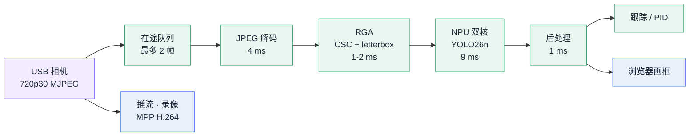
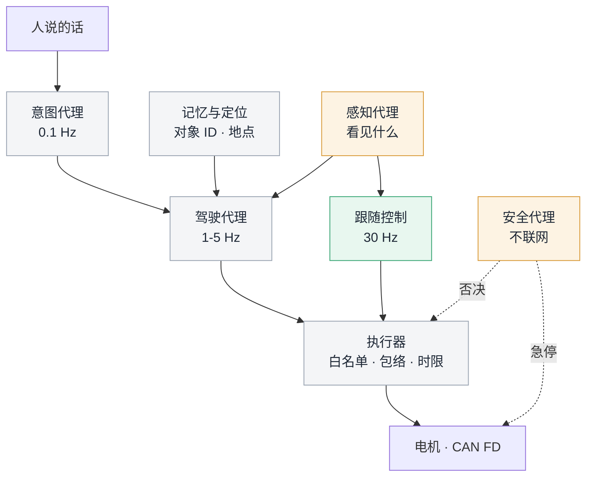

<a id="top"></a>

<div align="center">


</div>

# autonomous-driving-car

**一辆自己看路的小车。从摄像头到电机的整条链路跑在一个 C 进程里，端到端 79 ms。车上还坐着一个能听懂人话的智能体——它现在只能看，还不能开。**

---

2026 年 11 月，这辆车跑在 Radxa ROCK 4D 上：RK3576，八核，6 GB 内存，一块 6 TOPS 的 NPU，一颗 USB 摄像头，一条 CAN FD 接到差速底盘。

摄像头到轮子之间的每一段都在同一个进程里：V4L2 抓 MJPEG，双线程软解成 NV12，RGA 做色彩转换和 letterbox，NPU 双核跑 YOLO26n，跟踪器维持对象身份，PID 算出左右轮目标，MPP 同时编 H.264 存档，一个 reactor 喂着网页和推流。没有框架，没有节点间序列化，没有 ROS。

这个选择不太"正统"，但对一辆 720p30 的小车是对的：整条链路只有八个环节，每个环节的时限都是确定的；框架带来的进程边界和数据拷贝，比它省下的胶水代码贵得多。这里换来的是一份共享内存、一条 FIFO 优先级的控制线程，和一个 79 ms 的确定性上界。

当前的实情是：**感知闭环是活的，控制闭环在等电机。** 电机的 CAN 适配器没有配置（`adapter: false`），所以控制律每帧都在算，算出来的左右轮目标却没发出去。车上的智能体也只接了"看"的那一半。这两件事之后怎么接，是这份文档后半部分的主题。

## 先说怎么跑起来

```bash
cmake -B build -DCMAKE_BUILD_TYPE=Release
cmake --build build -j8          # 板上编译约 40 秒
sudo scripts/deploy.sh -i        # 装到 /opt，注册 systemd 并重启
```

打开 `http://<板子IP>/`，浏览器会弹 Basic 认证。服务直接查系统账号（`getpwnam` + `getspnam` + `crypt`），没有独立的账号库，用户名密码就是板子的登录账号。只读页面不需要登录，写操作需要。

依赖 `librknnrt` 2.5.x、`rockchip_mpp`、RGA、`libjpeg-turbo`。模型在 `config/yolo26.rknn`，网页上可以直接换。

## 它此刻看到的世界

<div align="center">


<sub>左边是实时画面，右边是那个会说话的乘客。底部一行是这套系统里最诚实的数字：采集 30.000 FPS，处理 79 ms。画面中的人像已整体马赛克处理。</sub>

</div>

框不是烧在视频流里的。服务只推纯净的 MJPEG，检测结果走 `/api/detections/live` 单独下发，浏览器用 canvas 画上去。这样录像存下来的是原始画面——代价是事后想回看"当时模型到底看到了什么"，得拿录像重新跑一遍推理。

底部那个"处理"报的是 `processing_age_ms`：从这一帧曝光结束，到它带着检测结果画到屏幕上。它不是推理耗时（推理只要 9 ms），是整条链路加上排队的时间。数字变大，说明中间有环节堵了，而不是模型变慢了。

## 一帧的八十毫秒

服务每十秒往日志里打一行分段耗时。这是刚才真实的一行：

```text
yolo timing ms: capture_to_decode=46 deliver_to_decode=14 decode=4 queue=50 resize=2 run=9 post=1
yolo handoff ms: post_to_display=0 decode_to_display=48 samples=261
```

读这行日志有个前提：各段是在不同线程里分别计时的，不能直接相加。比如 `queue` 那 50 ms 是这一帧排队等前面腾出在途名额的工夫，而 `capture_to_decode` 的 46 ms 里已经含了一次 33 ms 的帧间隔。唯一可信的总账是 `processing_age_ms`。



这行日志里最值得看的是 `run=9`：一次推理只花 9 毫秒。也就是说这颗 NPU 在这条链路上是闲的，瓶颈从来不在算力，而在"一帧要走完多少段"。所以优化没有往模型上做，全做在搬运上。四个决定：

**在途上限两帧，宁可丢帧不排队。** 差 3 帧的老画面喂给控制环，比丢一帧更糟——转角早就变了。所以队列满了直接丢，`infer_dropped` 涨上去是设计而不是故障。老帧对一辆要转弯的车没有价值。

**RGA 不做软件回退。** 如果 RGA 打不开，预处理直接失败退出，不用 CPU 顶上。因为 CPU 顶上不会报错，只会把 30 FPS 悄悄变成 12 FPS——实时系统里这种"温柔的降级"比崩溃更难查。

**letterbox 塞进 RGA 一次做完。** 色彩转换、缩放、填边三个操作合并成一次硬件任务，CPU 从头到尾不碰像素。这一段的代价是 1 到 2 毫秒，比 memcpy 一帧 NV12 还便宜。

**推理绑双核、每核一个 worker，控制线程 FIFO 20。** 实时预算怎么分、绑在哪个核上、cgroup v2 如何抢走实时带宽，这些坑写在 [docs/REALTIME_SCHEDULING.md](docs/REALTIME_SCHEDULING.md) 里，不在这里重复。

## 方向盘现在握在谁手里

控制环只做一件事：**让选中的那个框待在画面中间，大小稳定。** 没有路径规划，没有地图，没有"向前两米"这种东西。

具体是两条 PID 叠起来。纵向看框的面积误差，输出限幅到 `max_speed`（默认 0.3 m/s）；横向看框中心的横坐标误差，输出限幅到 `max_turn_delta`（默认 0.15 m/s）；两者混合成左右轮目标速度，再进一层轮速 PI 转成归一化的 `[-1, 1]` 执行量，交给 CAN 适配器。丢目标超过 `timeout_ms`（默认 300 ms）立刻停。

发命令之前有四道联锁，每一帧都查：

| 联锁 | 意思 |
|---|---|
| 适配器已绑定 | 没有电机驱动就只做预览，不算数 |
| 线程真的拿到了 FIFO | 抢不到实时优先级就认为不可信，不动 |
| CAN 已启用 | `can_enabled off` 时一切照算，但不发 |
| 轮速反馈新鲜 | 超过 300 ms 没有实测轮速，视为失联 |

任何一道不过，直接 `stop_wheels()`，理由写进 `/api/follow` 的 `status.reason`。能出现的理由只有这几种：`target_lost`、`priming`、`motor_send_failed`，加上四道联锁各自的名字。就这几个字符串，是这套系统对外的全部"失败语义"——后面会看到，它不够用。

保守是刻意的。参数在入口处就被夹住：`max_speed` 只能落在 0 到 2 m/s，`timeout_ms` 只能落在 100 到 1000 ms，`max_turn_delta` 不超过 4。哪怕有人把 PID 调到发疯，`follow_mix` 的限幅也不会让车超出这个包络。

现在 `can_enabled off`、`motor.configured false`，所以控制环在"预览"状态跑：`/api/follow` 里那些 `left_target` / `right_target` 数字是算出来的，轮子没动。控制律是对的，执行器还空着。

## 车上有个乘客，它会说话

板子上跑着一个 Codex CLI，网页右侧那个面板就是它的座位。它不是嵌进来的网页，也不是一个远程 API 的转发——板上真的会起一个进程，在车机上想事情。

它的位置很关键：**服务本体是 root，它自己只是普通用户 `qianruo`。** 看得见的都给它，开得动的都不给。

它看得见什么？比想象中多。只读接口本来就对局域网开放——`/api/system`、`/api/video/stats`、`/api/follow`、`/api/detections/live`——不需要密码。加上 `recordings/logs/` 下按天切分的运行日志、录像清单、检测日报，它完全能回答"刚才为什么停了"：因为停的理由就在 `/api/follow` 的 `status.reason` 里，而 300 ms 的丢目标超时、轮速反馈是否新鲜，都写在同一个 JSON 里。

它开不了口的地方也很清楚：任何 POST 到控制面的接口都要 root——`/api/follow`、`/api/tracking`、`/api/can/send`、`/api/reboot` 全在 `http_check_auth_root` 后面，而它手上没有 root 凭据。

一轮对话是一个短生命周期进程，最长 300 秒，单条消息上限 16000 字符，同时只允许一个任务。用量走 ChatGPT 套餐的两个窗口（5 小时 / 每周），面板画的是**剩余**百分比。窗口用满时 CLI 直接拒绝执行，面板上表现为一句 `rate limit reached`——那不是网络故障，别去查网线。

<div align="center">


<sub>模型、推理强度、套餐与两个额度窗口。这张图拍摄时周窗口已用满，所以显示"额度已用尽"。</sub>

</div>

于是它现在的角色很明确：**观察者**。它能解释，不能决定。这不是能力不够，是刻意留下的第一层授权——推理可以随便跑，让一台 0.3 m/s 的车动起来这件事，必须过另一道门。

## 然后呢：几个智能体，一具身体

让一个模型控制一辆车，是把所有问题压进同一个上下文窗口。可开车不是一件事，是好几件节奏完全不同的事：看清楚（30 Hz）、决定往哪走（1–5 Hz）、想清楚要去哪（0.1 Hz，还得联网）。塞进同一次推理，只会换来两样东西——延迟，和幻觉。

所以下一步不是找一个更强的模型，是**分工**：几个智能体共享同一具身体。



| 角色 | 现在 | 它需要看见 | 它能决定 | 时限 |
|---|---|---|---|---|
| 跟随控制（反射弧） | 已有 | 每帧检测框 | 左右轮目标速度 | 33 ms |
| 感知代理 | 半个：固定 80 类，目标靠手点 | 视频流 | 画面里有什么、在哪、还是不是同一个 | 33–200 ms |
| 记忆与定位 | 没有 | 轮速反馈、检测历史 | 对象 ID、地点、走过的路 | 1 s |
| 驾驶代理 | 没有 | 意图、世界状态 | 把"去那边"拆成三五个动作 | 0.5–2 s |
| 安全代理 | 半个：联锁 + 看门狗 | 所有动作请求 | 否决、限幅、急停 | < 100 ms |

### 它们共享的应该是事实，不是对话

多智能体最典型的死法，是各自维护一份世界理解，然后在执行层打架：一个说"人还在左边"，一个说"人已经不见了"，车原地抽搐。

好消息是地基已经在了。每一帧有单调递增的 `seq`，每个检测带 capture 时间戳，`/api/video/stats` 报 `processing_age_ms`——这本身就是一个带序号、带时效的共享世界状态。智能体之间不该互相聊天，它们应该读写同一份带时间戳的事实，并且知道这份事实有多旧。

### 只有一个人能碰方向盘

仲裁放在 C 侧，不放在模型侧。任何智能体的动作都只是一次**请求**，进同一个执行器；执行器只做三件事：白名单（只认几种动作）、包络（速度、时长、区域）、时限（超时即停）。模型之间可以争论，执行器不参与讨论。

这不是性能考虑，是责任划分。模型的输出是建议，执行器的输出才是电信号。

### 先补三个原语

现在的运动原语只有一个半：`follow`（跟住一个框）算一个，`setpoint`（定速，但转向仍然自动对中）只能算半个。要让语言变得有意义，至少还缺三个：

- `go(distance_m, speed)`——直线走一段。缺的是从轮速到位移的积分和打滑补偿：`follow_feedback()` 已经在报实测轮速了，但没人把它积成里程。
- `turn(deg)`——转向一个角度。缺的是偏航角来源，现在没有 IMU 融合，转向只能闭环在"框有没有回到中间"上。
- `stop()`——有了，但要变成不依赖模型、不依赖网络的硬件级动作。

再加一个 `look_for(描述)`，它把感知代理和检测器接起来。这需要开放词表检测：现在是固定 80 类 COCO 加一个 `class_id`，听不懂"穿蓝衣服的那个人"。

### 延迟决定分层，分层决定授权

一次大模型往返是秒级的，还要看网络和额度。这个数字直接决定了它能待在哪一层：

- **30 Hz 层**：不可能有模型。这里只能是 C 和 PID。
- **1 Hz 层**：模型可以选策略——跟谁、走哪条、要不要停。
- **0.1 Hz 层**：模型可以理解意图——"去厨房看看猫在哪"。

把模型放对层，延迟问题就消失了。剩下的是纯工程问题：它说的话，怎么变成安全电信号。

### 四份保险，缺一不可

1. **包络在 C 里。** 参数校验已经有先例（`max_speed` ≤ 2 m/s、`timeout_ms` 100–1000 ms），把这套校验扩展到动作原语上。
2. **执行器不经过模型。** 模型只能提交请求，不能直接写 CAN。
3. **硬件心跳。** 现在是 systemd 10 秒、线程 3 秒——对一台 0.3 m/s 的小车偏慢。需要 100–200 ms 级的独立急停，且不跑在 Linux 上。
4. **人在环。** 按住才走、松手即停，比"你说停它就停"可靠得多。

### 分五步走，每步都要能验收

| 阶段 | 内容 | 验收标准 |
|---|---|---|
| P1 观察者（今天） | 能解释车在发生什么 | 问"为什么停了"，回答必须引用 `status.reason`，不许猜 |
| P2 语义目标 | 一句话选中目标："跟着穿蓝衣服的人" | 20 次里至少 16 次选对；选错后 300 ms 内必须停住 |
| P3 三个原语 + 执行器 | `go` / `turn` / `stop` 走白名单 | 包络外参数 100% 被拒（上万次随机请求模糊测试）；急停端到端 < 100 ms |
| P4 短程导航 | 里程计 + 相对位姿 + 简单语义地图 | 5 米直线终点误差 < 20 cm；做不到就老实写"做不到" |
| P5 监督式自主 | 模型只在包络内选策略，安全代理持否决权 | 人为注入 100 次幻觉目标，全部被拦下 |

### 接口草案

所有智能体提交动作都走同一个入口。这是设计稿，**还没实现**：

```jsonc
// 提交一个动作
{ "action": "go", "distance_m": 1.5, "speed": 0.25,
  "lease_ms": 3000, "why": "用户说靠近门口" }

// 执行器的回答必须结构化，好让智能体能改计划
{ "accepted": false, "reason": "envelope",
  "detail": "distance_m > 2.0",
  "state": { "target_lost_ms": 320, "can_enabled": false } }
```

第二段比第一段重要。现在的 halt 理由只有几种粗粒度的字符串，模型没法据此调整；而真实的世界会告诉它"电机没接"、"轮速反馈过期"、"目标丢了 320 ms"——这些才是让计划收敛的输入。

### 边界

这套硬件——差速底盘、单目、没有激光、0.3 m/s、打滑不可控——能支撑的合理边界是：**室内、短程、有人看着。** 开放道路不在讨论范围，不是模型不够聪明，是这具身体没有冗余：没有第二套感知，没有独立刹车，没有失效可用的定位。

把这辆车做成一个能在客厅里听懂人话、并且撞到东西之前一定会停的机器人，比把它吹成"自动驾驶"更有意思，也更难。

## 量到的数

2026-11-07 01:50 的一次读数，两个接口，可以自己复核：

| 指标 | 读数 |
|---|---|
| 端到端延迟 | 79 ms（历史最大 128 ms） |
| 采集帧率 | 30.000 FPS，已产出 89 993 帧 |
| 解码 / RGA / 推理 / 后处理 | 4 / 1–2 / 9 / 1 ms |
| NPU 双核占用 | 13% 和 11% |
| RGA 双核占用 | 3% 和 2% |
| 温度 | 59 ℃ |
| 内存 | 6 GB，已用 10% |
| 系统版本 | 1.1.0，commit 3b03399 |

来源：`/api/video/stats`（延迟、帧数）、`/api/system`（CPU、NPU、RGA、温度、内存）。运行过程中唯一会明显变化的是延迟和温度，其余基本是常数。

## 没做到的部分

- **电机没接。** CAN 是 off，`adapter: false`。控制律在跑，轮子不动。
- **没有里程计。** 轮速反馈有，位姿没有，所以"走两米"这件事现在做不到。
- **目标记忆很短。** 跟踪器的关联超过 800 ms 没有可靠匹配就过期，人走出画面再回来，它不认识。
- **听不懂具体的东西。** 检测器固定 80 类 COCO，说"那个红色的杯子"没用。
- **智能体只读。** 从它到执行器之间，一条授权通道都还没有，这是接下来最该补的一环。
- **硬件编码没压测。** 录像走 MPP H.264，但没做过长时间满负载验证。

## 附录

### 目录

```text
source/           C 实现，约 1.7 万行
  core/           lifecycle · config · watchdog · 主循环
  video/          V4L2 采集 · 帧环 · 解码 · MPP 编码 · 推流
  yolo/           RKNN 推理 · 前后处理 · 帧调度
  control/        跟踪 · PID · 跟随状态机 · CAN 适配
  can/            CAN FD 收发 · DBC 解析 · 电机映射
  http/           reactor · 路由 · 认证 · 各 API
  tcp/            网络信息 · 遥测
include/          与 source/ 同构的头文件
html/             前端，无构建步骤：5 个页面 + 28 个 JS/CSS
config/           运行配置、模型、标签、DBC、电机映射示例
scripts/          构建、部署、同步、Codex 桥接
docs/             延迟剖析、帧流水线、实时调度、通信流程、量化说明
```

### 接口

只列出会和"控车"发生关系的那些。标 ✅ 的需要 root。

| 接口 | 方法 | 作用 |
|---|---|---|
| `/api/system` `/api/video/stats` | GET | 运行状态与延迟，公开 |
| `/api/detections/live` | GET | 当前帧的检测结果，公开 |
| `/api/follow` | GET | 跟随参数、状态、`reason`，公开 |
| `/api/follow` | POST ✅ | 改跟随参数、开关、选目标类 |
| `/api/tracking` | POST ✅ | 按 `seq` + 序号选中某个检测框 |
| `/api/can/send` | POST ✅ | 直接发原始 CAN 帧，不经过跟随层的混合与限幅 |
| `/api/codex/chat` | POST ✅ | 和车上那个乘客说话 |

### 日志在哪

```bash
journalctl -u autonomous-driving-car -f     # 服务日志
recordings/logs/log_info_YYYYMMDD.log       # 按天切分，含每 10 秒的耗时行
recordings/videos/                          # 分段录像
recordings/results/                         # 检测日报
recordings/codex/chat_YYYYMMDD.txt          # 对话记录，一行一条
```

### 几个常见故障

| 现象 | 先看哪里 |
|---|---|
| 画面卡住但进程活着 | `capture_stall_ms`、`infer_dropped`，多半是相机或 USB 带宽 |
| 延迟从 79 涨到几百 | `queue` 变大说明在途堆积，再看控制线程有没有被降级（`status.fifo`） |
| 车不动 | `/api/follow` 的 `status.reason` 和 `motor.configured`，先确认电机配了没 |
| 面板报 `rate limit reached` | `/api/codex/quota`，套餐窗口用满，不是网络 |
| 服务反复重启 | `systemctl show -p NRestarts`，配合 `WatchdogSec=10` 看是不是某个线程卡住 |

### 其它文档

[docs/FRAME_PIPELINE.md](docs/FRAME_PIPELINE.md) · [docs/LATENCY_PROFILE.md](docs/LATENCY_PROFILE.md) · [docs/REALTIME_SCHEDULING.md](docs/REALTIME_SCHEDULING.md) · [docs/COMMUNICATION_FLOW.md](docs/COMMUNICATION_FLOW.md) · [docs/YOLO26N_QUANTIZATION.md](docs/YOLO26N_QUANTIZATION.md) · [docs/FUNCTIONAL_TEST_REPORT.md](docs/FUNCTIONAL_TEST_REPORT.md)

<div align="center">

<a href="docs/img/ui-status.png"></a>
<a href="docs/img/ui-config.png"></a>
<a href="docs/img/ui-files.png"></a>
<a href="docs/img/ui-dbc.png"></a>

<sub>状态、配置、文件、DBC，点开看原图。DBC 那张是空表，因为这块板子还没接总线。</sub>

</div>

---

如果你只记一件事：这辆车最值钱的不是那 79 ms，而是它把"能看见"和"能动手"分在了两道门后面。接下来要做的多智能体控车，难的不是让模型更聪明，是让这句话在代码里继续成立。

GPL-3.0-or-later · [LICENSE](LICENSE)
