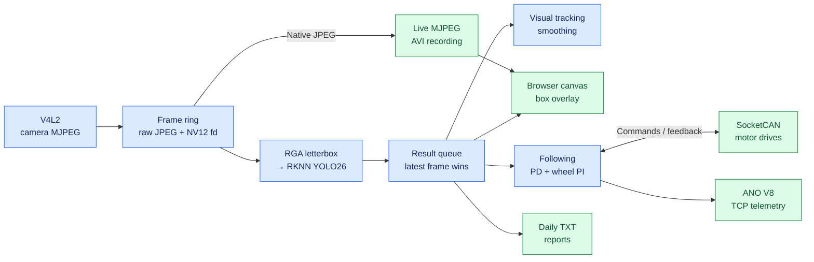
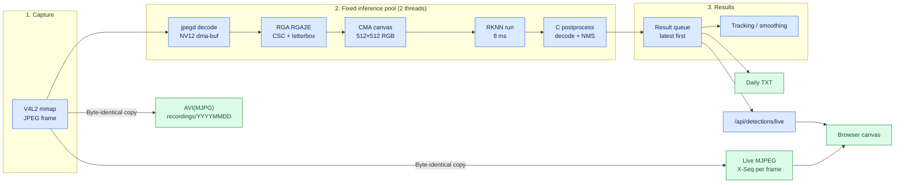

# Autonomous Driving Car

A Linux vehicle platform for **perception, inference and control** on a single
real-time kernel. The current build runs camera capture, RKNN YOLO26 inference,
visual tracking, differential wheel control, CAN/CAN-FD communication, lossless
recording and a browser management interface as one C/C++ application.
LLM inference is planned, not implemented.

The target board is the **Radxa ROCK 4D / RK3576** and the project is written for
that SoC only: NPU core count, RGA core selection and the model platform are
compile-time constants, not runtime probes.

The entire inference pipeline is hardware-accelerated and hardware-only:

```
camera MJPEG → jpegd (NV12 dma-buf) → RGA (CSC + letterbox) → NPU → C postprocess
```

There is no CPU fallback for preprocessing, no adaptive worker pool, and no
server-side box drawing. Video is lossless end to end: live view forwards the
camera's own MJPEG bytes, and recording writes those same bytes into AVI. Boxes
are overlaid in the browser on a canvas, aligned by frame sequence number.

## Measured performance

Numbers from the deployed build on the board, 30 fps capture:

| Metric | Value |
| --- | --- |
| End-to-end latency (`processing_age_ms`) | **44 ms**, p95 45 ms |
| Pipeline work per frame | **11 ms** (decode 1, RGA 1, NPU 8, postprocess 1) |
| Share of a 33.3 ms frame period | 33 % |
| CPU load, whole system | **~2 %** |
| NPU load per core | 8–13 % |
| RGA load per core | ~2 % |
| Capture / dropped frames | 30 fps, 0 from the ring |

44 ms splits into 33 ms of camera-side latency (UV C one-frame delay, not
software) plus 11 ms of pipeline. See [latency profile](docs/LATENCY_PROFILE.md)
for the per-stage history and the optimisations that were measured and rejected.

## Quick start

```bash
bash scripts/build.sh -R          # release build → bin/autonomous-driving-car
sudo bash scripts/deploy.sh -i    # install under /opt, start the service
curl -s http://127.0.0.1/api/video/stats
```

Open `http://<board-ip>/` for the web interface.

Prerequisites are a kernel with the Rockchip NPU, JPEG decoder and RGA drivers,
`librknnrt.so`, `librga.so`, and a prepared `config/yolo26.rknn`. Details in
[Requirements](#requirements) and [Build and deployment](#build-and-deployment).

## Architecture

One C/C++ process with cooperating worker threads. [main.c](source/core/main.c)
runs a module table in a fixed order; a shared frame ring, a result queue and
controller snapshots connect the stages. Blue nodes process data, green nodes are
outputs, amber nodes are checks, red nodes are failure paths.

### Runtime overview



### Perception and media pipeline



Two worker threads, each bound to one NPU core **and** one RGA core:

| Thread | NPU | RGA |
| --- | --- | --- |
| `yolo_infer` 0 | Core 0 (`mask 0x1`) | RGA2E core 0 (`0x4`) |
| `yolo_infer` 1 | Core 1 (`mask 0x2`) | RGA2E core 1 (`0x8`) |

The decode thread keeps the frame in an NV12 dma-buf; the worker asks RGA for
colour conversion plus scaling in one pass into a CMA-backed model canvas, and
passes that canvas address straight to `rknn_inputs_set`. Nothing is copied
between the accelerators.

### Web management, CAN and supervision


Module-table order: **context → log → config → DBC → CAN → CAN RX/TX → TCP →
HTTP → following → ANO → video → YOLO → watchdog → recording → signals**.
Motion and perception threads are fatal on a missed heartbeat; management
threads log and reset instead of stopping the vehicle.

## Perception

**Capture.** V4L2 MJPEG at 1280×720, 30 fps. The device is opened through a
stable path (`/dev/v4l/by-id/...`), because adding a built-in media driver can
renumber `/dev/videoN`.

**Decode.** `rockchip-jpegd` decodes to NV12 in a CMA dma-buf. There is no
software JPEG decoder and no CPU colour conversion on this path.

**Preprocess.** RGA performs NV12 → RGB, letterbox scaling and placement into a
512×512 canvas in one call (~1 ms). The 114-grey border is filled once at start
up; RGA only writes the centre rectangle each frame.

**Inference.** RKNN YOLO26n, 512×512 input, ~8 ms per frame on one NPU core.

**Postprocess.** C implementation: per-anchor class scan over the NHWC score
tensor, candidate collection, class-wise greedy NMS (IoU 0.45), top-32. ~1 ms.

**Results.** The result queue favours the newest frame; a slower consumer skips
intermediate results rather than falling behind.

### Model interface

| Tensor | Shape | Type | Meaning |
| --- | --- | --- | --- |
| `/model.23/Sigmoid_output_0` | `[1,5376,80]` | INT8, NHWC | class scores |
| `/model.23/Mul_2_output_0` | `[1,4,5376]` | FP16 | cx, cy, w, h in model pixels |

The worker asks the runtime for float only on the box tensor and dequantises the
scores itself. A model with a different output layout is rejected at load time.
Boxes stay FP16 because INT8 quantises them to a ~2.73 px step, which costs
2.45 mAP(50–95) points. Scores are NHWC so the 80 values of one anchor are
contiguous, which cut postprocessing from 4 ms to 1 ms.

Accuracy on a 64-image held-out set (conf ≥ 0.001, class NMS IoU 0.7, 101-point
AP): **mAP50 0.5909, mAP50–95 0.4336**.

## Preprocessing on the RGA

RGA is a **required** component — there is no CPU fallback. At start up the
application checks `/dev/rga` and loads `librga.so` with `dlopen`; if either is
missing the inference pool refuses to start and the process aborts with an
explicit message. `librga` is deliberately not in `DT_NEEDED` so a missing
library produces that message instead of a dynamic-loader failure before `main`.

Install the library once per board:

```sh
git clone https://github.com/airockchip/librga
sudo cp librga/libs/Linux/gcc-aarch64/librga.so /usr/local/lib/
sudo mkdir -p /usr/local/include/rga && sudo cp librga/include/*.h /usr/local/include/rga/
sudo /sbin/ldconfig
```

`scripts/deploy.sh` verifies the library and `/dev/rga`, and can install the
library from `LIBRGA_SOURCE` if it is missing.

RK3576 reports its RGA2E cores as **RGA2** devices, so per-core scheduling uses
`IM_SCHEDULER_RGA2_CORE0/1` (0x4/0x8). The RGA3 encodings (0x1/0x2) are rejected
by the driver with `job assign failed`.

## Visual tracking and following

**Tracking.** Click a detection on the home page to select it. Matching uses
constant-velocity prediction, predicted box overlap, displacement, size change
and class gates; ambiguous matches are rejected. IDs are local to the process
and expire after 800 ms without a match. The numbered labels and the selected
object's cyan box are drawn by the **browser canvas**, not into the frame.

**Following.** The wheel controller consumes detections independently of visual
tracking. Automatic speed uses relative target size, manual mode uses the
configured speed. Steering is PD; each wheel is PI with measured feedback.
Wheel-speed targets and differential correction use **m/s**.

Selecting a visual target does not enable motion, and following always starts
stopped after a service restart. Motor output additionally requires fresh
detections and wheel feedback, an available and enabled CAN interface with a
valid motor profile, and FIFO scheduling for the control thread. Target loss,
stale feedback or missing prerequisites inhibit motion.

Adapt [car_motor_can.example.conf](config/car_motor_can.example.conf) to the
drive manufacturer's command, stop and feedback formats before creating
`config/car_motor_can.conf`.

## Web interface

Open **`http://<board-ip>/`**; HTTP listens on port **80**.

| Page | Address | Operations |
| --- | --- | --- |
| Home | `/` | Live video, box overlay, target selection, resource monitor (CPU, NPU, RGA) |
| System Configuration | `/config` | Camera, YOLO, CAN, CPU, following, web IP, telemetry |
| Driving Logs | `/logs` | Log/report browsing, video playback, downloads, cleanup |
| DBC viewer | `/dbc` | CAN definitions and decoded signals |

Home and DBC accept a local Linux account through HTTP Basic authentication.
Configuration, logs and administrative actions require `root` or `sudo` group
membership. Some read-only status APIs are public.

The resource card shows CPU per core, **NPU per core**, **RGA per core** and
memory/disk. NPU load comes from `/sys/kernel/debug/rknpu/load`; RGA load is
measured inside the application (no driver counter exists) by timing each
`improcess` call per core over a one-second window.

Web access supports **two source IPv4 addresses**; one address can open many
tabs. The slot expires 30 s after its last connection closes and an extra
address receives HTTP 503.

### Live view and overlay

The home page plays `GET /video/mjpeg`, a `multipart/x-mixed-replace` stream of
the camera's own JPEG frames. Each part carries an `X-Seq` header so the browser
knows which frame is on screen.

Boxes come from `GET /api/detections/live?after=N`, returning records with
`seq`, image `w`/`h` and per object `x1, y1, x2, y2, class, score, name` in
original-image pixels. The browser matches the record to the displayed frame; if
inference skipped that frame it falls back to the nearest earlier record within
six frames, then draws nothing rather than a stale box.

Each frame is 60–110 KB at 720p, so an uncapped 30 fps stream needs
18–26 Mbps. `mjpeg_max_kbps` caps the per-client budget; when a socket backs up,
whole frames are dropped rather than falling behind.

## Recording and observability

Recording is lossless and starts automatically. Each session measures the real
capture cadence, writes `recordings/YYYYMMDD/video_<date>_<time>.avi`, and
stores camera JPEG frames verbatim in an AVI(MJPG) container with a proper
`idx1` index and header backfill. There is no encoder, bitrate target or quality
setting, so file size equals the camera's data rate: about **1.9 MB/s**, or
**6.8 GB/hour** at 720p/30 fps. Files split near **1.9 GB** (~16 min) and
recording continues in a new segment.

Recording never waits on inference, so a stalled or reloading model does not
interrupt it. Recorded frames contain no boxes; use the live view for annotated
inspection.

Daily TXT reports record completed inferences, including frames with no
detections: capture time, sequence, dimensions, lens position when available,
target index/class/confidence and `X1 X2 Y1 Y2` in the original image. Writers
batch records off the inference threads.

```bash
systemctl status autonomous-driving-car --no-pager
journalctl -u autonomous-driving-car -f
curl -s http://127.0.0.1/api/video/stats
curl -s http://127.0.0.1/api/rec/status
curl -s http://127.0.0.1/api/system
```

`GET /api/video/stats` reports `capture_fps`, `capture_dropped`,
`driver_dropped`, `capture_stall_ms`, `render_skipped` and `processing_age_ms`,
which separate camera problems from inference lag. Release builds keep debug
information for `coredumpctl`.

## Model and configuration management

[model_sync.sh](scripts/model_sync.sh) is shared by [build.sh](scripts/build.sh)
and [deploy.sh](scripts/deploy.sh). The platform is fixed to `rk3576`; the script
checks the RKNN header and declared target and synchronises prepared models by
hash. A model uploaded through the browser survives rebuilds and redeployments;
if source and deployed models changed independently, synchronisation stops and
preserves both.

Updates retain `config.txt`, `follow.conf`, `car_motor_can.conf`,
`cpu_freq.conf` and `ano.conf`; labels and DBC files may be replaced from source.

| Path | Purpose |
| --- | --- |
| `config/config.txt` | Camera, inference, CAN and web IP settings |
| `config/follow.conf` | Following parameters |
| `config/car_motor_can.conf` | Motor command and feedback protocol |
| `config/cpu_freq.conf` | CPU policy settings (default: `performance`) |
| `config/ano.conf` | Anonymous Assistant settings |
| `config/yolo26.rknn`, `config/coco.names` | Model and class labels |
| `config/*.dbc` | CAN databases |
| `logs/YYYYMMDD/` | Application logs |
| `recordings/YYYYMMDD/` | Lossless AVI(MJPG) recordings |
| `recordings/detections/YYYYMMDD/result_YYYYMMDD.txt` | Daily inference results |

Key video settings:

| Setting | Meaning |
| --- | --- |
| `video_device` | V4L2 capture node; use the `/dev/v4l/by-id/` path |
| `video_width`, `video_height` | Capture resolution; recording uses the same size |
| `video_fps` | Requested frame rate; `0` keeps the driver default |
| `mjpeg_max_kbps` | Per-client live-stream budget in kbit/s; `0` = uncapped |

**Export config** downloads the actual configuration and model as `.tar.gz`
(≤ 64 MiB uncompressed, internal metadata excluded).

## Communication registration

Business modules register their addresses and own their receive slots. Sending
uses only **handle + data + length**; the transport resolves ports, connections,
CAN IDs and frame formats.

- TCP: `tcp_component_register()`, CAN: `can_component_register()`.
- Send: `tcp_send(handle, data, length)` / `can_send(handle, data, length)`.
- Receive: `data_slot_pop()` on the business-owned slot.

TCP preserves partial writes and resets a client instead of dropping stream
bytes when its slot fills. CAN routes by interface plus ID, keeps original
monotonic receive timestamps, and enforces reserved motor IDs, explicit stop,
FIFO admission, feedback freshness and output limits. Full paths, capacities and
locking rules are in [communication flow](docs/COMMUNICATION_FLOW.md).

## Repository structure

| Location | Responsibility |
| --- | --- |
| `source/core/` | Module lifecycle, shared context, configuration, logging, CPU affinity |
| `source/video/` | Capture, frame ring, RGA preprocessing, lossless AVI recording, MJPEG streaming |
| `source/yolo/` | Inference pool, postprocessing, tracking events, reports |
| `source/control/` | Visual tracking, motion control |
| `source/can/` | SocketCAN, port/ID registration, data slots, DBC decoding, motor protocol |
| `source/tcp/` | Connections, registered ports, handle routing, data slots |
| `source/telemetry/` | ANO business slots, stream parsing, protocol encoding |
| `source/http/`, `html/` | Web server/APIs, pages, browser components |
| `source/watchdog/` | Worker heartbeat supervision |
| `include/` | Module interfaces and shared types |
| `config/` | Device settings, model, labels, CAN databases |
| `scripts/` | Build, deployment and model synchronisation |
| `tools/model/` | Offline model pipeline: ONNX export, RKNN quantisation, dataset prep, raw-output dumper, mAP evaluation |
| `docs/` | Architecture, latency, quantisation, real-time scheduling notes |

Video modules: `video_stream.c` owns capture and MJPEG fan-out,
`frame_ring.c` owns buffer handoff, `rga_preprocess.c` owns the RGA canvas,
`video_rec.c` owns recording sessions, and `rec_mjpeg.c` owns the AVI container.

## Requirements

**Hardware.** Radxa ROCK 4D (RK3576), a USB UVC camera that can produce MJPEG,
and — for vehicle control — SocketCAN hardware with a drive that reports wheel
speed.

**Kernel.** `7.4.0-rc1-npu-rt-full` or later from
[rock-4d-npu-kernel](https://github.com/qianruo-orange/rock-4d-npu-kernel), which
builds these drivers **into** the image:

| Driver | Needed by the application |
| --- | --- |
| RKNPU (`rknpu`) | yes — inference |
| JPEG decoder (`rkjpegd`) | yes — decode |
| RGA3 / RGA2E (`rga3`) | yes — preprocessing |
| VEPU510 encoder (`mpp`) | no — the application does not encode |

The application requires the NPU, JPEG and RGA engines. It does **not** require
an MPP install or the VEPU510 encoder.

**Userspace.** `librknnrt.so` (2.5.0), `librga.so`, libsystemd,
libnl-3/libnl-route-3, OpenCV core/imgproc.

**Build.** C11/C++11 compiler, GNU Make, CMake 3.18+, Bash, and the usual
`flock`, `sha256sum`, `strings`, `awk`, `tar`, `zip`.

## Build and deployment

Prepare `config/yolo26.rknn` (512×512 input, two outputs as described above) and
`config/coco.names` before the first build. The model is not in Git; the pipeline
that produces it is documented in [tools/model/README.md](tools/model/README.md)
with the quantisation history in
[docs/YOLO26N_QUANTIZATION.md](docs/YOLO26N_QUANTIZATION.md).

```bash
bash scripts/build.sh -R          # release
sudo bash scripts/deploy.sh -i    # install and start
```

| Command | Action |
| --- | --- |
| `bash scripts/build.sh -R` | Release build with optimisation and debug info |
| `bash scripts/build.sh -D` | Debug build with terminal output |
| `bash scripts/build.sh -C` | Remove build outputs and clear project logs |
| `sudo bash scripts/deploy.sh -i` | Install or update, preserving data and device settings |
| `sudo bash scripts/deploy.sh -u` | Uninstall, including configuration, logs and recordings |
| `sudo bash scripts/deploy.sh -r` | Uninstall then install |

The build produces `bin/autonomous-driving-car`; deployment installs the binary,
frontend, model and configuration under `/opt/autonomous-driving-car`, installs
the systemd unit and starts the service. There is no platform argument: the
target is RK3576.

On cgroup v2 systems, deployment installs
`/etc/systemd/system/-.slice.d/90-autonomous-driving-car-rt.conf` so FIFO and
deadline threads are permitted inside service groups. CPU quotas and weights are
unavailable across the hierarchy while that setting is active; it is retained on
uninstall and the global RT budget is unchanged.

## Development direction

The next architectural step is LLM inference alongside YOLO and conventional
motion control. Shared-resource scheduling, control timing and end-to-end latency
on the real-time kernel remain under evaluation; the behaviour documented above
is the foundation for that work.

## License

[GPL-3.0-or-later](LICENSE).
