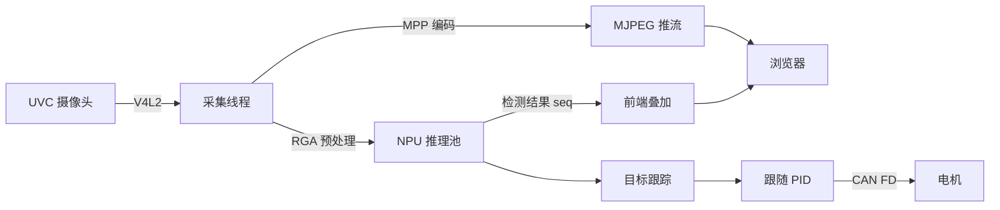

<div align="center">


# 🚗 Autonomous Driving Car

**视觉循迹小车 · 采集 → NPU 推理 → 跟踪 → CAN 输出 · 全流程单进程 C 服务**

[](#)
[](#)
[](#)
[](#)
[](LICENSE)

[**快速开始**](#-快速开始--quick-start) · [**界面**](#-界面一览--screenshots) · [**架构**](#-架构--architecture) · [**文档**](#-文档--documentation) · [**排障**](#-排障--troubleshooting)

<sub>中文 | <a href="#english">English</a></sub>

</div>

---

## ✨ 特性 / Features

| | 能力 | 说明 |
|---|---|---|
| 🎥 | **硬解硬编** | V4L2 采集 + MPP 编码 + MJPEG 直推，720p30 端到端约 300 ms |
| 🧠 | **NPU 推理** | RKNN 多线程推理池 + RGA 预处理，YOLO26n 640/512 量化模型 |
| 🎯 | **目标跟踪** | 点击画面识别框即锁定目标，按 `seq` 与画面严格同帧对齐 |
| 🕹️ | **CAN FD 控制** | 左右轮差速 + PID 跟随，安全门限、死区、限幅齐全 |
| 🌐 | **网页控制台** | 画面/参数/模型/代理/日志/Codex 对话全部在浏览器完成 |
| ⏱️ | **实时内核** | PREEMPT_RT + FIFO 调度 + CPU 隔离，控制环抖动 < 1 ms |
| 🤖 | **Codex 集成** | 设备码登录、额度显示、一键升级，板上直接与模型对话 |

## 📸 界面一览 / Screenshots

<div align="center">

| 系统配置 | 系统状态 |
|:---:|:---:|
|  |  |

</div>

## 🚀 快速开始 / Quick start

```bash
# 1. 依赖
sudo apt install -y build-essential cmake git python3 curl

# 2. 编译（约 40 s）
./scripts/build.sh -R

# 3. 部署 + 重启服务
sudo ./scripts/deploy.sh -i

# 4. 自检
curl -s -u qianruo:qianruo http://127.0.0.1/api/system | head -c 200
```

浏览器打开 **`http://<板子IP>/`** 即可看到实时画面。

<details>
<summary><b>🖥️ 完整部署流程（点击展开）</b></summary>

```bash
# 硬件自检
ls /dev/rga /dev/dri/renderD128        # RGA + NPU 就绪
v4l2-ctl --list-devices                # 摄像头枚举

# 编译产物校验
file bin/autonomous-driving-car        # aarch64 ELF

# 部署内容
sudo ./scripts/deploy.sh -i            # 二进制 + 前端 + 模型 + 桥接脚本

# 服务与日志
systemctl status autonomous-driving-car --no-pager
journalctl -u autonomous-driving-car -f

# 同步到仓库
./scripts/git_sync.sh "deploy: 说明"
```

</details>

## 🏗️ 架构 / Architecture



> 单进程、多线程；画面与检测结果用采集序号 `seq` 对齐，避免"框比画面慢几帧"。

## 🧩 模块 / Modules

```text
source/
├── core/        配置读写、日志
├── http/        HTTP 服务与全部 API
├── video/       V4L2 采集 · MPP 编码 · MJPEG
├── yolo/        RKNN 推理池（多线程 + RGA）
├── control/     跟随控制器（PID · 死区 · 限幅）
├── can/         CAN FD 与电机协议映射
└── telemetry/   匿名助手（ANO）
html/            前端（无构建，纯静态）
scripts/         build · deploy · model_sync · proxy_config · codex_bridge · git_sync
config/          运行期配置（可被网页修改）
docs/            设计、性能、测试文档
```

## 🖥️ 网页控制台 / Web console

| 页面 | 能做什么 |
|---|---|
| [`/`](http://192.168.1.7/) | 实时画面、点击框追踪、Codex 对话 |
| [`/status`](http://192.168.1.7/status) | CPU 逐核 + 温度、NPU/RGA、内存磁盘、网络速率 |
| [`/config`](http://192.168.1.7/config) | YOLO、CPU 频率、网络代理、视频、跟随、Codex |
| [`/logs`](http://192.168.1.7/logs) | 日志、录像、检测结果、交互记录 |
| [`/dbc`](http://192.168.1.7/dbc) | DBC 解析与实时报文 |

## 📚 文档 / Documentation

| 文档 | 内容 |
|---|---|
| [CODE_REVIEW](docs/CODE_REVIEW.md) | 代码评审与已知问题 |
| [COMMUNICATION_FLOW](docs/COMMUNICATION_FLOW.md) | 模块/线程通信与队列 |
| [FRAME_PIPELINE](docs/FRAME_PIPELINE.md) | 帧流水线时序 |
| [LATENCY_PROFILE](docs/LATENCY_PROFILE.md) | 端到端延迟剖析 |
| [REALTIME_SCHEDULING](docs/REALTIME_SCHEDULING.md) | PREEMPT_RT · FIFO · CPU 隔离 |
| [FUNCTIONAL_TEST_REPORT](docs/FUNCTIONAL_TEST_REPORT.md) | 功能测试报告 |
| [YOLO26N_QUANTIZATION](docs/YOLO26N_QUANTIZATION.md) | YOLO26n RKNN 量化 |
| [推理流水线延迟剖析](docs/pdf/推理流水线延迟剖析.pdf) | PDF |
| [YOLO26n 量化报告](docs/pdf/YOLO26n量化报告.pdf) | PDF |

## 🔧 排障 / Troubleshooting

<details>
<summary><b>画面黑屏 / Black preview</b></summary>

```bash
curl -s -u qianruo:qianruo http://127.0.0.1/api/video/devices
fuser -v /dev/video2
```
</details>

<details>
<summary><b>检测框不出现 / No boxes</b></summary>

```bash
curl -s -u qianruo:qianruo http://127.0.0.1/api/detections/live | head -c 300
```
确认 `config/yolo26.rknn` 与 `coco.names` 匹配。
</details>

<details>
<summary><b>页面样式丢失 / Styles gone</b></summary>

```bash
curl -s -o /dev/null -w '%{http_code} %{size_download}\n' \
  -u qianruo:qianruo 'http://127.0.0.1/css/config.css?v=2026110701'
```
应为 `200` 且字节数与磁盘一致。
</details>

<details>
<summary><b>小车不动 / Car does not move</b></summary>

`config/car_motor_can.conf` 未配置或 `enabled 0`；或在 `/config` 里未启用 CAN。
</details>

## 🤝 贡献 / Contributing

1. Fork & 新建分支 `feat/xxx`
2. `./scripts/build.sh -R && sudo ./scripts/deploy.sh -i` 本地验证
3. `./scripts/git_sync.sh "feat: 说明"` 提交并推送
4. 提 PR，附上截图或日志

## 📄 License

GPL-3.0-or-later © qianruo-orange · 见 [LICENSE](LICENSE)

---

<div align="center" id="english">

## English

**A vision-guided car on Radxa ROCK 4D (RK3576): camera → NPU inference → tracking → CAN motor, one C process, with a built-in web console.**

| | Capability | Notes |
|---|---|---|
| 🎥 | Hardware capture & encode | V4L2 + MPP + MJPEG, ~300 ms end-to-end at 720p30 |
| 🧠 | NPU inference | RKNN pool with RGA preprocessing, YOLO26n 640/512 |
| 🎯 | Tracking | Click a detection box to lock on; overlays share the capture `seq` |
| 🕹️ | CAN FD control | Differential drive with PID, dead-band and rate limits |
| 🌐 | Web console | Stream, parameters, models, proxy, logs and Codex chat in the browser |
| ⏱️ | Real-time kernel | PREEMPT_RT, FIFO scheduling, CPU isolation |

### Quick start

```bash
sudo apt install -y build-essential cmake git python3 curl
./scripts/build.sh -R
sudo ./scripts/deploy.sh -i
curl -s -u qianruo:qianruo http://127.0.0.1/api/system | head -c 200
```

Open `http://<board-ip>/` — live view, click a box to track.

### Documentation

See the [documentation table](#-文档--documentation) above — every design, latency and
quantisation document is linked and verified to exist in `docs/`.

### License

GPL-3.0-or-later © qianruo-orange

</div>
