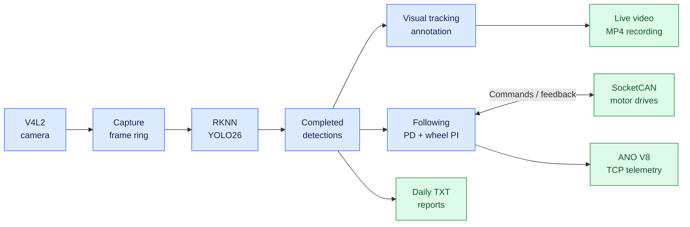
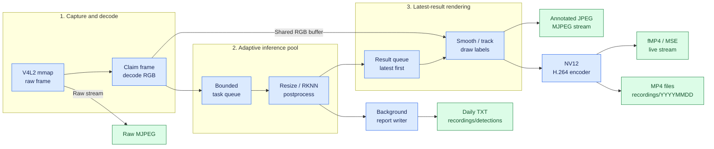
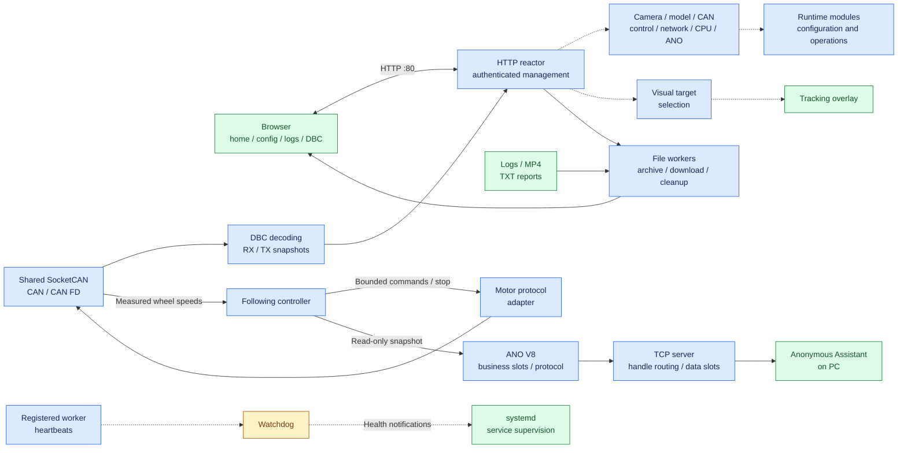
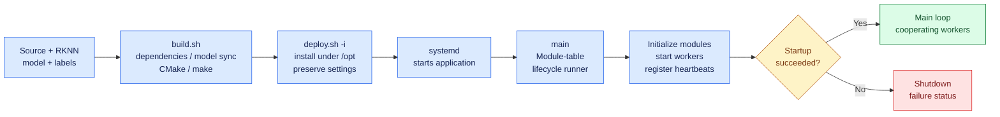
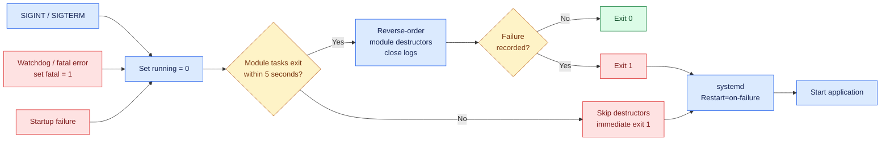
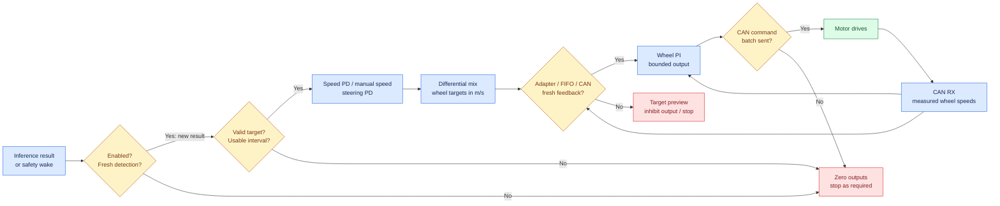
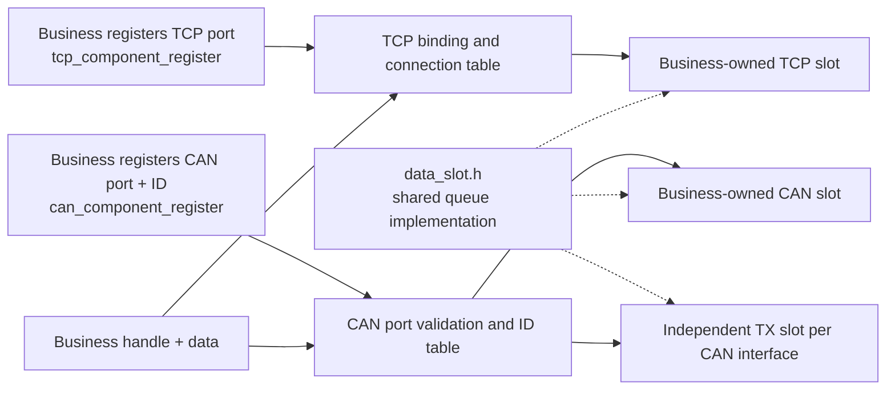

# Autonomous Driving Car

Autonomous Driving Car is a Linux-based vehicle platform being developed around a unified architecture for **perception, inference, and control**. Its hardware and system target is a shared computing platform running a Linux real-time kernel, bringing conventional motion-control algorithms, YOLO object detection, and large language model (LLM) inference into the same system.

The current implementation provides camera perception, RKNN YOLO26 inference, visual tracking, differential wheel control, and shared CAN communication. Web management, video recording, logs, and telemetry support operation and development. **LLM inference is a planned capability.**

The hardware validation platform is **Radxa ROCK 4D / RK3576**. The application uses C11/C++11, the browser interface uses HTML/CSS/JavaScript, and the build and deployment tools use Bash.

## Platform architecture

The current runtime is one C/C++ application with cooperating worker threads. [main.c](source/core/main.c) coordinates module startup and shutdown; shared frame buffers, timestamped detection results, and controller snapshots connect the processing stages.

The diagrams below follow the implemented runtime from left to right. Each view focuses on one part of the system so labels remain readable at normal README width. Solid arrows show data or execution flow; dotted arrows show management and supervision. Blue nodes process data, green nodes represent outputs or healthy states, amber nodes check prerequisites, and red nodes show stop or failure paths.

### Runtime overview



The following controller consumes detections independently of visual target selection. LLM inference is planned and is not part of the current runtime paths.

### Perception and media pipeline



Frame storage is shared through [frame_ring.h](include/video/frame_ring.h); claims and buffer ownership protect raw and RGB frames while workers use them. Bounded queues favor recent results for rendering. Each completed inference also feeds following and report generation. H.264 streaming and MP4 recording share one encoding session.

### Web management, CAN, and supervision



### Build and startup



Module-table order: **context → log → config → DBC → CAN → CAN RX/TX → TCP → HTTP → following → ANO → video → YOLO → watchdog → recording → signals**. The config module loads settings, switches the log directory, initializes CPU affinity, and applies network IP settings. The DBC module owns and loads the databases before CAN starts. CAN, TCP, and configuration storage are owned by their respective modules; the shared context borrows their pointers. Modules may create additional workers for following, inference, composition, reports, and media/file clients.

### Shutdown and recovery



The five-second wait covers module-table task threads. Destructors stop and join their owned workers where implemented. If a module task remains active, cleanup is skipped to avoid releasing resources it may still use. The kernel reclaims process resources; recording finalization is not guaranteed on this failure path.

### Following and wheel-feedback loop



Safety prerequisites are checked on timed wakes even without a new inference; PID updates use accepted inference timestamps. Following always starts disabled. Automatic speed uses relative target-area error; steering uses horizontal target error. Each wheel PI loop compares target speed with real measured feedback. Visual selection affects the overlay, while following selects its own target by configured class and proximity to its previous target or seed.

The CPU handles capture processing, tracking, control, communication, and management; the NPU runs YOLO detection. On the RK3576, the JPEG block decodes camera MJPEG into cached DMA-BUF surfaces, then a full-range BT.601 NEON conversion supplies RGB to inference. Worker affinity, adaptive inference allocation, frame ownership, and watchdog supervision support execution on the shared platform.

A Linux real-time kernel is the system target. `main.c` declares each thread's scheduling policy, priority, and CPU group alongside lifecycle callbacks in one module table, including internally owned HTTP and inference workers. Current thread rows select `SCHED_FIFO`; explicit creation attributes apply the selected CPU group before each thread starts. The controller runs at priority **20** and reports its actual scheduler separately from PREEMPT_RT kernel support through `/api/follow`. See [kernel and scheduling verification](docs/KERNEL_VERIFICATION.md) for deployed measurements and limits.

## Perception and motion control

**Perception.** V4L2 capture feeds YOLO26 detection through RKNN. The verified RK3576 YOLO26n artifact uses UINT8 RGB input, a W8A8 backbone, and FP16 detection heads and final output concatenation. Camera modes, confidence threshold, NMS IoU, model files, and labels are configurable in the browser. Codec backends are managed by the application: the RK3576 camera uses V4L2 JPEG hardware decoding when the prepared driver is available; recording uses the validated software H.264 encoder. Available camera modes depend on the attached camera and drivers.

Capture and rendering publish frame notifications to their subscribers; inference and result queues wake the next stage as work becomes available. See [frame handoff and the verified YOLO26n artifact](docs/FRAME_PIPELINE.md) for ownership, cancellation and model details.

**Visual tracking.** Click a detection on the home page to select it. Numbered labels and the selected object's cyan box are drawn into the video and included in recordings. Matching uses constant-velocity prediction, predicted box overlap, displacement, size changes, and class gates, with ambiguous matches rejected. IDs remain local to the running process; associations expire after 800 ms without a match. Display smoothing follows tracking so it does not distort velocity estimates.

The deployed model has one detection output. Model feature maps, per-target descriptors, appearance matching, and feature fields in the tracking API and new result records have been removed. See the [Chinese quantization report](docs/YOLO26N_QUANTIZATION.md) ([PDF](docs/pdf/YOLO26n量化报告.pdf)) for model preparation, accuracy, timing, output format and rollback. The [Chinese kernel build report](docs/KERNEL_BUILD_REPORT.md) ([PDF](docs/pdf/KERNEL_BUILD_REPORT_ZH.pdf)) records the kernel build, Kiln patches, installation and real-time verification.

**Intelligent Following.** The wheel controller consumes detection results independently of visual tracking. Automatic speed uses relative target size; manual mode uses the configured speed. Steering uses PD control, while the left and right wheels each use PI control with measured feedback. Wheel-speed targets and differential steering correction use **m/s**.

Clicking a visual target does not enable wheel motion. Following starts stopped after every service restart. Motor output requires:

- Following explicitly enabled for the current session.
- Fresh detections and measured left/right wheel-speed feedback.
- An available, enabled CAN interface and a valid, enabled motor protocol profile.
- Successful FIFO scheduling for the control thread.

Target loss, stale feedback, and unavailable prerequisites inhibit motion. Adapt [car_motor_can.example.conf](config/car_motor_can.example.conf) to the drive manufacturer's command, stop, and feedback formats before creating `config/car_motor_can.conf`. The example is disabled; special enable sequences or checksums require an appropriate adapter.

CAN and CAN FD traffic, DBC decoding, and motor commands share the same transport module. Target size provides a relative visual cue rather than a calibrated distance measurement.

## Hardware and software requirements

The board must provide Linux, a V4L2 camera, a working Rockchip NPU driver, and a compatible `librknnrt.so`. Vehicle control additionally requires SocketCAN hardware, an adapted motor profile, and actual wheel-speed feedback.

Build dependencies:

- C11/C++11 compiler, GNU Make, CMake **3.18+**, and Bash.
- libsystemd, libnl-3/libnl-route-3, libjpeg, and OpenCV core/imgproc development libraries.
- Standard Linux utilities including `flock`, `sha256sum`, `strings`, `awk`, `tar`, and `zip`.
- Recording uses FFmpeg libavcodec/libavutil, pkg-config and a runtime with `libx264`. Hardware encoding remains experimental and is excluded from the application backend selection.

## Build and deployment

For the validated ROCK 4D hardware JPEG path, first follow the [JPEG driver installation](kernel/rockchip-jpegd/README.md). See the [Chinese codec measurements](docs/CODEC_PERFORMANCE.md) for timing, quality checks and the encoder limitations. The front end exposes capture device, resolution and frame rate; codec selection is internal.

Prepare the model and labels before the first build:

| File | Requirement |
| --- | --- |
| `config/yolo26.rknn` | Board-compatible model with one RGB input and one decoded detection output |
| `config/coco.names` | Class labels matching the model |

The RKNN model is not included in Git. Model preparation takes place outside this repository's build process; the scripts do not train, convert, or download models. Working model initialization is required for normal service startup.

The verified RK3576 artifact takes 640×640 RGB and returns one FP16 `[1,84,8400]` tensor containing decoded pixel boxes and class probabilities. The SDK returns float detection values for postprocessing. Models with additional outputs are rejected. Raw multi-head or normalized-coordinate exports require adaptation and cannot be substituted solely because their files have the `.rknn` extension.

Run builds and deployments through the existing scripts from the repository root:

```bash
bash scripts/build.sh -R
sudo bash scripts/deploy.sh -i
```

The build produces `bin/autonomous-driving-car`. Deployment installs the executable, frontend, model, and configuration under `/opt/autonomous-driving-car`, installs the systemd unit, and starts the service.

| Command | Action |
| --- | --- |
| `bash scripts/build.sh -R` | Release build with optimization and debug information |
| `bash scripts/build.sh -D` | Debug build with terminal debug output |
| `bash scripts/build.sh -R -P rk3576` | Build with an explicitly selected model platform |
| `bash scripts/build.sh -C` | Remove build outputs and clear **project logs**; does not build |
| `sudo bash scripts/deploy.sh -i` | Install or update, preserving installed data and device settings |
| `sudo bash scripts/deploy.sh -u` | Uninstall, including installed configuration, logs, and recordings |
| `sudo bash scripts/deploy.sh -r` | Uninstall, then install again; installed data is removed |

Normal updates use `deploy.sh -i` and restart the service. The service runs from `/opt/autonomous-driving-car`, monitors worker heartbeats, and restarts on failure.

On cgroup v2 systems with effective kernel RT group scheduling, deployment first installs `/etc/systemd/system/-.slice.d/90-autonomous-driving-car-rt.conf` to disable the CPU controller and permit FIFO threads in service groups. CPU group quotas and weights are unavailable across the hierarchy while this setting is active; deployment leaves the existing service running if the controller cannot be disabled. The setting is retained on uninstall, and the global RT runtime budget is unchanged.

## Browser operation

Open **`http://<board-ip>/`**. The Web interface uses fixed HTTP port **80**.

| Page | Address | Available operations |
| --- | --- | --- |
| Home | `/` | Live video, visual target selection, resource monitoring |
| System Configuration | `/config` | Camera, YOLO, CAN, CPU, following, Web IP, and telemetry settings |
| Driving Logs | `/logs` | Log/report browsing, video playback, file downloads, cleanup |
| DBC viewer | `/dbc` | CAN definitions and decoded signals |

Home and DBC pages accept a local Linux account through HTTP Basic authentication. Configuration, logs, and administrative actions require `root` or membership in the `sudo` group. Some read-only status APIs are public.

**Web & ANO Settings** combines interface IP configuration and telemetry settings with one Save button. IP configuration manages the selected system interface; HTTP listens on the board's IPv4 interfaces. Reconnect at the new address after changing the board's IP.

Web access supports **two source IPv4 addresses**. One address can open multiple tabs, streams, or downloads while sharing a slot. The slot expires 30 seconds after its last connection closes; an additional address receives HTTP 503.

## Model and configuration management

[model_sync.sh](scripts/model_sync.sh) is a shared dependency of [build.sh](scripts/build.sh) and [deploy.sh](scripts/deploy.sh). It identifies the NPU platform, checks the RKNN header and declared target, and synchronizes prepared model files by their hashes.

A model uploaded through the browser is retained when the application is rebuilt or redeployed. If the source and deployed models have both changed independently, synchronization stops and preserves both files. Internal synchronization metadata is stored directly under `config/`.

Updates retain existing deployed `config.txt`, `follow.conf`, `car_motor_can.conf`, `cpu_freq.conf`, and `ano.conf` settings. Labels and DBC files may be replaced by source versions.

Runtime paths are relative to the working directory; the installed service uses `/opt/autonomous-driving-car`.

| Path | Purpose |
| --- | --- |
| `config/config.txt` | Camera, inference, CAN, and Web IP settings |
| `config/follow.conf` | Following parameters |
| `config/car_motor_can.conf` | Motor command and feedback protocol |
| `config/cpu_freq.conf` | CPU policy settings |
| `config/ano.conf` | Anonymous Assistant settings |
| `config/yolo26.rknn`, `config/coco.names` | Model and class labels |
| `config/*.dbc` | CAN databases |
| `logs/YYYYMMDD/` | Application information and error logs |
| `recordings/YYYYMMDD/` | Annotated MP4 recordings |
| `recordings/detections/YYYYMMDD/result_YYYYMMDD.txt` | Daily inference results: frame timestamps, class, confidence and box; existing historical rows are preserved |

**Export config** downloads actual configuration files and the model as `.tar.gz`. Empty directories and internal synchronization metadata are omitted; the total uncompressed file size is limited to **64 MiB**.

## Recording and observability

H.264/MSE and MJPEG provide live video. H.264 streaming shares its encoding session with MP4 recording. Recording starts automatically when a session can start; manually stopping recording ends that H.264 session and disables automatic continuation.

Daily TXT reports record completed inferences, including results with no detected objects. Entries contain capture time, frame sequence, image dimensions, lens position when available, target index/class/confidence, and `X1 X2 Y1 Y2` coordinates in the original image. New records contain no feature vectors or feature metadata. The existing writer batches records without doing file I/O on inference threads. Historical report content remains intact; earlier rows may contain feature fields from the previous version. Processing favors recent frames, so reports and videos need not include every captured frame.

The Driving Logs page provides individual downloads and a whole-page ZIP. Bulk deletion protects recordings that are active or being finalized. ZIP downloads omit active or incomplete videos.

```bash
systemctl status autonomous-driving-car --no-pager
journalctl -u autonomous-driving-car -f
curl -s http://127.0.0.1/api/video/stats
curl -s http://127.0.0.1/api/follow
curl -s http://127.0.0.1/api/ano
```

For startup problems, check the RKNN model, NPU driver/runtime, and camera. Use video counters for capture/encoding issues and controller readiness for missing motor output. HTTP routes are defined in [http.c](source/http/http.c).

The service permits core dumps, and Release builds retain debug information. With a configured system `systemd-coredump` collector, use `sudo coredumpctl info /opt/autonomous-driving-car/bin/autonomous-driving-car` and retain the matching executable for analysis.

## Anonymous Assistant

**Anonymous Assistant 2.0.1** receives **ANO V8 over TCP**, with the board as server and the PC as client. Configure the port and send rate in **Web & ANO Settings**. Defaults are **8080**, **30 Hz**, and initially disabled; saved settings are restored at startup. It supports **two TCP clients**.

Telemetry publishes target/actual speed and steering correction. Simulated waveforms help check the link. The telemetry connection does not issue motor commands.

Official website: [ANO Tech](https://www.anotc.com/). Downloads and documentation: [Anonymous Assistant](https://gitee.com/anotc/AnoAssistant).

## Repository structure

| Location | Responsibility |
| --- | --- |
| `source/core/` | Module lifecycle, shared context, configuration, logging, CPU affinity |
| `source/video/`, `source/yolo/` | Capture, inference, annotations, streaming, recording, reports |
| `source/control/` | Visual tracking, motion control |
| `source/can/` | SocketCAN, CAN port/ID registration, shared data slots, DBC decoding, motor protocol |
| `source/tcp/` | Protocol-independent connections, registered ports, handle routing, data slots |
| `source/telemetry/` | ANO business slots, stream parsing, protocol encoding, controller telemetry |
| `source/http/`, `html/` | Web server/APIs, pages, shared browser utilities, separate feature scripts |
| `source/watchdog/` | Worker heartbeat supervision |
| `include/` | Module interfaces and shared types |
| `config/` | Device settings, model, labels, CAN databases |
| `scripts/` | Bash build, deployment, model synchronization and JPEG driver installation |
| `kernel/` | JPEG driver sources, provenance and RK3576 activation overlay |

## Communication registration and data slots

Business modules register their communication addresses and own their receive-slot instances. The transport returns generation-tagged handles. Sending uses only **handle + data + length**; transport modules resolve ports, connections, CAN IDs, and frame formats.



TCP owns sockets and connection lifetimes; `ano.c` owns ANO slot consumption, stream assembly, and telemetry framing. CAN owns registration, interface validation, slot dispatch, and frame transmission; `can_motor.c` owns command encoding and measured wheel feedback. The former connection-forwarding, CAN service/observer/feature, internal-header, and separate CAN queue files have been consolidated.

The queue **implementation** is shared, while buffers, locks, cursors, and counters remain independent per **instance**. TCP registration rejects an uninitialized or already-bound receive slot. CAN validates that the configured interface is a real kernel CAN interface and routes by interface plus ID. A business may explicitly bind multiple CAN IDs to its own slot; incoming handles identify each binding.

- Register TCP with `tcp_component_register()` and CAN with `can_component_register()`.
- Send with `tcp_send(handle, data, length)` or `can_send(handle, data, length)`.
- Read incoming items using `data_slot_pop()` on the business-owned slot.
- Handle TCP connection/data/disconnect/reset events; assemble protocol messages in the business module.
- Use `tcp_prepare_register()`, `tcp_commit_register()`, and `tcp_cancel_register()` only when a port change must be committed after configuration is saved.

TCP preserves partial writes and resets clients instead of silently dropping stream bytes when a receive slot fills. CAN feedback slots retain recent frames and preserve the original monotonic receive timestamp. Reserved motor IDs, explicit stopping, FIFO admission, measured-feedback freshness, and output limits remain enforced.

The complete registration, receive, send, failure, and shutdown paths are documented in [CAN 和 TCP 业务流](docs/COMMUNICATION_FLOW.md), with API examples, horizontal flow diagrams, capacities, locking rules, and validation limits.

## Browser components

`html/js/app.js` provides shared JSON requests, timeouts, non-overlapping polling, card status messages, and named component lookup. Each feature owns its DOM and state: `cpu-frequency.js` manages the CPU card, `network-tools.js` manages diagnostics, and `ano.js` manages ANO settings. The network Save action uses the registered `network-ano` component. Authentication, translation, and theme behavior stay in their existing scripts.

New components should guard their root element, bind local events, use `App.json()` / `App.poll()` / `App.status()`, and expose only required methods through `App.components`. Polling pauses while hidden and resumes after returning to the page. Existing page-level inline handlers remain compatible; no bundler or frontend framework is required.

## Development direction

The next architectural step is to integrate LLM inference alongside YOLO and conventional motion control. This will extend the platform toward unified perception, inference, and control while retaining explicit interfaces for observations, model outputs, and actuator commands.

Shared-resource scheduling, control timing, and end-to-end latency on Linux real-time kernels remain areas for continued evaluation. The implemented behavior documented above provides the foundation for that work; LLM integration and broader autonomous decision-making are future development goals.

## License

[GPL-3.0-or-later](LICENSE).
