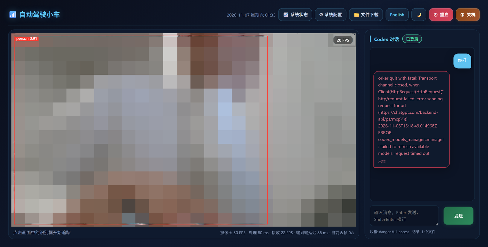
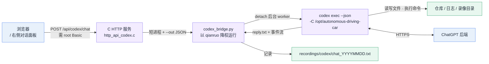
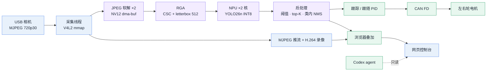
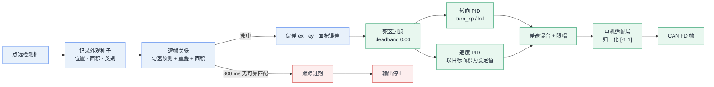
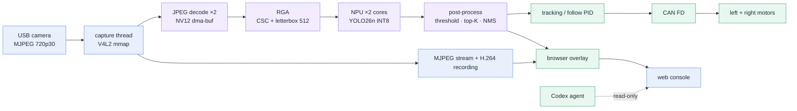

<a id="top"></a>

<div align="center">


# Autonomous Driving Car

**Radxa ROCK 4D（RK3576）上的视觉循迹小车：相机到电机整条链路跑在一个 C 进程里，板上还带一个能读代码、改代码、看日志的 Codex 智能体。**

[](#)
[](https://radxa.com)
[](#)
[](#)
[](#)
[](#板上-ai-智能体codex)
[](LICENSE)

[**中文**](#zh) · [**English**](#en)

</div>

<div align="center">


<sub>720p30 实时画面，单帧检测 `person 0.91`，底部是实测吞吐与端到端延迟。画面中的人像已整体马赛克处理。</sub>

</div>

---

<a id="zh"></a>

## 目录

- [这是什么](#这是什么)
- [界面](#界面)
- [实测指标](#实测指标)
- [板上 AI 智能体（Codex）](#板上-ai-智能体codex)
- [整体架构](#整体架构)
- [帧流水线](#帧流水线)
- [跟踪与跟随控制](#跟踪与跟随控制)
- [实时调度与绑核](#实时调度与绑核)
- [构建与部署](#构建与部署)
- [配置与模型](#配置与模型)
- [HTTP API](#http-api)
- [仓库结构](#仓库结构)
- [日志与排障](#日志与排障)
- [已知限制](#已知限制)
- [参考文档](#参考文档)

---

## 这是什么

一辆差速小车的完整固件。摄像头采集、硬件加速推理、目标跟踪、PID 跟随、CAN FD 电机输出、视频推流、录像回放，加上一个零安装的网页控制台，全部编译进同一个 C 可执行文件，由 systemd 托管。

2026 年的版本多了一层：**板子上跑着一个 Codex CLI 智能体**，网页上就能和它对话，让它读这个仓库的代码、翻运行日志、改错、重新编译。它不是外挂的聊天窗口，是长在车机里的开发助手 —— 见 [板上 AI 智能体](#板上-ai-智能体codex)。

| 能做什么 | 说明 |
|---|---|
| 视觉循迹 / 跟车 | 在画面上点选一个检测框，车自动转向并保持距离；目标丢失立即停车 |
| 纯检测演示 | 不接电机也能跑：实时出框、同帧对齐、检测结果可回放导出 |
| 边缘推理基准 | `/status` 看 NPU / RGA / CPU 逐核占用与端到端延迟曲线 |
| 分段录像 | 按段编成 H.264 fMP4，浏览器内播放、打包下载 |
| **板上 AI 助手** | 内置 Codex 对话：读代码、查日志、改文件、跑构建，带额度与用量显示 |
| 总线调试 | DBC 解析、CAN 报文抓取与发送、信号在线解码 |

> **为什么不是树莓派 + ROS？**
> 720p30 的闭环在 Pi 上跑不动，光是软件解码就吃满 CPU。这里的取舍是：单进程共享内存，帧以 DMA-BUF 在采集、RGA、NPU 之间流转，不做序列化和拷贝；控制线程跑在 PREEMPT_RT 的 FIFO 优先级上，避免"看到了但来不及刹车"。代价是没有 ROS 生态，所有模块都要自己写。

---

## 界面

五个页面，纯静态资源，无构建步骤、无 CDN 依赖，中英双语 + 明暗主题。

| 主界面 — 实时画面 + Codex 对话 | 系统状态 — 逐核占用与温度 |
|:---:|:---:|
| [](docs/img/ui-main.png) | [](docs/img/ui-status.png) |
| 点框即追踪；右侧是板载智能体，角标显示已登录 | CPU / NPU / RGA 占用、频率、内存磁盘、网速 |

| 系统配置 | 文件下载 |
|:---:|:---:|
| [](docs/img/ui-config.png) | [](docs/img/ui-files.png) |
| YOLO、调频、Codex、代理、采集参数，写操作需管理员密码 | 日志 / 录像 / 检测日报 / 对话记录，可预览、打包、清理 |

<div align="center">

[](docs/img/ui-dbc.png)

<sub>DBC 信号解析：上传 DBC 后按报文在线解码收发方向的总线信号（本机未接总线，故为空表）</sub>

</div>

> 首图与主界面截图里，摄像头画面是**整块马赛克**的：原始画面是真人，进公开仓库前做了像素化，只保留检测框与 FPS 角标。截图取自 2026-11-07 01:33 的真实运行状态。

---

## 实测指标

以下数字取自 2026-11-07 板端 `/api/video/stats`、`/api/system` 与运行日志的实际采样，不是理论值。

| 指标 | 数值 | 采集位置 |
|---|---|---|
| 端到端处理延迟 | **80 ms**（最大 128 ms） | `processing_age_ms` |
| 采集 | 1280×720 MJPEG，30.0 fps | `capture_fps` |
| 丢帧 | 采集 0 / 驱动 0 / 推理 0 | `*_dropped` |
| NPU 推理 | 512×512，双核，`run` 8–10 ms | `yolo timing` |
| JPEG 解码 | 2 线程并行，约 5 ms/帧 | `yolo timing` |
| 整机 CPU | ≈ 4%（60 s 平均），4×2016 + 4×2208 MHz | `/api/system` |
| 常驻内存 | 76 MB RSS / 18 线程 | `ps` |
| 温度 | 59 ℃，满载无风扇 | `/api/system` |
| 模型精度 | mAP50 **0.591** / mAP50-95 **0.434** | `tools/model` 留出集 |

---

## 板上 AI 智能体（Codex）

这是这套固件里最新、也最容易被忽略的一层：**车机自己会读代码**。

不是把 OpenAI 的网页嵌进 iframe，而是把 Codex CLI 装到板上，用一层很薄的桥接接到现有的 C HTTP 服务上。浏览器里发一句话，板上真的会起一个 agent 进程去干活。



**链路分工**（`source/http/http_api_codex.c` 360 行 + `scripts/codex_bridge.py` 1326 行）：

| 环节 | 做法 | 为什么 |
|---|---|---|
| HTTP → 桥接 | 每次调用都是短生命周期进程，结果写 `--out` JSON 后退出 | 不让 Python 常驻，崩溃不影响 HTTP reactor |
| 长任务 | 一轮对话、设备码登录 detach 到后台子进程 | HTTP worker 永远不阻塞，前端轮询状态 |
| 用户输入 | 一律走 `--input` 文件，永不进 argv | 中文、引号、换行都不会被 shell 拆开 |
| 权限 | `codex` 以 `qianruo` 身份运行，服务本身是 root | 服务要 root 才能配网/调频，但 agent 不需要 |
| 执行 | `-s danger-full-access`、`approval_policy = "never"` | 无人值守场景下不想卡在交互确认 |
| 上下文 | 最近 6 轮对话（每条截断 1200 字符）+ 当前消息 | 控制在 CLI 上下文的便宜区间 |
| 上限 | 单轮 300 s 超时；同时只允许 1 个 job；单条消息 16000 字符 | 车机内存和 CPU 都紧张 |

### 它能做什么，不能做什么

**能**：读整个仓库（C 源码、HTML、脚本、文档）、读 `recordings/` 下的日志与录像清单、跑 `cmake` / 编译、改文件、调只读接口（`/api/system`、`/api/video/stats`、`/api/detections/live`）。

**不能**：`sudo`、跑 `deploy.sh -i`、以及任何 POST 到控制面的接口 —— 这些在 `http.c` 的路由表里被标成 `http_check_auth_root`，而 agent 手上没有 root 凭据。

这是刻意的：**推理与执行分开授权**。模型可以随便分析、随便改代码，但把车开出去这件事必须过 root 密码。

### 登录、额度与升级

- **登录**：设备码流程。页面上点"登录"→ 板上调 CLI 拿 device code → 浏览器打开 `https://auth.openai.com/codex/device` 输码 → 凭据落 `.codex/auth.json`。不配置自定义 provider，也不存 API key。
- **模型与推理强度**：页面上是两个下拉框，写进 `.codex/config.toml`（`model`、`model_reasoning_effort`）。可选模型列表来自 CLI 的 app-server，不是前端写死的。
- **额度**：读 ChatGPT 套餐的两个窗口（5 小时 / 每周），页面画的是**剩余**百分比 + 重置时间。

<div align="center">


<sub>配置卡片：模型 GPT-6.1-Sol、推理强度 medium、PLUS 套餐。这张图拍摄时周窗口已用满，所以下面写着"额度已用尽"。</sub>

</div>

- **升级**：检查 npm 上的最新版本，安装动作在 sandbox 之外单独拉起，避免自己改自己被系统沙箱拦住。

### 记录与审计

每轮对话都落盘，一行一条，纯文本，`recordings/codex/chat_YYYYMMDD.txt`：

```text
23:18:38 你：你好
23:19:04 错误：Worker quit with fatal: Transport channel closed ...
```

事件流（`thread.started`、`item.completed` 等）只留在 JSON 里用于调试，不写进可读记录。网页"文件下载"页能预览、打包、导出这些记录。

### 从"能问答"到"能控车"

这里的现状要说清楚：**它已经能改代码，但还不能开车**。

| 环节 | 现在 | 缺什么 |
|---|---|---|
| 读状态 | ✅ 只读 API + 日志 | — |
| 改代码 / 编译 | ✅ full-access 工作目录 | — |
| 部署 | ❌ 需要 root | 一条受审计的部署通道 |
| 下发运动指令 | ❌ 控制接口要 root | 把动作封装成工具，而不是给 shell |
| 安全 | 靠权限隔离 | 速度/时长/地理围栏包络、人在环审批、失败即停 |

真要让模型参与控制，顺序应该是：先把"前进 0.3 m/s、左转 50 ms"这类动作做成**带参数校验的工具调用**，再加一层不依赖模型的硬件急停，最后才是让模型在包络内决策。现在直接给它一个 shell 去 `curl POST /api/follow`，是不负责任的。

---

## 整体架构



**模块表驱动的生命周期。** 所有常驻线程（名称、初始化顺序、调度策略、优先级、CPU 分组）集中声明在 `source/core/main.c` 的一张表里：按依赖顺序初始化，启动失败回滚连续前缀，退出时按相反顺序析构，并以 5 秒为限逐个 join。新增模块只要扩表，不用改调度代码。

**采集序号 `seq` 是贯穿全链路的主键。** 每一帧出队时拿到自增序号，解码、推理结果、推流帧、前端叠加都带着它。前端按 `seq` 把框贴回对应那一帧，因此框不会比画面慢几帧，丢帧也能被精确统计。

---

## 帧流水线

```mermaid
flowchart LR
    A["V4L2 采集<br/>1280×720 MJPEG"] -->|"mmap + claim"| B["libjpeg-turbo<br/>→ NV12 dma-buf"]
    B -->|"dma-buf 零拷贝"| C["RGA<br/>CSC + letterbox"]
    C -->|"RGB 512×512"| D["NPU<br/>RKNN 推理"]
    D --> E["解码输出<br/>INT8 类别 + FP16 框"]
    E --> F["阈值 · top-K<br/>类内 NMS"]
    F --> G["检测列表<br/>带 seq"]

    classDef io fill:#e8f1fb,stroke:#5b8def,color:#1f2937
    classDef hw fill:#f3ecff,stroke:#8f7cf0,color:#1f2937
    classDef out fill:#e8f7ef,stroke:#3aa675,color:#1f2937
    class A,G io
    class B,C,D hw
    class E,F out
```



**80 ms 的构成**（实测 `yolo timing`）：

| 环节 | 耗时 | 说明 |
|---|---:|---|
| 相机侧 | 33 ms | 驱动时间戳 → DQBUF 返回，UVC 固有的一帧延迟 |
| JPEG 软解 | 5 ms | 双线程并行，`deliver_to_decode = 0` 说明应用自身没有排队 |
| RGA CSC + letterbox | 1–2 ms | 一趟完成 NV12→RGB、缩放、居中填充 |
| NPU run | 9–10 ms | 512×512，双核各挂一个 worker |
| 后处理 | ≈ 1 ms | 逐锚点扫描 + 类内 NMS |
| 渲染节拍 | ≤ 33 ms | 叠加流按 30 fps 提交，最多等一个帧周期 |

几个关键取舍：

- **在途上限 2 帧**（`YOLO_MAX_INFLIGHT`）。解码拆成双线程后生产速率追平相机，若不设上限，队列会永久积压，端到端一度涨到 169 ms；限制在途为 2 后稳定在 80 ms，且 `infer_dropped` 保持 0。
- **跳帧策略**：推理跟不上时丢最旧的帧，保证画面永远是最新的，丢帧数在 `/api/video/stats` 可见。
- **全硬件通路**：RGA 缺失时推理池直接拒绝启动，不静默回退到 CPU 缩放。
- **性能调速器**：`ondemand` 会在 33 ms 帧间隔内降频，下一帧爬频导致解码/缩放/NMS 抖动（E2E 60±7 → 46±0.5 ms）。仓库默认写 `performance`，由 `/api/cpu_freq` 持久化。

---

## 跟踪与跟随控制

不做自动跟踪，避免误锁背景：**点哪个框就锁哪个**。



默认参数（`/api/follow` 可读写，重启后跟随默认关闭）：

| 参数 | 默认 | 作用 |
|---|---|---|
| `max_speed` | 0.30 m/s | 单轮速度上限 |
| `max_turn_delta` | 0.15 m/s | 左右轮差速上限 |
| `deadband` | 0.04 | 中心误差死区，防停车抖动 |
| `timeout_ms` | 300 ms | 目标丢失后多久强制停车 |
| `speed_kp` | 0.40 | 面积误差 → 速度 |
| `turn_kp` / `turn_kd` | 0.15 / 0.003 | 横向误差 → 差速 |
| `wheel_kp` / `wheel_ki` | 1.00 / 0.10 | 轮速闭环（有实测反馈时启用） |

安全设计：

- **控制线程不是固定节拍**：每次新检测结果唤醒一次，50 ms 超时兜底，所以控制频率跟随推理帧率，而不是空转。
- **双层限幅**：速度与差速各自限幅，PID 参数写错也不会全速冲出去。
- **积分限幅**：轮速环的 I 项单独限幅，避免长距离直道积分饱和。
- **失效保护**：目标丢失超过 `timeout_ms`、反馈超时、推理停滞超过 1 秒，任一条成立都立即输出停止命令；看门狗漏报 3 次则整个服务失败退出，由 systemd 拉起。
- **电机协议不写死**：`config/car_motor_can.conf` 用 ID / 偏移 / 位宽 / 缩放描述命令与反馈帧，只有校验通过才绑定；未配置时控制器启动即关闭，不会向总线瞎发。

---

## 实时调度与绑核

RK3576 是 4×Cortex-A53 + 4×Cortex-A72。分组按 SoC 写死在 `cpu_affinity.c`，不在运行时探测。

| 线程 | 策略 / 优先级 | CPU 组 |
|---|---|---|
| main · TCP · HTTP reactor | FIFO 5 | LITTLE |
| HTTP worker · 推理日报 · Codex 桥接 | FIFO 1 | LITTLE |
| 图像渲染 · 录像 | FIFO 10 | BIG |
| NPU 推理 worker | FIFO 12 | BIG |
| JPEG 软解 ×2 · 相机采集 | FIFO 15 | BIG |
| CAN 收发 | FIFO 15 | LITTLE |
| **跟随控制** | **FIFO 20** | LITTLE |
| 看门狗 | FIFO 30 | LITTLE |

- 采集线程固定在 FIFO 15 绑大核：它绝大部分时间阻塞在 `DQBUF`，每 33.3 ms 唤醒一次只做入环，单次运行 < 1 ms。早先版本用 `SCHED_DEADLINE`，代价是内核要求 deadline 线程亲和性覆盖整个 root domain，只能在 8 个核之间漂移，最坏单次运行 0.867 ms；改绑核 FIFO 后降到 0.48 ms。
- 解码优先级高于推理（15 > 12），保证推理取帧时数据已就绪。
- **cgroup v2 陷阱**：内核启用 `CONFIG_RT_GROUP_SCHED` 时，服务子组可能没有实时预算，申请 FIFO 返回 `EPERM`。`scripts/deploy.sh` 会在停机前检查并在根 slice 上设 `DisableControllers=cpu`，验证生效后才安装。
- 跟随控制接口会回报实际拿到的策略、优先级与内核是否 RT，不是"配置了就算成功"。

---

## 构建与部署

**前置条件**：Radxa ROCK 4D（RK3576）、PREEMPT_RT 内核、板端 `librknnrt` 2.5.0、`librockchip_mpp`、`librga`，以及与运行时匹配的 `config/yolo26.rknn`（模型不入库，见 [模型链路](tools/model/README.md)）。

```bash
sudo apt install -y build-essential cmake git python3 curl libnl-3-dev libnl-route-3-dev \
                    libjpeg-turbo8-dev librga-dev

# 编译（Release，约 40 秒）
cd ~/autonomous-driving-car && ./scripts/build.sh -R

# 部署（安装到 /opt，注册并重启 systemd 服务）
sudo ./scripts/deploy.sh -i

# 自检
curl -s -u qianruo:qianruo http://127.0.0.1/api/video/stats
```

| 脚本 | 参数 | 说明 |
|---|---|---|
| `scripts/build.sh` | `-R` Release / `-D` Debug / `-C` 清理 | 构建前会 `model_sync.sh reconcile` 校验模型与哈希 |
| `scripts/deploy.sh` | `-i` 安装 / `-u` 卸载 / `-r` 重装 | 处理 cgroup v2 实时预算，安装 systemd 单元 |
| `scripts/git_sync.sh` | `"提交信息"` | 提交工作区改动并推送到 origin，部署后保持板端与仓库一致 |
| `scripts/model_sync.sh` | `reconcile` / `validate` | 模型落位、校验、部署前后哈希比对 |
| `scripts/codex_bridge.py` | — | Codex 对话桥接，独立于 HTTP worker 运行 |

部署后目录为 `/opt/autonomous-driving-car`，服务以 `ProtectSystem=strict` 沙箱运行，只放开 `config/`、`recordings/`、`.codex/` 与 `/etc/proxy-client.conf` 可写，`html/` 只读。构建会生成 `include/core/version.h`（版本、提交号、分支、构建时间），页面右上角显示的就是它。

---

## 配置与模型

| 文件 | 入库 | 说明 |
|---|:--:|---|
| `config/config.txt` | ✗ | 主配置：相机、YOLO、CAN、网卡（网页保存） |
| `config/follow.conf` | ✗ | 跟随 PID 与限幅（网页保存） |
| `config/car_motor_can.conf` | ✗ | 电机协议映射，由 example 复制后改 |
| `config/car_motor_can.example.conf` | ✓ | 协议字段说明与示例 ID，**不是可用电机参数** |
| `config/cpu_freq.conf` | ✗ | 调频策略，默认 performance 固定高频 |
| `config/ano.conf` | ✗ | ANO V8 遥测采样配置 |
| `config/yolo26.rknn` | ✗ | 运行时模型，构建与部署按哈希校验 |
| `config/coco.names` | ✓ | 80 类标签 |
| `config/can0.dbc` · `can1.dbc` | ✓ | DBC 示例，可在网页上传替换 |
| `.codex/config.toml` | ✗ | 由网页写入：`model`、`model_reasoning_effort`、`approval_policy` |
| `.codex/auth.json` | ✗ | 设备码登录凭据，**绝不能入库** |

运行期配置一律不入库，避免每次调参都污染提交历史。

---

## HTTP API

接口以 JSON 为主（个别写接口返回纯文本状态）。认证分两级：页面与只读接口用系统账户 Basic 认证，写接口额外要求 root 或 sudo 组成员。

| 分组 | 端点 |
|---|---|
| 系统 | `GET /api/system` · `GET /api/cpu_freq` · `GET/POST /api/config` · `POST /api/reboot` · `POST /api/shutdown` |
| 视频 | `GET /api/video/devices` · `/caps` · `/stats` · `/api/camera` · `/api/tracking` |
| 检测 | `GET /api/detections/live?after=<seq>` · `/api/detections/reports` · `POST /api/yolo/upload` |
| 跟随 | `GET/POST /api/follow` |
| 录像 | `POST /api/rec/start` · `/stop` · `/split` · `GET /api/rec/status` · `/list` · `/pack` · `/delete` |
| 文件 | `GET /api/files/...` · `/download-session` · `/video-session` · `POST /api/files/pack` |
| CAN | `GET /api/can/ifaces` · `/frames` · `/decoded` · `POST /api/can/toggle` · `/send` · `/dbc` |
| 网络 | `GET /api/network` · `/ifaces` · `GET/POST /api/proxy/config` · `/api/nettest` |
| 日志 | `GET /api/logs` · `POST /api/logs/clear` |
| ANO 遥测 | `GET/POST /api/ano` |
| **Codex** | `GET /api/codex/status` · `/models` · `/quota` · `/history` · `/records` · `/export` · `POST /api/codex/chat` · `/stop` · `/reset` · `/login/device` · `/config` · `/update/check` · `/update/install` · `/logout` |

`/api/codex/*` 全部要求 root 认证 —— 智能体能改代码，所以进这道门就要管理员密码。

---

## 仓库结构

```text
source/                 C 实现（约 1.7 万行）
├── core/               模块表、配置读写、日志、CPU 亲和性、通用容器
├── http/               epoll reactor + worker、全部 REST 接口、静态文件、Codex 桥接层
├── video/              V4L2 采集 · 帧环 · RGA 预处理 · fMP4 录像 · JPEG 解码
├── yolo/               RKNN 推理池（多 worker + 在途限流）、后处理、事件分发
├── control/            跟随控制（PID · 死区 · 限幅 · 电机适配）与视觉跟踪
├── can/                CAN FD socket、DBC 解析、电机协议映射
├── tcp/                共享 TCP 事件循环（ANO 遥测复用）
├── telemetry/          ANO V8 采样帧编码与校验
└── watchdog/           线程心跳与失活处置
include/                对应头文件（含 RKNN 厂商接口）
html/                   前端，无构建步骤（5 个页面 + 28 个 JS/CSS）
scripts/                build · deploy · model_sync · git_sync · codex_bridge · proxy_config
tools/model/            离线模型链路：数据集 → ONNX → RKNN → 评测
docs/                   设计、延迟、调度、量化、测试与评审文档
config/                 运行期配置与标签、DBC、模型
```

---

## 日志与排障

| 位置 | 内容 |
|---|---|
| `journalctl -u autonomous-driving-car -f` | 服务日志（含 `yolo timing` / `handoff` 每 10 秒一行） |
| `recordings/logs/log_info_YYYYMMDD.log` | 按天切分的运行日志 |
| `recordings/videos/video_YYYYMMDD_N.mp4` | 分段录像（H.264 fMP4） |
| `recordings/results/` | 检测日报 |
| `recordings/codex/chat_YYYYMMDD.txt` | 与板载智能体的对话记录 |
| `recordings/proxy-backups/` | 代理配置改动前的备份 |

| 现象 | 排查 |
|---|---|
| 画面黑屏 | `curl /api/video/devices` 看设备是否存在；`fuser -v /dev/video2` 查占用 |
| 有画面没框 | `curl /api/detections/live`；模型输入尺寸与 `coco.names` 是否匹配 |
| 服务起不来 | 日志里找 `create thread ... EPERM`，多为实时调度预算被 cgroup 掐掉 |
| 服务反复重启 | `YOLO inference stalled > 1s` 触发故障保护，先看 NPU 是否被别的进程占用 |
| 延迟突然变高 | `/api/video/stats` 的 `processing_age_max_ms` 与 `infer_dropped`；查是否切回 `ondemand` 调频 |
| 小车不动 | `car_motor_can.conf` 缺失或 `enabled 0`；`/api/can/ifaces` 确认接口 up |
| 两侧轮子反向 | 反馈 `fb_scale` 符号或电机安装方向，不是 PID 问题 |
| 保存报 401 | 会话过期，重新弹框输入；连续失败会触发 IP 限速 |
| 样式全丢 | `curl /css/common.css` 应为 200，字节数与磁盘一致 |
| Codex 报 `Transport channel closed` | 先看 `/api/codex/quota`：周窗口用满会直接拒答，不是网络问题 |
| Codex 一直"正在回答" | `/api/codex/stop`；桥接单轮超时 300 s，卡死时 `busy` 标记最多 330 s 后自动失效 |

---

## 已知限制

诚实列出来，避免误用：

- **CAN 与电机闭环未在本机验收**：仓库只有协议示例，没有绑定具体电机型号；实车闭环、CAN FD 总线收发与在线 DBC 解码需自行配置后验证。
- **舱内 AI 依赖外部账号**：Codex 走 ChatGPT 套餐配额，断网或额度用尽就只剩只读能力；模型、额度、可用性都不由本仓库控制。
- **AI 不能控车**：控制面接口一律要 root 凭据，agent 拿不到；"让模型开车"目前只是路线图，不是功能。
- **单目标**：同时只跟一个目标，多目标切换会重置外观种子。
- **手工选点**：没有车道线检测或语义分割，循迹依赖 YOLO 的 80 类目标。
- **MJPEG 推流**：延迟可控但带宽不低，弱网下不如 WebRTC；硬件 JPEG 解码器存在同帧多次解码不一致的缺陷，因此固定用软件解码。
- **硬件编码只做了短时验证**：录像用 MPP 编 H.264，产物能被 ffprobe 正常解析，但没有做过小时级压测与异常掉电测试。
- 其余并发与边界问题见 [CODE_REVIEW](docs/CODE_REVIEW.md)，未全部修复，状态逐条标注。

---

## 参考文档

| 文档 | 内容 |
|---|---|
| [LATENCY_PROFILE](docs/LATENCY_PROFILE.md) | 80 ms 的逐环节剖析，以及被验证否定掉的优化 |
| [REALTIME_SCHEDULING](docs/REALTIME_SCHEDULING.md) | 线程策略、绑核依据、cgroup 实时预算处理 |
| [FRAME_PIPELINE](docs/FRAME_PIPELINE.md) | 帧发布、订阅、claim 与模型校验 |
| [COMMUNICATION_FLOW](docs/COMMUNICATION_FLOW.md) | 模块注册表、队列与背压 |
| [YOLO26N_QUANTIZATION](docs/YOLO26N_QUANTIZATION.md) | INT8 类别 + FP16 框的量化过程与精度 |
| [FUNCTIONAL_TEST_REPORT](docs/FUNCTIONAL_TEST_REPORT.md) | 105 项接口回归、浏览器与隔离验证记录 |
| [CODE_REVIEW](docs/CODE_REVIEW.md) | 代码审查与未修复问题清单 |
| [模型链路](tools/model/README.md) | checkpoint → ONNX → RKNN 的离线工具 |
| [推理流水线延迟剖析（PDF）](docs/pdf/推理流水线延迟剖析.pdf) · [YOLO26n 量化报告（PDF）](docs/pdf/YOLO26n量化报告.pdf) | 出版版报告 |

内核侧（PREEMPT_RT、NPU/RGA 驱动、调频补丁）在独立仓库：[qianruo-orange/rock-4d-npu-kernel](https://github.com/qianruo-orange/rock-4d-npu-kernel)。

## 路线图

- [x] 板载 Codex 智能体：对话、额度、记录、升级
- [ ] 把控制动作封装成受校验的工具调用，让模型在安全包络内参与决策
- [ ] 多目标同时跟随与目标切换
- [ ] 车道线检测替代手工选点
- [ ] WebRTC 低延迟推流替代 MJPEG
- [ ] 用板端采集的数据做端侧微调
- [ ] CAN 电机协议的更多实测型号

---

<div align="right"><a href="#top">⬆ 回到顶部</a></div>

<a id="en"></a>

---

# English

**A vision-guided differential-drive car on Radxa ROCK 4D (RK3576).** Capture, NPU inference, tracking, PID following, CAN FD motor output, streaming and the web console all live in one C process, supervised by systemd. An on-board **Codex CLI agent** sits behind the same console: it can read this repository, inspect runtime logs, edit files and rebuild — behind a root-only gate that keeps it away from the control plane.

<div align="center">

<br><sub>720p30 live view, single-frame detection, measured throughput and end-to-end latency. The person in frame is pixelated on purpose.</sub>
</div>

## Measured on hardware

| Metric | Value |
|---|---|
| End-to-end processing latency | **80 ms** (max 128 ms) |
| Capture | 1280×720 MJPEG, 30.0 fps, 0 dropped frames |
| NPU inference | 512×512 YOLO26n, two cores, 8–10 ms per frame |
| JPEG decode | 2 threads, ~5 ms per frame |
| Whole-board CPU | ≈ 4 % (60 s average) |
| Resident memory | 76 MB RSS, 18 threads |
| Model accuracy | mAP50 0.591 / mAP50-95 0.434 |

Numbers come from `/api/video/stats`, `/api/system` and runtime logs, not from estimates.

## On-board agent

`codex exec` runs on the board, detached from the HTTP reactor by a thin Python bridge. Every `/api/codex/*` endpoint requires **root** Basic auth, and the CLI itself runs as the unprivileged `qianruo` user with `danger-full-access` on the repository only. Consequences: it can read code, read logs, edit files and compile; it cannot `sudo`, run the deploy script, or POST to any control endpoint (`/api/follow`, `/api/can/send`, …) because those are root-gated. Model and reasoning effort are chosen in the web UI and written to `.codex/config.toml`; login uses the ChatGPT device-code flow; quota is read from the CLI's app-server and shown as remaining percentage.

Letting a model *drive* is a roadmap item, not a feature: it needs validated tool calls, a hardware envelope and a human-in-the-loop, not a shell.

## Architecture



## Screens

| Main console | System status |
|:---:|:---:|
|  |  |

| Configuration | Files |
|:---:|:---:|
|  |  |

## Build & deploy

```bash
sudo apt install -y build-essential cmake git python3 curl libnl-3-dev libnl-route-3-dev \
                    libjpeg-turbo8-dev librga-dev
./scripts/build.sh -R          # release build, ~40 s
sudo ./scripts/deploy.sh -i    # install to /opt, register the systemd unit
```

The runtime model (`config/yolo26.rknn`) is not in the repository; see [tools/model](tools/model/README.md) for the dataset → ONNX → RKNN chain.

## Known limits

CAN motor closed-loop control is not validated on this unit — the repository ships an example mapping, not a specific motor model. The agent needs an external ChatGPT subscription and stops answering when the weekly quota is gone. Only one target is followed at a time, tracking relies on manual selection of the 80 COCO classes, and streaming is MJPEG rather than WebRTC. Annotated recording uses MPP H.264 and has only been smoke-tested. Open review findings are tracked in [docs/CODE_REVIEW.md](docs/CODE_REVIEW.md).

## License

GPL-3.0-or-later — see [LICENSE](LICENSE).
