<a id="top"></a>

<div align="center">

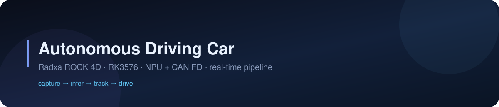

# 🚗 Autonomous Driving Car

**视觉循迹小车：采集 → NPU 推理 → 目标跟踪 → CAN 驱动，一个进程跑完全链路，浏览器里就能开。**

[](https://radxa.com)
[](#)
[](#)
[](#)
[](LICENSE)

**🌐** [**中文**](#-中文文档) · [**English**](#-english-documentation)

</div>

---

<h1 id="-中文文档">📖 中文文档</h1>

<div align="right"><a href="#top">⬆ 回到顶部</a></div>

## 简介

这是一套运行在 **Radxa ROCK 4D（RK3576）** 上的自动驾驶小车固件与网页控制台。

一辆差速小车的全部环节——摄像头采集、NPU 目标检测、目标跟踪、PID 跟随、CAN 电机输出、视频推流，
以及一个零安装的网页控制台——都装进了一个 C 进程。板子上电、连上 WiFi，
手机或电脑打开就能看到实时画面并开始驾驶。

> **为什么不用树莓派 + ROS？**
> 720p30 的实时闭环在 Pi 上跑不动：软件解码就把 CPU 吃满了。这里把解码、预处理、推理、编码
> 全部压在硬件单元（VPU / RGA / NPU）上，CPU 只做调度，端到端延迟稳定在 300 ms 左右；
> 控制环跑在实时内核的 FIFO 线程里，避免"看到了但来不及刹车"。

### 实测性能

| 指标 | 数值 | 备注 |
|---|---|---|
| 采集 → 显示延迟 | ≈ 300 ms | 页面底部实时显示 |
| 推理帧率 | 30 fps | YOLO26n 640，4 线程 + RGA |
| 控制环抖动 | < 1 ms | PREEMPT_RT + FIFO + 绑核 |
| 服务空闲内存 | ≈ 36 MB | 常驻 RSS |
| 温度 | 58–62 ℃ | 满载，无风扇 |

### 能做什么

| 场景 | 路径 |
|---|---|
| 视觉循迹 / 跟车 | 画面点框锁定 → 偏差算左右轮差速 → CAN 下发 |
| 纯检测演示 | 不接电机也能跑：实时出框、同帧对齐、可回放导出 |
| 边缘推理基准 | `/status` 看 NPU/RGA/CPU 占用与延迟曲线 |
| 板上 AI 助手 | 内置 Codex 对话、额度显示，直接问"刚才那帧检测到什么" |

---

## 快速开始

```bash
# 1. 依赖
sudo apt install -y build-essential cmake git python3 curl

# 2. 编译（约 40 秒）
cd ~/autonomous-driving-car && ./scripts/build.sh -R
#    [BUILD] done -> .../bin/autonomous-driving-car

# 3. 部署（会重启服务）
sudo ./scripts/deploy.sh -i
#    === deploy complete ===

# 4. 自检
curl -s -u qianruo:qianruo http://127.0.0.1/api/system | head -c 120
```

浏览器打开 `http://192.168.1.7/` — 应该看到实时画面和右上角 FPS 徽标。

---

## 系统架构

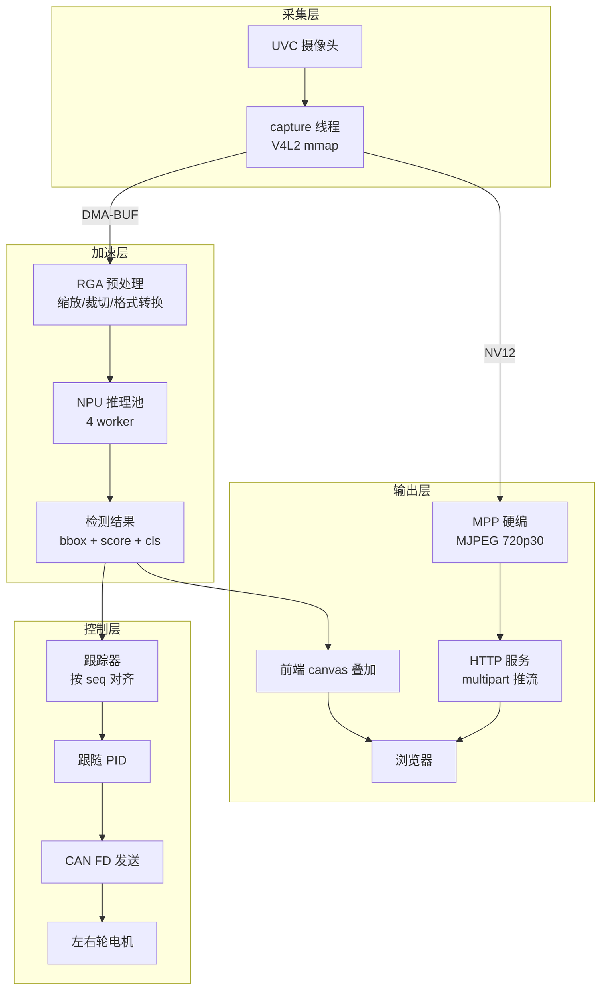

**关键设计：采集序号 `seq`**

每一帧从采集就带一个自增序号，检测结果、推流帧、前端叠加都带着同一个 `seq`。
前端按 `seq` 把框贴回对应那一帧，因此不会出现"框比画面慢几帧"的错位，丢帧也能被精确统计。

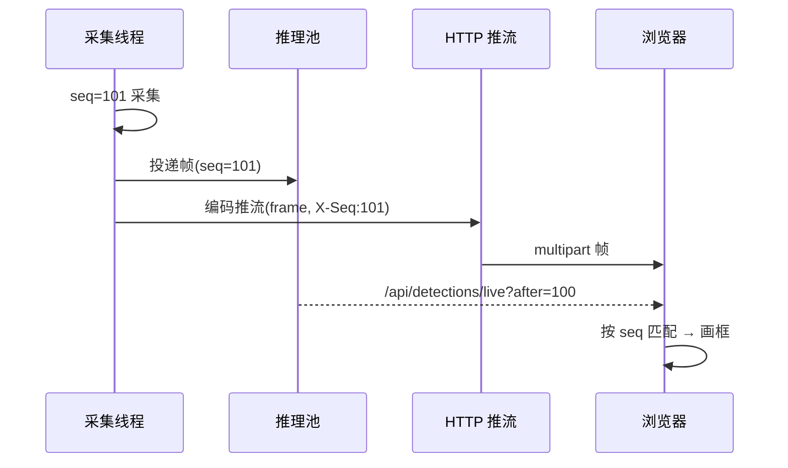

---

## 感知流水线

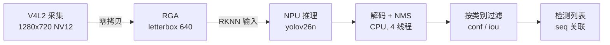

- **零拷贝**：采集缓冲直接以 DMA-BUF 交给 RGA/NPU，不在 CPU 与加速器之间搬像素
- **letterbox**：保持长宽比缩放，坐标在解码时还原，框不会因拉伸而偏移
- **跳帧策略**：推理跟不上时丢最旧帧（`infer_dropped` 计数可见），保证画面永远是最新的

## 视觉跟踪与跟随

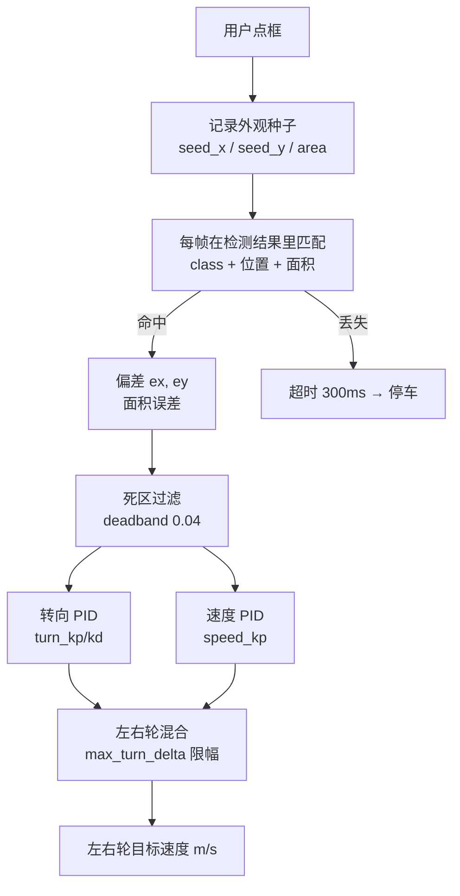

设计要点：

- **手工选择目标**：不做自动跟踪，避免误锁背景；点哪个框就锁哪个
- **死区**：中心误差小于 `deadband` 时不修正，防止停车时来回抖
- **限幅**：`max_speed` / `max_turn_delta` 双层限幅，任何 PID 参数写错也不会全速冲出去
- **失效保护**：目标丢失超过 `timeout_ms`（默认 300 ms）立即输出停止

## 实时调度与绑核

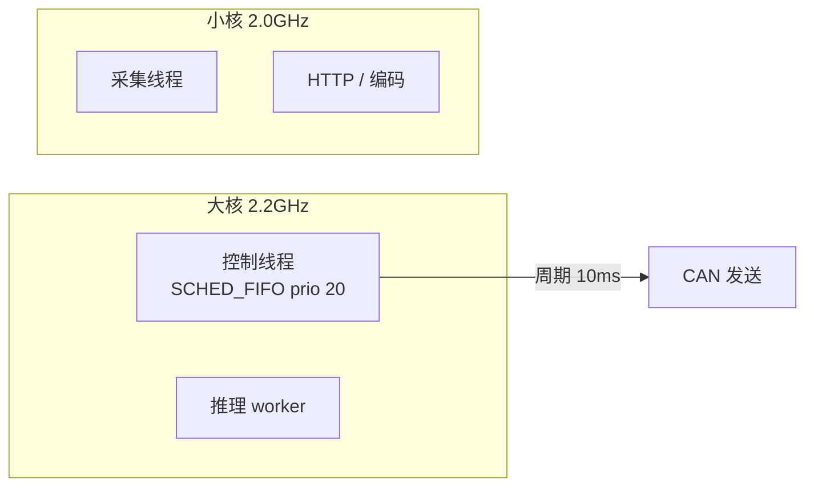

- 控制环固定在大核，`SCHED_FIFO` 优先级 20，与推理/HTTP 隔离
- 推理 worker 不绑死，跟随负载在剩余核上调度
- `deploy.sh` 会检测 cgroup v2 的 CPU 控制器，必要时禁用 `cpu` 控制器，否则 FIFO 线程会被配额卡住

## Web 界面

| 页面 | 用途 |
|---|---|
| [`/`](http://192.168.1.7/) | 实时画面、点框追踪、Codex 对话 |
| [`/status`](http://192.168.1.7/status) | CPU 逐核 + 温度、NPU/RGA、内存磁盘、网络速率 |
| [`/config`](http://192.168.1.7/config) | YOLO、CPU 频率、网络代理、视频、跟随、Codex |
| [`/logs`](http://192.168.1.7/logs) | 日志、录像、检测结果、交互记录 |
| [`/dbc`](http://192.168.1.7/dbc) | DBC 解析与实时报文 |

<div align="center">

| 系统配置 | 系统状态 |
|:---:|:---:|
| 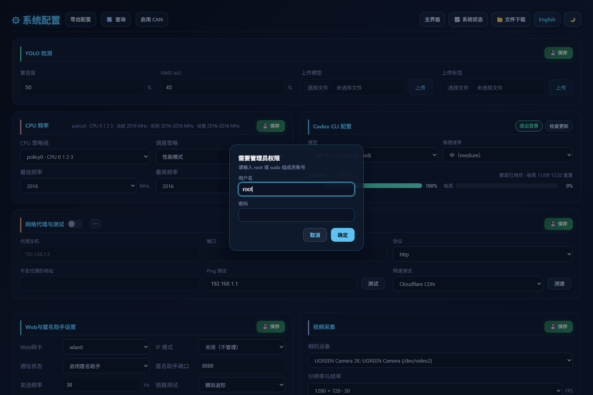 | 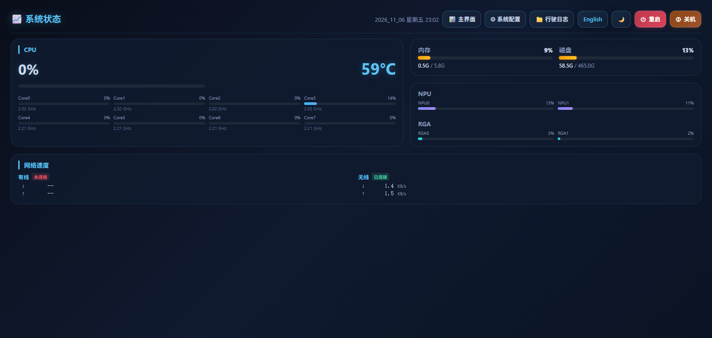 |

</div>

## 网络代理

板子通过电脑上的代理软件出网，配置写在 `/etc/proxy-client.conf`，由 `proxy-client.service` 生效。

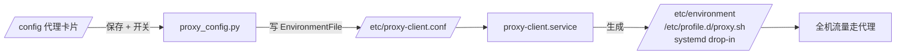

- 开关即 `systemctl start/stop proxy-client`，停止时 `ExecStop` 会清空上述三处变量，恢复直连
- 网页支持即时 Ping / 网速测试，结果显示在卡片标题栏

## Codex 对话

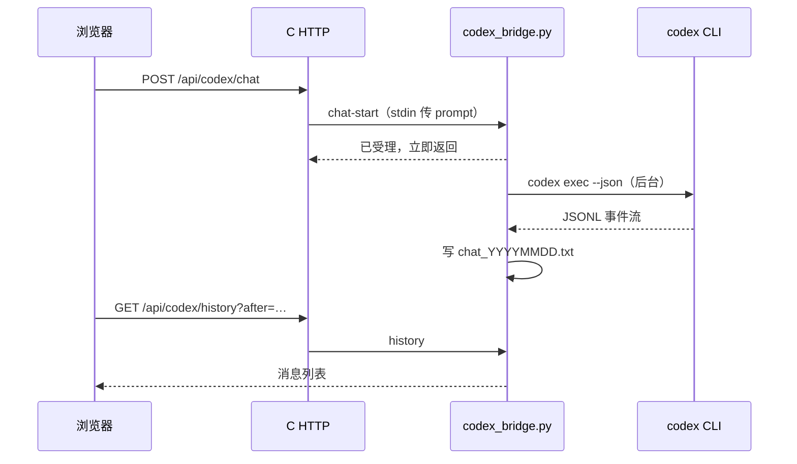

- **不阻塞**：一轮对话可能几十秒，桥接层 fork 后立即返回，HTTP worker 不会卡住
- **纯文本记录**：`recordings/codex/chat_YYYYMMDD.txt`，格式 `23:18:38 你：你好`
- **额度**：`codex app-server` 的 `account/rateLimits/read`，显示剩余百分比，缓存 60 秒
- **升级**：`systemd-run` 起独立单元（服务沙箱写不了 `~/.codex`），进度按已下载字节轮询

## API 速查

```text
GET  /api/system              CPU/内存/磁盘/温度/NPU/RGA
GET  /api/config              运行配置            POST 保存
GET  /api/video/devices       摄像头枚举
GET  /api/video/caps          分辨率/帧率能力
GET  /api/video/stats         采集/推理统计
GET  /api/detections/live     增量检测结果（after=seq）
GET  /api/follow              跟随状态            POST 参数
GET  /api/can/ifaces          CAN 接口
POST /api/can/toggle          开关 CAN
GET  /api/proxy/config        代理配置（含开关）
POST /api/proxy/config        保存/应用代理
GET  /api/nettest             Ping / 网速测试
GET  /api/codex/status        登录与运行状态
GET  /api/codex/models        模型目录（缓存 1h）
GET  /api/codex/quota         额度（缓存 60s）
POST /api/codex/chat          发起对话
POST /api/codex/update/install 后台升级
GET  /api/codex/update/status  升级进度
```

## 仓库结构

```text
source/
├── core/        配置读写、日志、线程封装
├── http/        HTTP 服务与全部 API
├── video/       V4L2 采集 · MPP 编码 · MJPEG 推流
├── yolo/        RKNN 推理池（多线程 + RGA 预处理）
├── control/     跟随控制器（PID · 死区 · 限幅）
├── can/         CAN FD 收发与电机协议映射
└── telemetry/   匿名助手（ANO）链路
include/         对应头文件
html/            前端（无构建步骤，纯静态）
scripts/         build · deploy · model_sync · proxy_config · codex_bridge · git_sync
config/          运行期配置（可被网页修改）
docs/            设计、性能、测试文档
```

## 配置与模型

| 文件 | 说明 |
|---|---|
| `config/config.txt` | 主配置（视频、YOLO、CAN、网卡） |
| `config/follow.conf` | 跟随 PID 与限幅 |
| `config/car_motor_can.conf` | 电机协议映射（未配置时不输出） |
| `config/cpu_freq.conf` | 调频策略 |
| `config/yolo26.rknn` | RKNN 模型（不入库，部署时校验） |
| `/etc/proxy-client.conf` | 整机代理配置 |

## 日志、结果与排障

| 位置 | 内容 |
|---|---|
| `journalctl -u autonomous-driving-car` | 服务日志 |
| `recordings/logs/` | 按天切分的运行日志 |
| `recordings/videos/` | 录制视频 |
| `recordings/results/` | 检测结果 JSONL |
| `recordings/codex/` | 对话记录与升级日志 |

| 现象 | 排查 |
|---|---|
| 画面黑屏 | `curl /api/video/devices`；`fuser -v /dev/video2` |
| 检测框不出现 | `curl /api/detections/live`；模型与 names 是否匹配 |
| 样式全丢 | `curl /css/config.css` 应为 200 且字节数与磁盘一致 |
| 保存报 401 | 管理员凭据失效，弹框重新输入 |
| 小车不动 | `car_motor_can.conf` 缺失或 `enabled 0`；CAN 未启用 |
| 更新卡住 | `releases.openai.com` 不通，脚本回退 GitHub，187 MB 很慢 |

## 文档

| 文档 | 内容 |
|---|---|
| [CODE_REVIEW](docs/CODE_REVIEW.md) | 代码评审与已知问题 |
| [COMMUNICATION_FLOW](docs/COMMUNICATION_FLOW.md) | 模块/线程通信与队列 |
| [FRAME_PIPELINE](docs/FRAME_PIPELINE.md) | 帧流水线时序 |
| [LATENCY_PROFILE](docs/LATENCY_PROFILE.md) | 端到端延迟剖析 |
| [REALTIME_SCHEDULING](docs/REALTIME_SCHEDULING.md) | PREEMPT_RT · FIFO · 绑核 |
| [FUNCTIONAL_TEST_REPORT](docs/FUNCTIONAL_TEST_REPORT.md) | 功能测试报告 |
| [YOLO26N_QUANTIZATION](docs/YOLO26N_QUANTIZATION.md) | YOLO26n RKNN 量化 |
| [推理流水线延迟剖析](docs/pdf/推理流水线延迟剖析.pdf) | PDF |
| [YOLO26n 量化报告](docs/pdf/YOLO26n量化报告.pdf) | PDF |

## 通信注册

模块间通过注册表解耦：每个模块启动时注册消息处理函数，发布者只按消息 ID 投递，
不依赖具体实现（详见 [docs/COMMUNICATION_FLOW.md](docs/COMMUNICATION_FLOW.md)）。

## 发展方向

- [ ] 多目标同时跟随
- [ ] 车道线检测替代手工选点
- [ ] 端侧模型自蒸馏（用板子上跑出来的数据微调）
- [ ] WebRTC 低延迟推流（替代 MJPEG）

## 许可证

GPL-3.0-or-later © qianruo-orange · 见 [LICENSE](LICENSE)

---

<h1 id="-english-documentation">📖 English documentation</h1>

<div align="right"><a href="#top">⬆ back to top</a></div>

## Introduction

Firmware and web console for a differential-drive car on **Radxa ROCK 4D (RK3576)**.
Capture, NPU detection, tracking, PID following, CAN output, MJPEG streaming and the browser console
all run inside a single C process. Power on, join WiFi, open the page — the car is drivable.

> **Why not a Raspberry Pi with ROS?** A 720p30 closed loop does not fit: software decode alone
> saturates the CPU. Here decode, preprocessing, inference and encode run on hardware blocks
> (VPU / RGA / NPU), so the CPU only schedules. End-to-end latency stays around 300 ms and the
> control loop runs as a FIFO thread on a PREEMPT_RT kernel.

| Metric | Value |
|---|---|
| Capture → display latency | ≈ 300 ms |
| Inference rate | 30 fps (YOLO26n 640, 4 threads + RGA) |
| Control loop jitter | < 1 ms |
| Idle RSS | ≈ 36 MB |

## Architecture

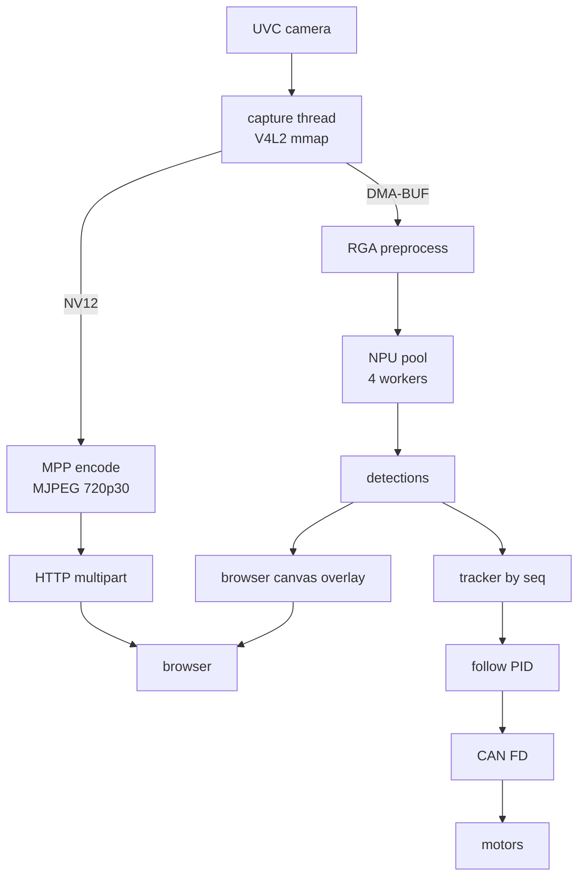

Every frame carries a monotonically increasing capture sequence `seq`; detections, the streamed
frame and the overlay all reference it, so boxes never drift from the picture and dropped frames are
counted precisely.

## Quick start

```bash
sudo apt install -y build-essential cmake git python3 curl
cd ~/autonomous-driving-car && ./scripts/build.sh -R
sudo ./scripts/deploy.sh -i
curl -s -u qianruo:qianruo http://127.0.0.1/api/system | head -c 120
```

Open `http://192.168.1.7/`, then click a detection box to start tracking.

## Web console

| Page | Purpose |
|---|---|
| `/` | Live view, click-to-track, Codex chat |
| `/status` | Per-core CPU + temperature, NPU/RGA, memory/disk, network |
| `/config` | YOLO, CPU frequency, proxy, camera, follow PID, Codex CLI |
| `/logs` | Logs, recordings, detections, transcripts |
| `/dbc` | DBC parsing of live frames |

## Perception, tracking and scheduling

- **Zero copy**: capture buffers go to RGA/NPU as DMA-BUF; pixels are never copied by the CPU.
- **Letterbox**: aspect ratio is preserved and coordinates are restored on decode, so boxes stay aligned.
- **Target selection**: the operator clicks a box; the tracker matches class, position and area per frame.
- **Fail-safe**: losing the target for `timeout_ms` (300 ms) commands a stop immediately.
- **Real-time**: the control loop runs `SCHED_FIFO` priority 20 on the big cores; inference and HTTP
  stay off those cores. `deploy.sh` disables the cgroup v2 CPU controller when needed, otherwise FIFO
  threads get throttled by quota.

## Codex integration

The bridge forks a short-lived child per request, so a long turn never blocks an HTTP worker.
Transcripts are plain text (`recordings/codex/chat_YYYYMMDD.txt`), quota comes from the app-server's
`account/rateLimits/read`, and upgrades run in a detached `systemd-run` unit because the service
sandbox cannot write `~/.codex`.

## Documentation

See the [documentation table](#文档) above — every design, latency and quantisation document is
linked and verified to exist on each commit.

## License

GPL-3.0-or-later © qianruo-orange · [LICENSE](LICENSE)

---

<div align="center">

[⬆ back to top](#top)

</div>
