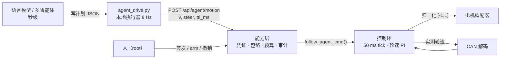
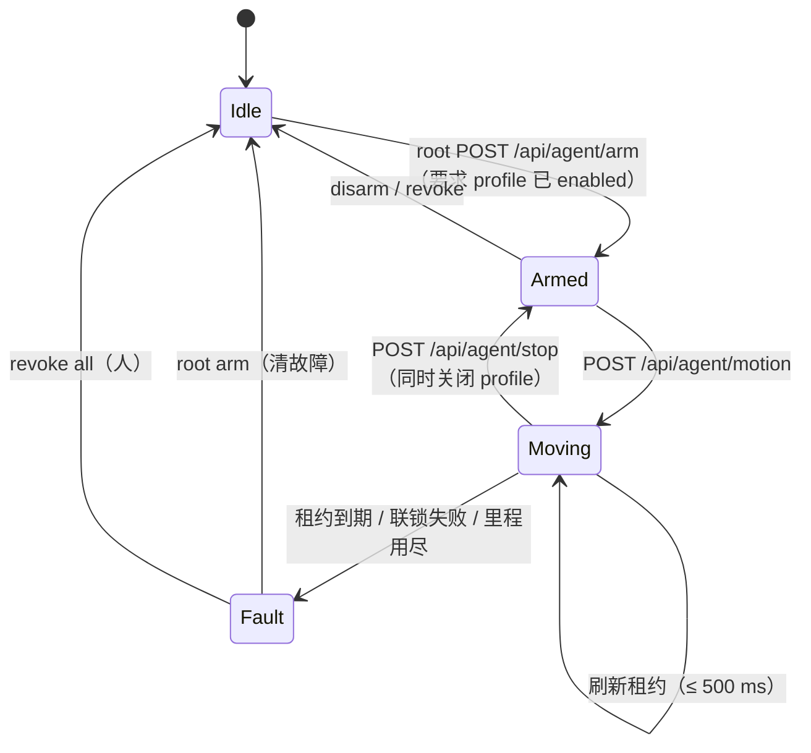

# 智能体硬件能力层

给多智能体一套**能真正落到执行器**的接口，同时保证任何一个模型出问题都不会让车继续动。

它不是 shell，也不是把 root 密码交给模型。它是一枚短期凭证 + 一组受限原语 + 一条带死手的执行通道，三者都在 C 里，不在提示词里。

- 实现：`source/agent/agent_hw.c`（凭证、包络、审计）、`source/control/car_sport_ctrl.c`（`follow_agent_*`，执行与联锁）
- 工具描述：`docs/agent-tools.json`（OpenAI function calling 格式）
- 计划执行器：`scripts/agent_drive.py`

---

## 1. 分层



关键点：**模型不产生 30 Hz 指令**。它产生计划，本地执行器把计划变成指令流。理由是算术：单次模型往返 2–10 s，0.3 m/s 下 3 s 就是 0.9 m 盲行；执行器与能力层的往返在本机实测中位数 2.4 ms。

## 2. 凭证（authority）

| 字段 | 含义 | 上限 |
|---|---|---|
| `scope` | `observe` / `motion`（motion 隐含 observe） | — |
| `v_max` | 该凭证允许的最大线速度 | 0.30 m/s（硬上限） |
| `steer_max` | 差速半差，单位与 `max_turn_delta` 一致 | 0.15 m/s（硬上限） |
| `budget_m` | 本次授权可行驶的总里程 | 100 m（硬上限） |
| `ttl_s` | 凭证有效期 | 3600 s |

- 凭证是 32 个十六进制字符，取自 `/dev/urandom`；熵源不可用则拒绝签发，不做降级。
- **只存在内存里**：服务重启即全部失效，磁盘上不留可复用的凭据。`persist=1` 是显式例外，写到 `config/agent.token`（0640 root:qianruo），供板上智能体进程读取，同样受 `ttl_s` 约束。
- 同时最多 8 枚，满了淘汰最早到期的一枚。
- `v_max` / `steer_max` / `budget_m` 在 C 侧再夹一次（`AGENT_V_CAP` 等），HTTP 层被绕过也无效。

## 3. 状态机



`Fault` 是**锁存**的：控制环每 50 ms 调一次 `halt()`，视觉路径同样被挡住，直到人显式 `arm` 或 `revoke`。这一条是刻意的——任何异常之后，车必须停着等人。

## 4. 端点

| 方法与路径 | 认证 | 作用 |
|---|---|---|
| `POST /api/agent/token` | root Basic | 签发凭证，返回一次性的 token |
| `POST /api/agent/arm` | root Basic | 把某枚凭证置为可执行；清除锁存故障 |
| `POST /api/agent/revoke` | root Basic | 撤销一枚或全部；被撤凭证正 armed 时同时停机 |
| `GET /api/agent/state` | root Basic | 全部凭证、计数、最后拒绝原因 |
| `GET /api/agent/audit` | root Basic | 当日审计 JSONL 尾部（≤ 384 KB） |
| `GET /api/agent/observe` | 凭证 | 车辆状态 + 自身包络 + 执行就绪位 |
| `POST /api/agent/motion` | 凭证 | 提交 `v`、`steer`、`ttl_ms` |
| `POST /api/agent/stop` | 凭证 | 停止并解除 armed（profile 一并关闭） |
| `POST /api/agent/estop` | 凭证 | 强制停机，profile 置 0 并落盘 |
| `POST /api/agent/disarm` | 凭证 | 解除 armed 并停止 |

认证用 `X-Agent-Cap: <token>`（或 `Authorization: Bearer`），与 Basic 互不通用。智能体拿不到 root 密码，也过不了 root 门禁。

## 5. 执行路径

`tick()` 里只有一条执行链，切换的只是速度来源：

```
enabled==0            → halt("disabled")
state==FAULT          → halt(<fault>)                  // 锁存
state==ACTIVE         → agent_tick()                   // 本层
detection 过期        → halt("stale_detection")        // 视觉路径
```

`agent_tick()` 依次检查：

| 条件 | 结果 |
|---|---|
| 无租约 / `now > expiry` | `lease_expired`，锁存 |
| 无电机适配器 | `adapter_not_connected`，锁存 |
| 控制线程非 FIFO | `fifo_unavailable`，锁存 |
| CAN 未使能 | `can_disabled`，锁存 |
| 轮速反馈缺失（> 500 ms 宽限） | `stale_wheel_feedback`，锁存 |
| 轮速反馈过期（> `timeout_ms`） | `stale_wheel_feedback`，锁存 |
| 以上全过 | 差速混合 → 轮速 PI → `motor.send()` |

宽限期只为「解码器第一帧还没到」这一个场景存在：从命令被接受起 500 ms 内不判故障，超过即锁存。真实总线上电后通常 20–50 ms 就有第一帧。

**结束即关断**：`stop` / `disarm` / 撤销 / 故障，任一发生都会把 `follow.conf` 的 `enabled` 写成 0。原因是视觉路径与智能体路径共用执行器——如果只停指令而不关 profile，车会立刻转去追检测框。这个设计决定在 `follow_agent_cancel()` 里，注释写明。

## 6. 审计

每行一个 JSON 对象，落在 `recordings/agent/audit-YYYYMMDD.jsonl`：

```json
{"ts":"2026-11-07T02:23:20","mono_ms":39468264,"tool":"motion",
 "actor":"bench:6808e5","args":"v=0.120 steer=0.000 ttl=400ms",
 "result":"ok","reason":""}
```

`result` 取 `ok` / `reject`；`reason` 复用控制层的停机语义字符串，不另造词表。签发、arm、撤销、stop、estop 全部记录。接受与拒绝都记——只记成功的审计在事故复盘中没用。

## 7. 计划执行器

```bash
# 单段
scripts/agent_drive.py --v 0.10 --steer 0.0 --ms 1500 --token $AGENT_CAP

# 多段计划（模型产出的就是这种文件）
scripts/agent_drive.py plan.json --token $AGENT_CAP
```

```json
{"segments": [
  {"v": 0.10, "steer": 0.00, "ms": 700},
  {"v": 0.08, "steer": 0.03, "ms": 700}
]}
```

执行器做四件事：起飞前用 `/api/agent/observe` 校验整份计划的里程与包络（超限直接退出码 2，一个字节都不发）、按 8 Hz 刷新 500 ms 租约、任何一次拒绝立即停、`finally` 里必发 `stop`。

退出码：`0` 完成，`2` 计划或状态被拒，`3` 运行中终止，`4` 传输失败。

不在段内轮询 `observe`——这是实测踩出来的：一次慢响应把租约拖过期，控制环如实锁存 `lease_expired`，执行器反而以为车出了故障。段内只靠「指令被拒」这一条信号，因为它没有竞态。

## 8. 验证矩阵

2026-11-07 02:1x 在板上实测。执行器部分是 `-DADCBENCH` 构建（回环电机适配器，把命令原样当作实测轮速回灌，不驱动真实电机）；生产固件不含该代码，已核对二进制中无 `mock actuator` 字符串。

| 用例 | 期望 | 实测 |
|---|---|---|
| 无凭证 `GET /api/agent/observe` | 401 | 401 |
| 未 arm 就 `motion` | 403 | 403 `credential is not armed` |
| profile 关闭时 `arm` | 409 | 409 `enable the follow profile first` |
| `v` 超凭证包络（0.25 > 0.15） | 422 | 422 `outside this credential's envelope` |
| 无电机时 `motion` | 接受后一 tick 锁存 | `adapter_not_connected`，profile 自动置 0 |
| 停止刷新租约 1 s | `lease_expired` | `lease_expired`，`armed` 仍为 true 但 profile 已关 |
| 0.30 m 预算跑满 | 拒绝并撤销 | 第 21 次 409 `distance budget exhausted`，已行 0.31 m |
| 计划执行器跑完两段 | 12 条指令、0.126 m、退出 0 | 12 条、1.53 s、0.126 m、退出 0 |
| 计划完成后的状态 | profile 关闭 | `enabled:false`，`armed:false` |
| 超包络计划（v=0.6） | 不发一条指令 | 退出 2，`outside credential envelope 0..0.15` |

## 9. 上真机 checklist

按顺序，缺一项都不要 arm：

1. `ip link set can0 up type can bitrate 500000`，`ip -details link show can0` 确认 `ERROR-ACTIVE`。
2. `config/car_motor_can.conf` 由 `car_motor_can.example.conf` 改成实际电机帧格式；`GET /api/follow` 的 `motor.configured` 与 `status.adapter` 都应为 true。
3. 台架验证 `motor.stop()` 真的断电：断指令后轮子必须停，而不是保持上一次占空比。
4. 起服务，`GET /api/agent/observe` 应报 `actuation.ready: true`。
5. 签发最小凭证：`v_max=0.05`、`budget_m=0.3`，先跑 `--dry-run`，再跑一段 300 ms。
6. 全程有人在急停旁。`estop` 是软件路径，物理断电仍是最后一道。

## 10. 扩展一个新原语

以 `go(distance_m)` 为例：

1. 在 `car_sport_ctrl.c` 增加一个受同样联锁保护的执行函数，不要新开执行路径——新路径意味着新的一套竞态。
2. 硬上限写进 C，不写在 HTTP 层。
3. 在 `agent_hw.c` 加路由处理器，作用域复用 `AGENT_SCOPE_MOTION`，参数校验后调上一步的函数。
4. 在 `docs/agent-tools.json` 加工具描述，字段与 C 侧校验一一对应。
5. 在本文 §8 加一行验收用例，写明期望的拒绝码。没有拒绝用例的原语不算完成。

`turn(θ)` 与 `look_for(desc)` 仍缺硬件前提：前者需要偏航角来源（当前无 IMU 融合），后者需要开放词表检测（当前固定 80 类 COCO）。缺前提就不做，不拿近似值凑。
