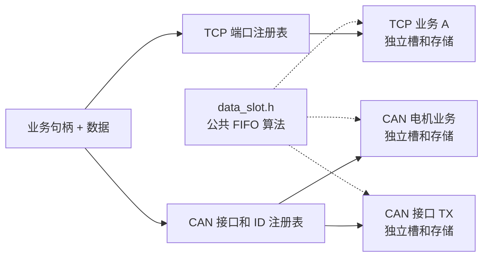
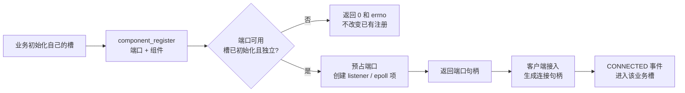
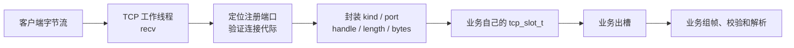
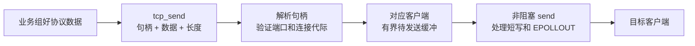
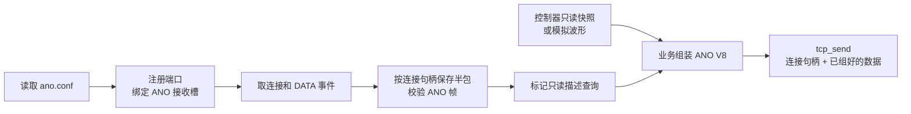
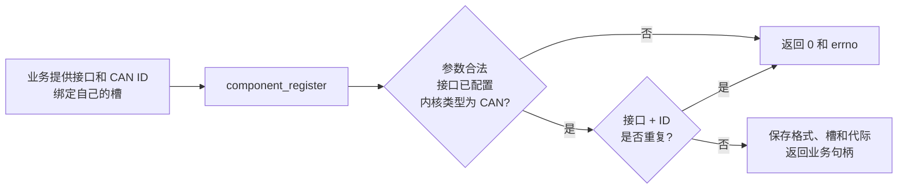
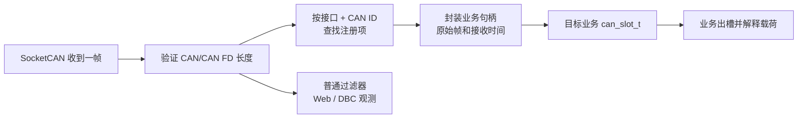
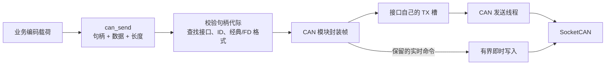
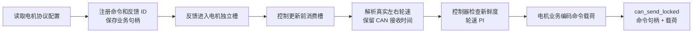

# CAN 和 TCP 业务流

通信层负责连接、接口校验、帧封装与收发；业务层负责协议内容。业务模块注册时把通信地址绑定到自己的数据槽，拿到业务句柄。后续发送统一使用 **句柄、数据、长度**，不用再次填写 TCP 端口、socket fd、CAN 接口或 CAN ID。

## 1 模块和所有权

| 模块 | 实现 | 持有的实例 |
| --- | --- | --- |
| 公共数据槽算法 | `include/core/data_slot.h` | 不持有任何全局队列；调用者提供存储 |
| TCP 通信 | `source/tcp/tcp_server.c` | 端口注册表、监听 socket、客户端连接、待发送缓冲 |
| 匿名上位机业务 | `source/telemetry/ano.c` | 独立 TCP 接收槽、连接句柄、ANO 半包状态、配置和采样状态 |
| CAN 通信 | `source/can/can_socket.c` | 接口、ID 注册表、每个接口独立的 TX 槽、接口开关和观测记录 |
| 电机业务 | `source/can/can_motor.c` | 独立 CAN 接收槽、命令/反馈句柄、协议配置及轮速解析状态 |
| 控制业务 | `source/control/car_sport_ctrl.c` | 控制线程、PD/PI 状态、运动使能和安全条件 |

**共用组件不等于共用实体。** `data_slot.h` 提供同一套初始化、入槽、出槽、计数和销毁算法。每个实例有自己的缓冲区、锁、读写位置和丢弃计数。TCP 每个端口使用独立接收槽；CAN 的多个 ID 可以由业务明确绑定到同一槽，槽内句柄区分来源。



实现中不再保留独立的 `can_queue`、CAN 分发/观察中间文件或 ANO 连接转发文件。CAN 功能集中在 CAN 模块，ANO 的槽消费和协议处理集中在匿名业务模块。

## 2 数据槽的基本约定

- 初始化必须成功，才能把槽绑定到注册项。注册入口会检查槽的类型、容量和存储是否已初始化。
- 入槽和出槽复制完整数据项，不把栈上的临时 payload 指针交给另一个线程。
- `data_slot_pop()` 返回 `1` 表示取出一项，`0` 表示槽为空。
- `data_slot_push(..., 0)` 满时拒绝；`data_slot_push(..., 1)` 满时覆盖最旧项。
- `data_slot_count()` 和其他操作都通过该实例自己的锁保护。
- 注销通信绑定、停止生产者和消费者后，才能销毁槽；不能在通信线程仍引用槽时销毁它。

公共 API 定义位于 [data_slot.h](../include/core/data_slot.h)、[tcp_server.h](../include/tcp/tcp_server.h) 和 [can_socket.h](../include/can/can_socket.h)。

## 3 TCP 注册和连接流

业务准备自己的 `tcp_slot_t` 和 `tcp_component_t`，通过 `tcp_component_register()` 注册端口。成功返回非零的端口业务句柄，失败返回 `0` 并设置 `errno`。

```c
static tcp_slot_t rx;
static const tcp_component_t component = {.slot = &rx};

if (tcp_slot_init(&rx) != 0) {
    /* 初始化失败，不能注册。 */
}
uint64_t port_handle = tcp_component_register(9000, &component, NULL);
```

业务也可以设置组件的 `poll` 方法，让共享 TCP 工作线程在传输锁外消费该槽；不用 `poll` 时，业务自己的线程负责出槽。组件描述符和槽必须持续有效，不能把短生命周期的局部对象绑定到长期运行的端口。



TCP 有两类句柄：

| 句柄 | 来源 | 发送目标 |
| --- | --- | --- |
| 端口句柄 | `tcp_component_register()` 或配置注册提交结果 | 当前端口的客户端，广播发送 |
| 连接句柄 | 槽内 `TCP_CONNECTED`、`TCP_DATA` 等事件的 `handle` | 对应的当次客户端连接 |

句柄包含代际信息，不是系统 fd。客户端断开后，旧连接句柄不能因为 fd 被系统复用而指向新客户端。端口注销再注册后，旧端口句柄也会失效。

### 3.1 TCP 接收流



`tcp_data_t` 包含事件类型、端口、业务连接句柄、数据长度和最多 512 字节的接收内容。`recv()` 的一块内容不是一条协议消息：TCP 的拆包、粘包和校验都由业务层处理。

槽事件按序排列：

| 事件 | 业务动作 |
| --- | --- |
| `TCP_CONNECTED` | 为该连接句柄建立协议状态 |
| `TCP_DATA` | 将字节交给该连接的组帧器 |
| `TCP_DISCONNECTED` | 清理该连接的半包和业务状态 |
| `TCP_RESET` | 清理该端口的所有半包状态；通信层已因槽满关闭相关连接 |

通信层不调用 ANO 解析函数，也不读写匿名业务的组帧状态。

### 3.2 TCP 发送流

```c
/* 定向回复：received 是刚从业务槽取出的数据项。 */
tcp_send(received.handle, reply, reply_length);

/* 端口广播：port_handle 来自注册成功的结果。 */
tcp_send(port_handle, payload, payload_length);
```



定向连接仍有待发送内容时返回 `ENOBUFS`，业务不得把这次发送当作已完成。广播会跳过繁忙客户端，并增加相应丢弃计数。短写保留偏移继续发送；待发送数据超过 100 ms 未完成时关闭慢客户端。

### 3.3 TCP 配置变更和注销

普通业务只需注册、取槽和按句柄发送。需要持久化端口配置的业务使用三步注册：

1. `tcp_prepare_register()` 预占新端口并创建需要的 socket/epoll 项，旧连接仍有效。
2. 保存配置成功后调用 `tcp_commit_register()`；提交阶段不再执行可能失败的 bind。
3. 保存失败则调用 `tcp_cancel_register()`，释放准备项，保留旧连接。

新注册使用前一个句柄 `0`，修改现有注册使用该业务自己的端口句柄。已经注册或正在准备的端口都会参与冲突检查；停用的注册仍保留端口占用关系。

业务退出时先停止其业务活动，再用端口句柄调用 `tcp_component_unregister()`。工程整体退出先等待 TCP 工作线程结束，再注销匿名组件并销毁其槽，最后清理 TCP 基础资源。组件的 `poll` 执行期间不能销毁它正在使用的业务状态。

## 4 匿名上位机的实际业务流

匿名业务在 `ano.c` 中持有一个独立 TCP 槽。其端口默认 8080，默认停用；保存的配置决定实际注册和监听状态。



匿名业务的 `poll` 先消费最多一个槽容量的事件，再执行到期采样，避免持续输入饿死遥测输出。业务保留未完成的查询状态；若发送失败，会恢复这部分状态，后续重试。匿名连接仍只提供遥测和描述查询，不通过该通道发出电机运动命令。

## 5 CAN 注册和接口验证

CAN 注册对象 `can_binding_t` 描述接口、ID、收发用途、帧格式和目标槽。注册成功返回非零业务句柄。

```c
static can_slot_t rx;
if (can_slot_init(&rx) != 0) {
    /* 初始化失败，不能注册。 */
}
can_binding_t binding = {
    .port = "can0",
    .id = 0x321,
    .flags = CAN_BIND_RX | CAN_BIND_TX,
    .fd = 0,
    .slot = &rx
};
uint64_t handle = can_component_register(&binding);
```

注册对象的元数据由 CAN 模块复制保存。槽仍属于业务模块。扩展 ID 要明确设置 `CAN_EFF_FLAG`；经典 CAN 和 CAN FD 的发送格式由注册项的 `fd` 字段确定。



CAN 模块负责验证：

- 接口名合法，且存在于应用配置的 CAN 通道中。
- 内核报告的接口类型为 `ARPHRD_CAN`；普通以太网卡、回环接口和不存在的接口不能冒充 CAN。
- 标准/扩展 ID 范围和格式合法。
- CAN FD 注册与通道配置兼容。
- RX 注册绑定了初始化成功的 `can_slot_t`。
- 同一接口和 ID 没有重复绑定；同一 ID 在不同 CAN 接口上可以分别注册。

注册 FD 功能不代表硬件一定已在线。接口关闭或全局 CAN 停用时，发送仍会被拒绝；恢复接口后才可继续发送。

### 5.1 CAN 接收流



业务 RX 分发独立于普通显示过滤器。注册的反馈 ID 会加入接收过滤并进入对应业务槽，Web 和普通观测仍遵循它们自己的过滤规则。

`can_data_t` 包含业务句柄、CAN 层记录的单调接收时间和完整帧。时间戳不是业务出槽时间；排队时间不能掩盖反馈已经过期。槽满时覆盖最旧帧，优先保留新鲜测量值，丢弃数量记录在该槽中。

### 5.2 CAN 发送流

```c
/* 业务不在发送时重复填写接口、CAN ID 或帧格式。 */
can_send(handle, payload, payload_length);
```



CAN 在发送时按接口名重新查找通道位置，防止 Web 改变通道排列后把旧句柄发到另一总线。无效、已注销或过期句柄返回错误；载荷过长、接口不可用、全局停用和 FD 不兼容也会阻止发送。

普通报文进入该接口独立的 TX 槽。电机保留命令使用即时路径，不把旧控制命令排进普通发送队列。控制回调已经持有 `can_mutex` 时，使用 `can_send_locked()`，同样只填写句柄、数据和长度。原始 Web CAN 调试入口保留，但不能绕过已注册的保留命令 ID。

## 6 电机的实际业务流



电机模块在注册前合并重复 ID，例如左右轮共用一条命令帧时只注册一次。任一绑定失败会回收本轮已创建的绑定，不能使用半套协议进入运动输出。

控制线程在每次控制更新前消费电机槽，最多处理一个槽容量的反馈。左右轮配对时间、反馈新鲜度和 PID 的判断使用真实接收时间。发送前仍要求本次会话已使能、目标新鲜、真实反馈新鲜、FIFO 调度成功且 CAN 可用。

关闭、停用或重配 CAN 接口前，CAN 会先清空旧反馈槽，并调用已注册的 `before_close` 停止钩子。同一业务注册多个 ID 时，停止钩子按接口去重。电机退出先停止并等待控制工作线程，再完成最后停止尝试、注销绑定，最后销毁自己的槽。

## 7 容量和异常策略

| 项目 | 当前上限或策略 |
| --- | --- |
| TCP 注册端口 | 4 个；每端口独立接收槽 |
| TCP 客户端 | 每端口最多 2 个 |
| TCP 接收槽 | 每业务实例 16 项，每项最多 512 字节输入 |
| TCP 待发送缓冲 | 每客户端 256 字节，保留短写偏移 |
| TCP 接收槽满 | 不悄悄丢字节；关闭该端口客户端，投递 `TCP_RESET` |
| TCP 发送忙 | 定向发送返回错误；慢客户端待发数据超过 100 ms 则关闭 |
| CAN 注册绑定 | 最多 32 个接口与 ID 组合 |
| CAN 业务接收槽 | 每实例 16 帧，满时淘汰最旧帧 |
| CAN 普通 TX 槽 | 每接口独立 64 帧，满时拒绝新写入 |
| 过期句柄 | 不允许因注册表位置或 fd 复用而发到新业务 |
| 配置保存失败 | 取消准备项，保持旧的 TCP 注册和连接 |

容量定义在相应头文件中；调整容量也会改变静态内存占用。该实现不会通过无限队列掩盖慢消费者。

## 8 锁和退出顺序

- TCP 注册管理采用 `registry_lock → 端口锁 → 数据槽锁` 的顺序。业务 `poll` 在传输锁外执行，出槽完成后才能按句柄发送。
- CAN 注册、注销和收发由 `can_mutex` 串行化，入槽只是复制帧。电机控制器的主锁不能与 `can_mutex` 反向嵌套。
- 公共槽只在自己的 push/pop/count/clear 内短暂加锁；消费者不能在手动持有槽锁时进入通信 API。
- 应用退出先设置停止标志并等待模块表任务退出，再逆序清理业务与传输资源。线程超时时走既有失败退出路径，不释放仍可能被访问的资源。

## 9 使用范围和验证边界

以上流程对应当前工程代码。TCP 仍是字节流传输，业务必须自行定义报文边界；句柄只是进程内绑定标识，不是跨重启持久 ID。

验证包括应用编译、回环 TCP、多业务独立槽、定向/广播句柄、旧句柄拒绝、注册冲突、端口变更取消、槽溢出复位，以及模拟接口元数据下的 CAN ID 分发与封装。真实 CAN 硬件、电机动作和实时延迟需要在目标设备上进一步联调，不能由本地模拟验证替代。
